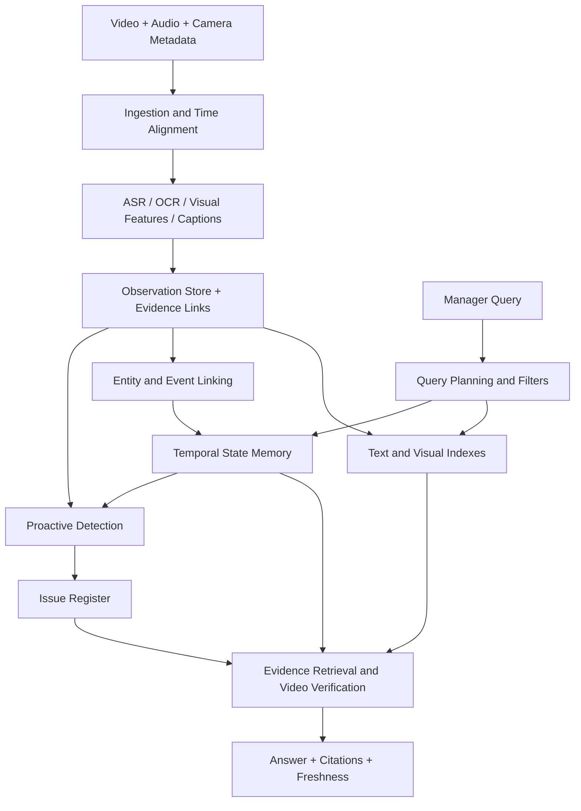

Дальнейшее — **проектный синтез обзора**, а не описание уже проверенного единого метода. Результаты на EgoLife, промышленной сборке и строительных инспекциях нельзя складывать и объявлять ожидаемой точностью Aligned.

### Память должна хранить наблюдения отдельно от текущего вывода

Минимальная единица — observation: какой источник, какой интервал, что непосредственно видно или слышно, к какому объекту предположительно относится запись. Несколько observations могут поддерживать один event. Несколько событий могут объяснять изменение состояния объекта. Вывод «исправлено» должен иметь собственные основания и время актуальности.

Предлагаемые поля observation: `source_id`, `camera_id`, `wearer_id`, `start_time`, `end_time`, `ingested_at`, `location_hypothesis`, `entity_candidates`, `observed_claim`, `modality`, `visibility`, `evidence_uri`, `extractor_version`. Это не обязательная схема конкретной статьи. Она показывает, какая информация теряется при хранении только caption и embedding.

Если два описания говорят о «белой панели», это ещё не две записи об одной панели. Если два синхронных видео показывают один монтаж, это ещё не два выполненных монтажа. Поэтому event linking и entity linking должны допускать неопределённость, проверяться отдельно и сохранять исходные наблюдения после объединения. Статья о строительных подъёмниках показывает, почему близкий KPI не валидирует case assignment, а Hsieh AI + BIM даёт конкретный пример общей идентичности компонента при фиксированных камерах. Для касок такую идентичность ещё предстоит установить.

Работы о связывании наблюдений уточняют ещё три поля: неопределённость временного совмещения, период валидности утверждения и требуемый тип свидетельства. VisualSync мотивирует хранить оценку смещения часов, EGOSTREAM — различать время наблюдения и срок актуальности факта, Isaac и Lucko — отдельно фиксировать визуальное подтверждение и приёмку по дополнительным основаниям. Это наша схема переноса идей, не опубликованная единая архитектура.

*Figure — Proposed Aligned architecture. Схема автора обзора, не результат статьи. Индексы выбирают кандидатов, исходные наблюдения сохраняют доказательства.*

### Два режима вычислений

**Ingestion path** работает без вопросов менеджера. Он декодирует данные, индексирует речь и визуальное содержание, выделяет события, обновляет связи и запускает детекторы. **Query path** использует уже подготовленные структуры и тратит дорогой анализ на небольшой набор фрагментов.

«Обработать всё заранее» тоже не бесплатное решение. Универсальные подробные captions могут стоить дорого, пропускать детали и содержать ошибки. Поэтому сравнивать нужно не только время поиска, но и стоимость на камера-час, размер памяти, долю нужных фактов, потерянных при сжатии, и цену переиндексации после смены модели.

Для повторяющихся вопросов нужна повторно используемая память. Для редких вопросов о мелких деталях нужен доступ к исходнику и дополнительный анализ. Хорошая система должна сочетать эти два режима, а не обещать, что компактное описание сохранит всё.

Reducto из [главы 2](/chapters/archive/#chapter-2) уменьшает обработку входа под определённый запрос, а StreamForest из [главы 7](/chapters/streaming/#chapter-7) ограничивает контекст ответа. Ни один отдельно не устанавливает полную стоимость на 18 000–36 000 камера-часов. Совместная проверка должна учитывать декодирование, запись оригиналов, обновление индекса, потоковый мониторинг и ответы с проверяемыми клипами.

### Что хранить в issue register

1. **Observation:** исходные клипы, камера, временной интервал, worker/work-item кандидаты, видимость и точность синхронизации.
2. **Finding:** наблюдаемое отклонение, применённое требование с версией, confidence и альтернативные объяснения.
3. **Issue:** идентичность проблемы, связь нескольких камер и смен, статус `candidate / confirmed / in_progress / correction_observed / acceptance_pending / resolved / unknown_current_state / reopened`.
4. **Verification:** отдельное свидетельство устранения. Потеря объекта из кадра не переводит issue в `resolved`. Само исправляющее действие тоже не всегда доказывает результат.
5. **Freshness:** время последней доступной записи и последнего подтверждения состояния. «Вчера было исправлено» не означает «сейчас гарантированно исправно».

Проверять нужно отдельно detection recall, precision уведомлений, повторные уведомления об одном событии, скорость обнаружения, правильность объяснений, корректность закрытия issue и полноту доказательств. Для редких событий useful operating point важнее общего F1. Полные смены с восстановлением после ошибок необходимы, потому что ошибки предыдущих решений меняют историю и последующие ответы. Именно здесь встречаются идеи PROVIA, ProactEgoMem, grounded QA и construction workflow.

### Чат и proactive detector имеют разные обязанности

Чат может запросить дополнительные фрагменты и честно ответить «недостаточно данных». Автоматический детектор должен решить, когда материала достаточно для предупреждения, и не создавать десятки повторных уведомлений об одной проблеме.

В предложенной выше модели жизненного цикла каждый переход требует собственного основания. Отсутствие новых кадров не переводит issue в `resolved`. Исчезновение объекта из поля зрения не подтверждает устранение дефекта. Поздно загруженная запись может менять реконструкцию прошлого, но не должна незаметно переписывать историю решений системы.

Состояние `correction_observed` между `in_progress` и `resolved` фиксирует наблюдаемое исправление. Для закрытия нужен явно проверяемый факт восстановления. IMPACT обосновывает раздельную разметку попытки recovery и состояния компонента, а строительная методология добавляет `acceptance_pending`, когда визуальное исправление видно, но обязательное испытание или приёмка ещё не подтверждены. Даже удачное предупреждение и последующее действие человека не означают, что дефект устранён.

Обнаружение ожидания требует особой осторожности. Видеофрагмент может показывать бездействие, но «потенциально устранимое ожидание» требует контекста зависимости от других работ, доставки, разрешений или правил выполнения задачи. Сначала фиксируется наблюдение и длительность, затем гипотеза о причине. Работник вне кадра не считается простаивающим.

### Что измерять: evaluator для всей цепочки

| Layer | Основная метрика | Необходимый негативный пример |
|---|---|---|
| Retrieval | Recall@k и доля найденных обязательных интервалов | Визуально похожая операция в другой день |
| Localization | Temporal IoU и покрытие доказательств | Правильный объект, но время до исправления |
| Answers | Корректность отдельных утверждений | Правдоподобный ответ без источника |
| Citations | Evidence precision / recall | Ссылка на соседний, неподтверждающий фрагмент |
| Identity | False merge / false split | Две одинаковые панели в соседних помещениях |
| Lifecycle | False closure rate, duplicate issues | Объект исчез из кадра, дефект остался |
| Alerts | Recall при заданном FA/hour, latency | Длительная нормальная работа без нарушений |
| Abstention | Risk–coverage curve | Шаг полностью скрыт или камера выключена |
| Freshness | Arrival-to-searchable, event-to-alert | Загрузка старого видео после завершения смены |
| System | p50/p95 query latency, cost/camera-hour | Одновременная индексация и запросы |

**Event time** — когда происходило действие. **Arrival time** — когда файл поступил. **Searchable time** — когда его уже можно найти. **Alert time** — когда возникло предупреждение. Загрузка после смены делает различия особенно существенными. Быстрый ответ чата не означает быструю индексацию, а быстрая индексация не гарантирует своевременное обнаружение.

Это проектное разделение для Aligned. Его нельзя выдавать за результат какой-либо одной статьи.

Нужен **oracle-evidence test**: дать reader правильные фрагменты вручную. Если он всё равно ошибается, улучшение retrieval не решит проблему. Обратный тест — фиксировать reader и менять только retriever. Для proactive режима запрещено предоставлять кадры после момента решения. Иначе модель получает сведения о будущем исправлении или исходе операции.

В запросах с несколькими обязательными доказательствами обычный hit@k недостаточен: система может найти один из двух нужных эпизодов и получить положительную оценку поиска, хотя ответ об изменении состояния невозможен. Полезно дополнительно измерять, найдены ли **все** необходимые интервалы.

### Явно задавать, какой результат обещает запрос

«Покажи пример», «найди все случаи», «сколько случаев было» и «проверь нарушение условия» требуют разных гарантий. QV-M² проверяет несколько интервалов, TVR/EventFormer — поиск записи и момента, BlazeIt — оценку агрегата или LIMIT, EQUI-VOCAL — записи с подходящей последовательностью. Ни одну из этих метрик нельзя автоматически объявлять полнотой всех событий многокамерного архива.

Отрицательные утверждения требуют особого контроля: «не было проверки», «никто не исправил», «все элементы закреплены». Неподдерживаемый предикат должен давать явное ограничение или `unknown`. Применение dummy-предиката VOCAL-UDF, всегда возвращающего True, в compliance-запросе незаметно удалило бы проверяемое условие. Аналогично EQUI-VOCAL без negation не реализует произвольный запрос об отсутствии действия.

Для отказов нужно разделять четыре причины: нужный момент не записан, утрачен при сжатии, не найден retrieval или неверно прочитан. APM-Bench и UVQA помогают строить такие тесты, но ответ «не могу определить по этому клипу» не доказывает отсутствие сведений во всём архиве. Удаление размеченного решающего интервала полезнее произвольного уменьшения числа кадров. Порог отказа и visual override policy выбираются на отдельном development split, а не после просмотра ошибок финального теста.

### Начальный retrieval-прототип

Это инженерный вывод обзора, не установленный результат какой-либо одной статьи. Начальный кандидат — сохраняемые эпизоды с timestamp и provenance, несколько текстовых ключей по образцу MERIT, независимый визуальный поиск, поиск по ASR/OCR, а затем ограниченный повторный просмотр исходного клипа. Структурированные фильтры по камере, времени и площадке должны применяться до смыслового поиска. Графы отношений разумно добавлять для запросов, где экспериментально подтверждена необходимость связывать несколько событий.

Для каждого вопроса нужно хранить не только текст ответа, но и найденные кандидаты, прочитанные интервалы и точные источники каждой проверяемой части ответа. При отсутствии подтверждения система должна уметь сказать «в доступных записях не видно». Это не эквивалентно «события не было».

Честное сравнение представлений памяти требует одних и тех же исходных записей, captioner, ASR, answer model и evidence budget. Сравнивать следует минимум: **retrieval recall**, правильность локализации, **answer correctness**, соответствие ответа доказательствам, среднюю и p95 задержку, стоимость построения памяти и стоимость заданного числа запросов. И отдельно — момент, когда запись появилась в памяти. Система может быстро отвечать по вчерашнему индексу и при этом не удовлетворять требованию свежести.

### Объединение наблюдений в общей памяти

Предлагаемая ниже схема — наша инженерная гипотеза, а не опубликованный результат одной из перечисленных систем:

1. **Observation store:** неизменяемые ссылки на исходные camera/time intervals, captions, ASR, визуальные признаки и условия наблюдаемости.
2. **Identity and alignment:** отдельно camera-to-wearer mapping, actor/speaker hypotheses, clock offsets, scene/location IDs и вероятные object-instance links. Неподтверждённая связь остаётся гипотезой.
3. **Individual memory:** детали наблюдений каждого носителя и их происхождение.
4. **Shared event memory:** объединённые рабочие эпизоды со ссылками на поддерживающие и противоречащие наблюдения.
5. **Entity histories:** история конкретной панели, инструмента или дефекта с разрывами наблюдений и датой последнего подтверждения.
6. **Query-time verification:** поиск эпизода, выбор нужных носителей и ракурсов, проверка исходных клипов перед утверждением о выполнении или исправлении.

Для каждого перехода нужен собственный тест. Синхронизация проверяется на одновременно наблюдаемых событиях. Entity association — на повторных появлениях похожих предметов, включая ложные merge и split. Общая память — на сохранении всех участников и исходников. История дефекта — на различении «виден исправленный объект», «не виден прежний дефект» и «данных после ремонта нет». Последние три состояния нельзя сливать в один статус `resolved`.

Ни одна из рассмотренных работ не демонстрирует всю эту цепочку на 18 000–36 000 camera-hours строительной площадки. Ближайшая литература даёт необходимые части, а их соединение и проверка на собственных данных остаются самостоятельной задачей Aligned.

### Минимальный набор сравнений до усложнения архитектуры

1. **Text baseline:** ASR + captions + metadata filters + text retrieval. Показывает, какую часть вопросов можно решить недорогим текстовым доступом.
2. **Hybrid baseline:** тот же pipeline плюс visual retrieval и reranking. Измеряет пользу визуального канала при неизменном reader.
3. **Evidence verification:** reader повторно смотрит найденные клипы. Измеряет, исправляет ли это ошибки caption-памяти и насколько растёт latency.
4. **Temporal memory:** добавить entity/event links и историю состояний. Проверить именно вопросы о нескольких сменах и источниках, а не только общий QA score.
5. **Proactive path:** отдельная причинная оценка детекции и issue lifecycle, включая длительные нормальные записи.

Не следует одновременно менять encoder, память, reader и prompting, а затем приписывать улучшение графу. Для каждого расширения нужны одинаковые исходные данные, бюджет обработки и типы вопросов. Разделять train/test следует по площадкам, задачам или периодам так, чтобы соседние почти одинаковые записи не оказались по обе стороны разбиения.

Дополнительные обязательные controls: CapMem при одинаковом покрытии кадров, независимый тест цены verifier, собственная история помощника вместо GT-history из GuideMe и непрерывный вход во время ответов вместо паузы replay. Для early-exit нужны два режима — с известной границей шага и без неё. Для исправлений — ошибки без вмешательства, попытки ремонта без успеха, успешное восстановление и последующее повторное нарушение. VERA с доступом к будущему остаётся offline baseline до причинной переработки.

Для проверки проактивного контура нужен раздельный протокол: подтверждение состояния и его видимости, обнаружение нарушения относительно процедуры, момент первого обоснованного предупреждения, затем проверка наблюдаемого восстановления. Помимо recall нужны ложные тревоги за длительность нормальной работы, пропуски из-за отсутствия видимости, задержка относительно появления доказательства и накопление ошибок при собственной истории помощника. Проверка полезности рекомендаций требует наблюдать, что человек действительно сделал после совета и изменилось ли состояние, а не только оценить формулировку ответа.

Дополнения к сравнению памяти: HPP позволяет проверить программное объединение свидетельств против обычного tool calling, EgoCITE — разрешение контекста и временного смысла при одинаковых captions, FLORA — отдельное качество границ и описаний событий. Эти факторы следует менять по одному. Для spatial memory DirectMe нужен отдельный контроль доступности данных на момент вопроса, а All-Angles Bench и EgoExoBench мотивируют тесты с удалением ракурса или эталонной демонстрации.

Для процедурной ветви сравнение должно включать допустимые альтернативы порядка и неожиданные действия. AMNAR допускает несколько следующих шагов, тогда как жёсткие ограничения VidParse способны скрыть неизвестную правильную ветку или нарушение. Оценка разбиения на шаги, ошибки исполнения и основания закрытия issue остаётся раздельной.

### Что остаётся открытым научно и инженерно

Главный разрыв — переход от эпизодического QA к проверяемой истории физических объектов и проблем. В рассмотренных направлениях по отдельности есть полезные решения: поиск по описаниям, визуальное уточнение, графы сущностей, состояние процедуры и streaming memory. Их совместная надёжность на многонедельной стройке не следует из отдельных таблиц.

Особенно важны четыре проверки переноса: устойчивость к повторяющимся помещениям и объектам, пропускам записи, смене людей и ракурсов, а также различию между видимым завершением и соответствием требованиям. Здесь нужны собственные размеченные эпизоды Aligned. Бенчмарки из литературы позволяют проверить компоненты, но не заменяют проверку конечного продукта.
