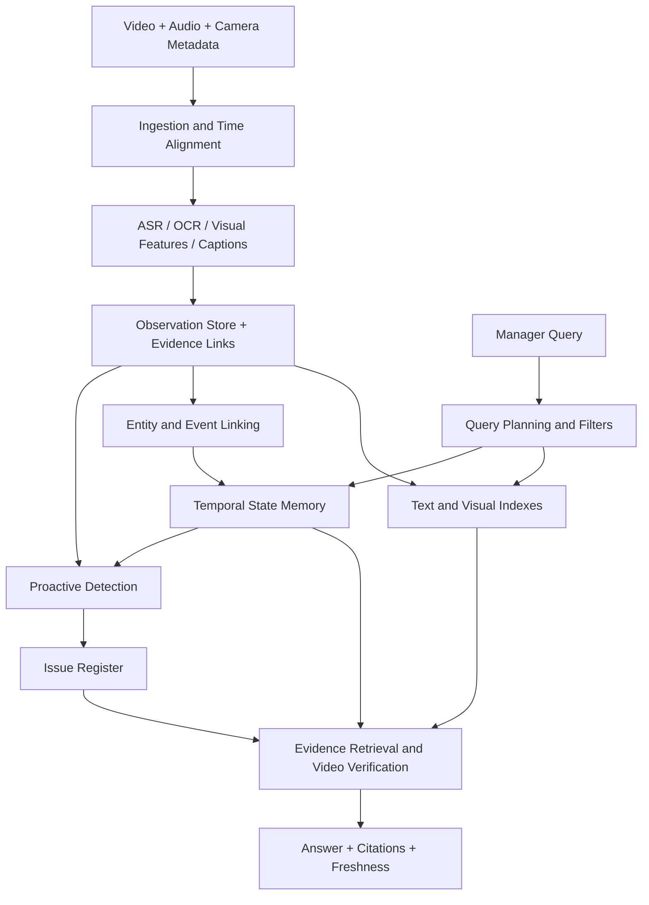

The following is a **design synthesis of the review**, not a description of a single, already validated method. Results on EgoLife, industrial assembly and construction inspections cannot be combined and presented as Aligned's expected accuracy.

### Memory should keep observations separate from the current conclusion

The smallest unit is an observation: which source, which interval, what is directly visible or audible, and which object the recording may refer to. Several observations may support one event. Several events may explain a change in an object's state. The conclusion “fixed” needs its own supporting evidence and validity time.

Proposed observation fields: `source_id`, `camera_id`, `wearer_id`, `start_time`, `end_time`, `ingested_at`, `location_hypothesis`, `entity_candidates`, `observed_claim`, `modality`, `visibility`, `evidence_uri`, `extractor_version`. This is not a schema required by any particular paper. It illustrates the information lost when storing only a caption and an embedding.

Two descriptions mentioning a “white panel” are not necessarily two records of the same panel. Two synchronized videos showing one installation are not two completed installations. Event linking and entity linking must therefore allow uncertainty, be evaluated separately, and retain the original observations after merging. The construction-hoist paper shows why a similar KPI does not validate case assignment, while Hsieh AI + BIM provides a concrete example of shared component identity with fixed cameras. That identity still needs to be established for helmet cameras.

Work on linking observations adds detail to three further fields: uncertainty in temporal alignment, the period during which a claim is valid, and the type of evidence required. VisualSync motivates storing an estimated clock offset, EGOSTREAM motivates distinguishing observation time from a fact's validity period, and Isaac and Lucko motivate recording visual confirmation separately from acceptance based on additional evidence. This is our proposed adaptation of these ideas, not a published unified architecture.

*Figure — Proposed Aligned architecture. A diagram by the review author, not a result from a paper. Indexes select candidates, while the original observations retain the evidence.*

### Two computation paths

The **ingestion path** runs without a manager's question. It decodes data, indexes speech and visual content, identifies events, updates links and runs detectors. The **query path** uses these prepared structures and spends expensive analysis on a small set of clips.

“Process everything in advance” is not a free solution either. General-purpose detailed captions can be expensive, omit details and contain errors. Comparisons must therefore measure not only retrieval time but also cost per camera-hour, memory size, the proportion of relevant facts lost during compression, and the cost of reindexing after a model change.

Recurring questions need reusable memory. Rare questions about small details need access to the source and additional analysis. A good system should combine these two modes rather than promise that a compact description will preserve everything.

Reducto in [Chapter 2](/chapters/archive/#chapter-2) reduces input processing for a particular query, while StreamForest in [Chapter 7](/chapters/streaming/#chapter-7) bounds the context used for an answer. Neither independently establishes the total cost at 18,000–36,000 camera-hours. A joint evaluation must account for decoding, storage of originals, index updates, streaming monitoring, and answers with verifiable clips.

### What to store in the issue register

1. **Observation:** original clips, camera, time interval, worker/work-item candidates, visibility and synchronization accuracy.
2. **Finding:** the observed deviation, the versioned requirement applied, confidence and alternative explanations.
3. **Issue:** problem identity, links across cameras and shifts, and status `candidate / confirmed / in_progress / correction_observed / acceptance_pending / resolved / unknown_current_state / reopened`.
4. **Verification:** separate evidence of resolution. An object leaving the frame does not move an issue to `resolved`. The corrective action itself does not always establish the outcome either.
5. **Freshness:** the time of the latest available recording and the latest confirmed state. “It was fixed yesterday” does not mean “it is guaranteed to be correct now.”

Detection recall, alert precision, duplicate alerts for the same event, detection speed, correctness of explanations, validity of issue closure and completeness of evidence must be evaluated separately. For rare events, a useful operating point matters more than overall F1. Full shifts with recovery from mistakes are necessary because errors in earlier decisions change the history and subsequent answers. This is where ideas from PROVIA, ProactEgoMem, grounded QA and construction workflows meet.

### Chat and the proactive detector have different responsibilities

Chat can request additional clips and honestly answer “insufficient evidence.” An automatic detector must decide when the material is sufficient for an alert and avoid producing dozens of duplicate notifications about the same problem.

In the lifecycle model proposed above, every transition requires its own justification. A lack of new frames does not move an issue to `resolved`. An object disappearing from view does not confirm that a defect has been corrected. A recording uploaded late may change the reconstruction of the past, but it must not silently rewrite the history of the system's decisions.

The `correction_observed` state between `in_progress` and `resolved` records an observed corrective action. Closure requires an explicitly verifiable recovery outcome. IMPACT supports annotating recovery attempts separately from component state, while construction methodology adds `acceptance_pending` when a visual correction is visible but a mandatory test or acceptance has not yet been confirmed. Even a successful alert followed by a human action does not establish that the defect has been resolved.

Detecting waiting requires particular care. A clip may show inactivity, but “potentially avoidable waiting” requires context about dependencies on other work, deliveries, permits or task execution rules. First record the observation and its duration, then a hypothesis about the cause. A worker who is out of frame is not counted as idle.

### What to measure: an evaluator for the entire chain

| Layer | Main metric | Required negative example |
|---|---|---|
| Retrieval | Recall@k and the proportion of required intervals retrieved | A visually similar operation on a different day |
| Localization | Temporal IoU and evidence coverage | The correct object, but at a time before the correction |
| Answers | Correctness of individual claims | A plausible answer without a source |
| Citations | Evidence precision / recall | A citation to a nearby clip that does not support the claim |
| Identity | False merge / false split | Two identical panels in adjacent rooms |
| Lifecycle | False closure rate, duplicate issues | The object left the frame, but the defect remains |
| Alerts | Recall at a specified FA/hour, latency | A long period of normal work without violations |
| Abstention | Risk–coverage curve | A fully occluded step or a camera that is switched off |
| Freshness | Arrival-to-searchable, event-to-alert | Old video uploaded after the shift ends |
| System | p50/p95 query latency, cost/camera-hour | Concurrent indexing and queries |

**Event time** is when the action occurred. **Arrival time** is when the file arrived. **Searchable time** is when it became retrievable. **Alert time** is when an alert was raised. Uploading after a shift makes these distinctions especially important. A fast chat response does not imply fast indexing, and fast indexing does not guarantee timely detection.

This is a proposed evaluation breakdown for Aligned. It must not be presented as the result of any single paper.

An **oracle-evidence test** is needed: manually provide the reader with the correct clips. If it still makes mistakes, better retrieval will not solve the problem. The converse test fixes the reader and changes only the retriever. For proactive operation, frames after the decision time must not be provided. Otherwise, the model receives information about a future correction or the outcome of the operation.

For queries requiring several pieces of evidence, ordinary hit@k is insufficient: the system may retrieve one of two required episodes and receive a positive retrieval score even though answering a question about the state change is impossible. An additional useful measure is whether **all** required intervals were retrieved.

### Specify explicitly what result a query promises

“Show an example,” “find every instance,” “how many instances occurred” and “check whether a condition was violated” require different guarantees. QV-M² evaluates multiple intervals, TVR/EventFormer evaluate recording and moment retrieval, BlazeIt evaluates aggregate estimation or LIMIT, and EQUI-VOCAL evaluates recordings containing a matching sequence. None of these metrics can automatically be treated as completeness over all events in a multi-camera archive.

Negative claims require particular scrutiny: “there was no inspection,” “nobody fixed it,” “all components are fastened.” An unsupported predicate must produce an explicit limitation or `unknown`. Applying VOCAL-UDF's dummy predicate, which always returns True, to a compliance query would silently remove the condition being checked. Likewise, EQUI-VOCAL without negation does not implement arbitrary queries about an action's absence.

Abstention must distinguish four causes: the relevant moment was not recorded, was lost during compression, was not retrieved, or was misread. APM-Bench and UVQA help construct these tests, but “I cannot determine this from this clip” does not establish that the entire archive lacks the information. Removing the annotated decisive interval is more informative than arbitrarily reducing the number of frames. The abstention threshold and visual override policy must be selected on a separate development split, not after examining errors on the final test.

### An initial retrieval prototype

This is an engineering conclusion of the review, not an established result of any single paper. An initial candidate is persistent episodes with timestamps and provenance, multiple textual keys following MERIT, independent visual retrieval, ASR/OCR retrieval, and then a bounded second look at the original clip. Structured camera, time and site filters should be applied before semantic retrieval. Relationship graphs are reasonable additions for queries where experiments demonstrate a need to link several events.

For each question, store not only the answer text but also the retrieved candidates, the intervals read and the exact sources for every verifiable part of the answer. Without supporting evidence, the system must be able to say “this is not visible in the available recordings.” That is not equivalent to “the event did not happen.”

A fair comparison of memory representations requires the same source recordings, captioner, ASR, answer model and evidence budget. At a minimum, compare **retrieval recall**, localization accuracy, **answer correctness**, agreement between the answer and its evidence, mean and p95 latency, memory construction cost, and the cost of a fixed number of queries. Separately measure when a recording becomes available in memory. A system may answer quickly from yesterday's index while failing the freshness requirement.

### Combining observations in shared memory

The following design is our engineering hypothesis, not a published result of any one of the systems discussed:

1. **Observation store:** immutable links to source camera/time intervals, captions, ASR, visual features and observability conditions.
2. **Identity and alignment:** separate camera-to-wearer mapping, actor/speaker hypotheses, clock offsets, scene/location IDs and probable object-instance links. An unconfirmed association remains a hypothesis.
3. **Individual memory:** details of each wearer's observations and their provenance.
4. **Shared event memory:** combined work episodes with links to supporting and contradicting observations.
5. **Entity histories:** the history of a particular panel, tool or defect, including observation gaps and the date of the last confirmation.
6. **Query-time verification:** episode retrieval, selection of relevant wearers and viewpoints, and inspection of the original clips before claiming completion or correction.

Each transition needs its own test. Synchronization is evaluated on simultaneously observed events. Entity association is evaluated on reappearances of similar objects, including false merges and splits. Shared memory is evaluated for preservation of all participants and sources. A defect history must distinguish “the repaired object is visible,” “the previous defect is not visible” and “there is no data after the repair.” These last three states must not be collapsed into a single `resolved` status.

None of the reviewed papers demonstrates this entire chain on 18,000–36,000 camera-hours from a construction site. The closest literature supplies necessary components, while integrating them and validating them on its own data remains a separate task for Aligned.

### A minimum set of comparisons before adding architectural complexity

1. **Text baseline:** ASR + captions + metadata filters + text retrieval. Shows which questions can be answered through inexpensive textual access.
2. **Hybrid baseline:** the same pipeline plus visual retrieval and reranking. Measures the value of the visual channel with a fixed reader.
3. **Evidence verification:** the reader reexamines retrieved clips. Measures whether this corrects caption-memory errors and how much latency increases.
4. **Temporal memory:** add entity/event links and state histories. Evaluate questions spanning multiple shifts and sources specifically, rather than only an overall QA score.
5. **Proactive path:** a separate causal evaluation of detection and the issue lifecycle, including long normal recordings.

Do not change the encoder, memory, reader and prompting simultaneously and then attribute an improvement to the graph. Each extension needs identical source data, processing budgets and question types. Train/test splits should separate sites, tasks or periods so that neighboring, nearly identical recordings do not end up on opposite sides of the split.

Additional mandatory controls: CapMem with identical frame coverage, an independent test of verifier cost, the assistant's own history instead of GuideMe's GT-history, and continuous input during answers rather than paused replay. Early exit needs two settings: with known step boundaries and without them. Corrections need errors without intervention, unsuccessful repair attempts, successful recovery and subsequent recurrence. VERA with access to the future remains an offline baseline until it is adapted to causal operation.

Evaluating the proactive path requires a separate protocol: establish state and visibility, detect a violation relative to the procedure, identify the earliest justified alert time, and then verify observed recovery. Besides recall, measure false alarms per duration of normal work, misses caused by lack of visibility, delay relative to the appearance of evidence, and error accumulation under the assistant's own history. Evaluating the usefulness of recommendations requires observing what the person actually did after the advice and whether the state changed, rather than only assessing the wording of the answer.

Additional memory comparisons: HPP makes it possible to test programmatic evidence aggregation against ordinary tool calling, EgoCITE tests context resolution and temporal meaning with identical captions, and FLORA tests the quality of event boundaries and descriptions separately. Vary these factors one at a time. DirectMe's spatial memory needs a separate control for data availability at question time, while All-Angles Bench and EgoExoBench motivate tests that remove a viewpoint or reference demonstration.

For the procedural branch, comparisons must include valid alternative orders and unexpected actions. AMNAR allows several possible next steps, whereas VidParse's hard constraints can hide an unknown valid branch or a violation. Step segmentation, execution errors and the grounds for closing an issue must remain separate evaluation targets.

### Open scientific and engineering questions

The main gap is the transition from episodic QA to a verifiable history of physical objects and issues. Each reviewed direction offers useful components: description-based retrieval, visual refinement, entity graphs, procedural state and streaming memory. Their joint reliability over weeks of construction work does not follow from separate result tables.

Four transfer tests are especially important: robustness to repetitive rooms and objects, gaps in recording, changes in people and viewpoints, and the distinction between visible completion and compliance with requirements. These need Aligned's own annotated episodes. Benchmarks from the literature can test components, but they do not replace evaluation of the end product.
