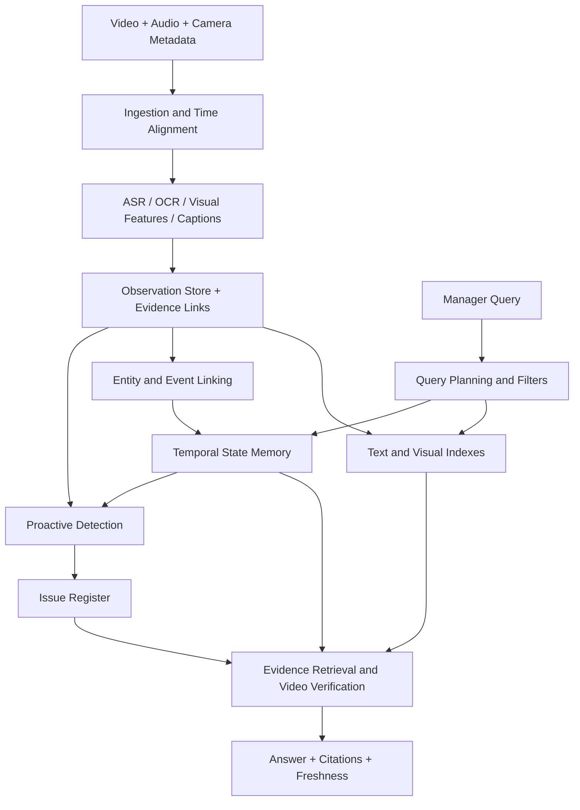

# Aligned: от поиска видео к проверяемой памяти о строительных работах

**Literature review · Russian narrative / English terminology · 2 November 2026**

Тематический обзор для проектирования системы. Проверенные результаты отделены от наших проектных выводов. Главы организованы по задачам Aligned, а бенчмарки и протоколы оценки вводятся перед методами. Исторический аудит оригинальных PDF сохранён в [реестре доказательств](PDF_AUDIT_RU.md). Источники и ограничения указаны в тексте, подробный [реестр бизнес-кейсов](../../aligned-wiki/business-cases.md) хранится отдельно.

## Содержание

- [1. Постановка Aligned и основы работы с видео](#chapter-1)
- [2. Поиск и ответы по видеоархиву](#chapter-2)
  - [2.1. Найти нужную запись и временной интервал](#task-2-1)
  - [2.2. Найти все подходящие эпизоды](#task-2-2)
  - [2.3. Ответить на вопрос по длительной истории](#task-2-3)
  - [2.4. Посчитать события и проверить составное условие](#task-2-4)
- [3. Объединение наблюдений разных камер, людей и объектов](#chapter-3)
- [4. Ответ с доказательствами: локализация, актуальность и отказ](#chapter-4)
- [5. Состояния объектов и подтверждение результата работы](#chapter-5)
- [6. Распознавание процедур, ошибок и исправлений](#chapter-6)
- [7. Потоковое понимание и своевременное вмешательство](#chapter-7)
- [8. Научные работы непосредственно о строительстве](#chapter-8)
- [9. Близкие бизнес-кейсы](#chapter-9)
- [10. Смежные направления и дополнительные методы](#chapter-10)
- [11. Проектный синтез для Aligned](#chapter-11)
- [Приложение A. План чтения и словарь](#appendix-reading)
- [Приложение B. Границы обзора и воспроизводимость](#appendix-evidence)

## 1. Постановка Aligned и основы работы с видео

Цель — понять, какие научные идеи нужны для системы из [PROBLEM_STATEMENT](../PROBLEM_STATEMENT.md), как они работают и где заканчиваются их доказанные возможности. Под «полным обзором» здесь понимается покрытие необходимых классов решений, а не перечисление всех статей о видео. Статьи о генерации видео и обучении роботизированных политик исключены из основного рассказа, поскольку они не решают текущую задачу поиска и контроля строительных работ.

Материал разделён по задачам: поиск и ответы по архиву → объединение наблюдений → проверка доказательств → состояния объектов → ошибки и исправления → своевременное вмешательство. Представления и способы хранения памяти рассматриваются внутри задач, которым они служат. **Ключевой** означает важность для архитектурного выбора, а не максимальный результат в рейтинге.

Основной локальный источник — Aligned Wiki. В RL-Wiki и PM-Wiki выполнен тематический поиск. PM-LLM-Benchmark относится к анализу уже представленных процессов и не решает извлечение надёжного журнала событий из видео. Поэтому процессный анализ рассматривается после восприятия и связывания наблюдений. Сведения из локальных карточек используются для навигации, а значимые числа и архитектурные утверждения сверяются с оригинальными PDF и официальными репозиториями.

### Что именно требуется построить

Вопрос «Что Педро делал вчера после обеда?» выглядит как Video Question Answering. Но система сначала должна определить нужный временной интервал и камеры, найти события, связать их с человеком, проверить исходные кадры и сформулировать ответ с источниками. Вопрос «Исправили ли вчерашний дефект?» добавляет идентификацию физического объекта, историю состояния и проверку свежести данных. Ни один из этих шагов не следует автоматически из способности VLM описывать короткий ролик.

Рассмотрим условный пример. В понедельник камера Педро показывает монтаж панели. Во вторник другой работник снимает ту же панель. Во вторник на записи видно закрытую поверхность, но скрытый крепёж уже не виден. Система может сообщить, что панель выглядит закрытой, и показать оба наблюдения. Из этого не следует, что крепёж установлен правильно. Такое разделение между наблюдением и заключением должно существовать в данных, а не только в вежливом тексте ответа.

| Requirement | Что должна уметь система | Что проверять отдельно |
|---|---|---|
| Searchable memory | Найти нужное событие среди недель записей | Recall релевантных интервалов при большом числе похожих эпизодов |
| Grounded answers | Ответить и предъявить подтверждение | Правильность утверждения, полнота и точность ссылок |
| Multi-source continuity | Связать один объект и работу между камерами и сменами | Ошибочные слияния объектов и пропущенные связи |
| Proactive detection | Обнаруживать проблемы без вопроса | Пропуски, ложные сигналы, время до обнаружения |
| Issue lifecycle | Отслеживать проблему и её исправление | Ошибочное закрытие, дубли, повторное открытие |
| Freshness | Объяснять, до какого момента есть данные | Задержка загрузки и обработки по каждой камере |
| Scale | Обрабатывать 18–36 тысяч камера-часов | Полная стоимость, пропускная способность, задержки |

### Размер архива и размер контекста

По сценарию постановки 50–100 камер × 6 часов × 60 рабочих дней дают 18 000–36 000 камера-часов. Если чисто для расчёта разбить поток на непересекающиеся интервалы по 30 секунд, получится 2,16–4,32 миллиона интервалов. При одном кадре в секунду — 64,8–129,6 миллиона кадров

При условных 4 Mbit/s исходное видео занимает примерно 32,4–64,8 TB в десятичной системе, без репликации, аудио и производных данных. Один 768-мерный float16-вектор на интервал — около 3,32–6,64 GB только числовых данных, без индекса и метаданных. Эти расчёты не являются рекомендацией битрейта или размера embedding. 

Чтобы обработать ежедневные 300–600 камера-часов в течение 24 часов, нужна суммарная производительность 12,5–25 камера-часов на час реального времени. Это ещё не число GPU: оно зависит от декодирования, модели, разрешения, частоты кадров и batching. Для предупреждений во время работы важны пиковый входящий поток и задержка очереди

### Базовые данные и протоколы оценки представлений

Прежде чем выбирать encoder, полезно понять, какой результат проверяет его benchmark. Для Aligned нужны и дешёвый поиск кандидатов, и сохранение мелких визуальных деталей. Хороший результат первого не гарантирует второго. Подробные протоколы поиска и QA разбираются в следующей главе.

| Данные или тест | Что оценивается | Как читать результат |
|---|---|---|
| **MSR-VTT, MSVD, LSMDC, ActivityNet, DiDeMo** | Сопоставление текстового запроса и видео в постановках clip retrieval, используемых CLIP4Clip | Recall зависит от split и числа кандидатов. Это не полнота поиска всех событий площадки. [CLIP4Clip, §§3–4](pdf-audit/sources/clip4clip.pdf) |
| **WebVid-2M** | Пары видео и описаний для обучения представлений в Frozen in Time | Обучающий корпус, а не независимая проверка готовой видеопамяти. [Frozen in Time, §§3–4](pdf-audit/sources/frozen.pdf) |
| **Набор задач InternVideo2** | Перенос общего backbone на распознавание, retrieval и мультимодальное понимание | Более 60 задач не образуют единой метрики качества. Encoder и reader оцениваются раздельно. [InternVideo2, §3 и эксперименты](pdf-audit/sources/internvideo2-eccv.pdf) |
| **VOC object discovery, ADE20K** в EgoViT | CorLoc локализации объекта и mIoU сегментации после supervised fine-tuning | Сравнение с переобученными авторами baselines. Не проверяет долговременную идентичность, состояние или качество работы. [PDF, Table 1, Appendix C.4](../../aligned-wiki/raw/2026-tan-egovit.pdf#page=6) |
| **ADE20K, NYUv2** в V-JEPA 2.1 | Сегментация и глубина с обученным head поверх frozen features | Проверяют dense representations, не готовую видеопамять. Условия linear probing отличаются от fine-tuning EgoViT. [PDF, §2.3, Figure 5](../../aligned-wiki/raw/2026-mur-labadia-v-jepa-2-1.pdf#page=6) |

Эта таблица задаёт роль данных в обсуждаемых работах. Она не является новым аудитом всех исторических splits или рейтингом актуальных encoders.

### Представления видео и этапы ответа

**Representation** превращает клип в удобную для поиска форму. **Retrieval** выбирает кандидатов. **Reranking** уточняет их порядок более дорогой моделью. **Temporal grounding** определяет начало и конец подтверждающего события. **Generation** формулирует ответ. На практике эти этапы могут объединяться, но раздельная оценка показывает, где возникает ошибка.

Есть три основных представления.

1. **Text memory.** ASR даёт речь, OCR — надписи, captioner — описание видимого. Это позволяет использовать текстовый поиск. Однако в текст попадает только то, что распознаватель решил сохранить. Неописанная шайба не появится из точного поиска по описанию.
2. **Visual memory.** Embeddings сохраняют признаки кадров и клипов. Они помогают найти визуально похожие события даже без подходящей формулировки caption. Семантическая близость не гарантирует идентичности объекта, человека или завершённости работы.
3. **Structured memory.** События, объекты, места, состояния и связи между ними становятся явными записями. Это облегчает запросы «после», «тот же», «до исправления». Зато ошибки извлечения и слияния становятся частью памяти и могут влиять на много последующих ответов.

ASR нельзя считать расшифровкой всего происходящего. Работник может молчать, описывать планы или обсуждать чужую работу. Фраза «я всё затянул» — свидетельство высказывания, а не прямое визуальное подтверждение момента затяжки. По той же причине наличие в кадре инструмента не доказывает его использование.

### Frozen in Time: почему embeddings позволяют отделить индексацию от запроса

**Bain et al., ICCV 2021.** *Frozen in Time: A Joint Video and Image Encoder for End-to-End Retrieval* обучает независимые кодировщики текста и видео в общем пространстве на парах изображений и видео с описаниями, включая WebVid-2M. Пространственное и временное attention кодирует ролик, contrastive learning сближает подходящие пары. Видео можно индексировать заранее, а при вопросе вычислять только текстовый embedding и сходство. Это историческое основание дешёвого поиска кандидатов, а не проверки физической корректности работы. Ниже CLIP4Clip показывает другой путь к такому поиску, через перенос image–text модели, а InternVideo2 — более широкий мультимодальный backbone. Это сопоставление подходов, не утверждение о прямом наследовании архитектур. [PDF, pp. 3–4, §§3–4](pdf-audit/sources/frozen.pdf).

### CLIP4Clip: сильные признаки изображения уже полезны для поиска клипа

**Luo et al., preprint 2021.** *CLIP4Clip: An Empirical Study of CLIP for End to End Video Clip Retrieval* исследует перенос CLIP на видео, объединение кадров и настройку обучения на MSR-VTT, MSVD, LSMDC, ActivityNet и DiDeMo. Работа даёт понятный baseline: предобученные image–text признаки, объединённые для клипа, позволяют строить text-to-video retrieval. Но похожий набор кадров не обязательно различает «открутил и снял» и «поставил и закрутил». Для Aligned такой индекс следует дополнять временными признаками и чтением найденного эпизода. Далее InternVideo2 рассматривается как другой масштаб и устройство представлений, а не доказанное улучшение именно CLIP4Clip при одинаковом протоколе. [PDF, pp. 4–8, §§3–4](pdf-audit/sources/clip4clip.pdf), [код](https://github.com/ArrowLuo/CLIP4Clip). Год относится к первому preprint.

### InternVideo2: один backbone может поддерживать несколько уровней системы

**Wang et al., ECCV 2024.** *InternVideo2: Scaling Foundation Models for Multimodal Video Understanding* объединяет три стадии: дистилляцию признаков незамаскированных видеотокенов от expert encoders при маскировании входа, мультимодальное contrastive learning и next-token prediction. Авторы масштабируют video encoder до 6B параметров и оценивают перенос на более чем 60 задачах видео и аудио.

Это помогает понять разницу между хорошими визуальными признаками, retrieval-моделью и диалоговым интерфейсом. Они могут использовать общий backbone, но имеют разные цели обучения и режимы работы. В официальном репозитории стадии 1–2 отделены от стадии 3, связанной с VideoChat2. Для Aligned выбор encoder и выбор reader следует проверять раздельно. Сильное распознавание действий не доказывает готовность памяти к поиску по тысячам часов.

[PDF, pp. 4–6, Figure 2, §3](pdf-audit/sources/internvideo2-eccv.pdf), [official implementation](https://github.com/OpenGVLab/InternVideo/tree/main/InternVideo2). Это исторический архитектурный ориентир, не утверждение, что версия 2024 года является лучшей моделью на дату обзора.

### EgoViT, Tan et al., CVPR 2026: устойчивость признаков локальных областей

**EgoViT** учит encoder на неразмеченных эгоцентрических клипах: teacher–student self-distillation сочетается с pseudo-depth и отбором надёжных соответствий областей между кадрами. Для Aligned это кандидат на признаки перед tracking и индексацией. В сопоставимом переобучении DINO object discovery на VOC растёт **37.2 → 45.2% CorLoc**, ADE20K — **21.2 → 26.0 mIoU**, но последнее требует supervised fine-tuning. Proto-objects не гарантируют устойчивую идентичность: одна attention head может перейти с человека на автомобиль. Слабое воспроизведение DoRA и один seed ограничивают сравнение. Дополнительный Ego4D-mini состоит из трёх клипов с SAM2 pseudo-GT, при этом в приложении есть и более широкая проверка tracking и supervised video segmentation. Это локальные признаки, а не база экземпляров или проверка состояния изделия. [PDF, Table 1, Appendices C–D, I](../../aligned-wiki/raw/2026-tan-egovit.pdf#page=6).

### V-JEPA 2.1, Mur-Labadia et al., 2026 preprint: сохранить локальную структуру видео

**V-JEPA 2.1** расширяет masked latent prediction: teacher supervision получают и скрытые, и видимые patches, а промежуточные слои помогают сохранить одновременно локальную геометрию и глобальную информацию о действии. Изображения и видео используют разные patch tokenizers. Для Aligned это кандидат на признаки для tracking и анализа состояния, а не готовый поиск по языковому запросу. На ADE20K и NYUv2 качество проверяется обученными heads поверх замороженного encoder, поэтому речь не о zero-shot восстановлении сцены. Выигрыш зависит от задачи, а robot-planning результаты требуют отдельного action-conditioned predictor и не доказывают качество строительного контроля. Компактные distilled варианты позволяют отдельно проверить стоимость извлечения признаков. [PDF, §§2.3, 3, Figure 4](../../aligned-wiki/raw/2026-mur-labadia-v-jepa-2-1.pdf#page=5).

### Почему одного top-k недостаточно

Если запрос просит найти один эпизод, top-k retrieval может быть достаточным. Если нужно перечислить все переделки за неделю, число релевантных событий заранее неизвестно. Выдача десяти красивых примеров не доказывает полноту перечня. Для таких вопросов нужен обход временных и пространственных разделов архива, контроль покрытия и явное указание непросмотренных интервалов.

Разумная проектная схема: сначала точные фильтры site/date/camera, затем объединение текстовых и визуальных кандидатов, затем reranking и проверка исходного видео. Фильтры не должны незаметно исключать дополнительные источники, если вопрос относится к работе, а не только к конкретному носителю камеры. Векторный индекс здесь — один компонент, а не готовая видеопамять.

## 2. Поиск и ответы по видеоархиву

Вопросы к одному архиву требуют разных результатов. «Покажи монтаж этой панели» просит найти эпизод. «Найди все её переделки» требует полного набора событий. «Почему её переделывали?» требует ответа по нескольким свидетельствам. «Какую долю времени занимала переделка?» требует определённого способа подсчёта. Поэтому глава разделена по этим задачам. Текстовая память, visual embeddings, графы и инструменты агента — способы их решения, а не отдельные пользовательские задачи.

Для Aligned общий вход — записи камер, звук и метаданные за несколько смен. Ниже важно различать, что уже предоставлено модели: нужный клип, одна длинная запись или весь корпус. Проверка того, что окончательный ответ подтверждён именно нужными свидетельствами, вынесена в [главу 4](#chapter-4).

### Бенчмарки и протоколы оценки: карта задач

| Задача | Бенчмарки и данные | Что проверяется и что заранее дано | Ограничение и переиспользование |
|---|---|---|---|
| Найти запись и момент | **TVR**, **ActivityNet Captions**, **DiDeMo** | Корпусный поиск и temporal localization в используемых авторами постановках | EventFormer повторно использует TVR, ActivityNet Captions и DiDeMo (§4.1, Tables 2–4). Результаты локализации нельзя смешивать с clip retrieval из главы 1. [TVR PDF](../../aligned-wiki/raw/2020-lei-tvr.pdf), [EventFormer PDF](../../aligned-wiki/raw/2026-hou-eventformer.pdf) |
| Найти evidence для ответа | **V-RAGBench** | `query → evidence chunk → answer` внутри заданного длинного видео | Уникальный эпизод обеспечивается фильтрацией повторов. Независимое переиспользование здесь не установлено. [PDF, §4](https://arxiv.org/pdf/2606.13141v2) |
| Ответить с поиском по корпусу | **WikiHowQA / HowTo100M**, **LongerVideos** | Инструктивные ответы по найденным видео либо синтез по коллекции | ROUGE-L и предпочтение судьи не измеряют полноту событий. HowTo100M — корпус поиска в описанном опыте. [Jeong PDF](https://aclanthology.org/2025.findings-acl.1096.pdf), [Ren PDF](https://arxiv.org/pdf/2502.01549v1) |
| Найти несколько моментов | **QV-M² / QVHighlights** | Несколько размеченных интервалов одного видео, multi-moment метрики | QV-M² расширяет разметку QVHighlights. Baselines исходной статьи не являются независимым переиспользованием нового теста. Покрытие нескольких камер не проверяется. [FlashMMR PDF](../../aligned-wiki/raw/2025-cao-flashmmr.pdf) |
| Найти прошлый эпизод и связать события | **EgoLifeQA**, **Ego-R1 Bench** | Многодневные записи EgoLife, но разные наборы вопросов и доступные инструменты | EgoLifeQA повторно используют EGAgent, WorldMM, MERIT и EM²Mem. Это одна исходная среда, а не независимые домены. Основной Jake subset — 500 вопросов. Источники и различия приведены ниже |
| Память между сеансами и рассуждение по длительной истории | **APM-Bench**, **EgoMonth**, **EgoMemReason** | Межсессионная память, эпизоды/привычки и рассуждение по разнесённым свидетельствам | APM имитирует причинный поток, календарный горизонт EgoMonth не равен непрерывной записи, EgoMemReason использует EgoLife. Независимое переиспользование этих новых тестов здесь не установлено |
| Понять заданное видео | **EgoSchema**, **NExT-QA**, **LongVideoBench**, **Video-MME**, **LVBench** | QA по уже выбранной записи. Короткий клип и длинное видео создают разные нагрузки | EgoSchema используется в LLoVi и двух VideoAgent, Video-MME — в нескольких описанных ниже методах. Это ещё не поиск по архиву. [LongVideoBench](https://longvideobench.github.io/index.html), [Video-MME PDF](https://openaccess.thecvf.com/content/CVPR2025/papers/Fu_Video-MME_The_First-Ever_Comprehensive_Evaluation_Benchmark_of_Multi-modal_LLMs_in_CVPR_2025_paper.pdf) |
| Восстановить взаимодействия с предметами | **AMB** на **EPIC-KITCHENS** | Временной порядок и пересечение взаимодействий, visual multiple-choice queries | Отфильтрована часть сложных случаев идентичности. Независимое переиспользование AMB здесь не установлено. [AMEGO PDF](https://arxiv.org/pdf/2409.10917) |
| Проверить цену переиспользуемой памяти | **Оценочный набор CapMem** | 75 видео, несколько вопросов на запись, контроль покрытия кадров | Это протокол статьи. Политика visual override подобрана по ошибкам того же теста. [CapMem PDF](../../aligned-wiki/raw/2026-liang-capmem.pdf) |
| Выполнить составной запрос | **CLEVRER, CityFlow-NL, Charades** в VOCAL-UDF | Выполнение запросов над объектами и предикатами в разных доменах | Наличие нескольких datasets не доказывает проверку строительных норм. [VOCAL-UDF PDF](../../aligned-wiki/raw/2025-zhang-vocal-udf.pdf) |
| Оценить стоимость поиска и агрегатов | **Протоколы Focus, BlazeIt, TASTI и Reducto** | Качество относительно выбранного labeler, стоимость ingest/query, sampling или фильтрация | Выход teacher detector часто служит reference. Это не человеческий ground truth дефектов. Источники разобраны в §2.4 |
| Найти материалы и составить отчёт | **MultiVENT-Raw** | Корпусный retrieval и отдельная оценка подтверждённых утверждений | Подробный протокол и citation F1 — в [главе 4](#chapter-4). Не benchmark строительных касок |
| Понять заданное длинное видео через агентный поиск | **LongVideoBench, EgoSchema, Video-MME, MLVU** в HPP | QA, а для MLVU SSC — описание локализованной сцены. Сравнение code/tool calling использует отдельные 150 вопросов LVB-3600 | Независимое повторное применение общих QA-тестов, но не benchmark полноты event retrieval. Доступ к субтитрам и число итераций фиксированы лишь в указанном сравнении. [HPP, §§4–5, Tables 2–4](../../aligned-wiki/raw/2026-rauf-hpp.pdf#page=7) |
| Проверить временной смысл поиска по памяти | **EgoLifeQA, EgoMem, EgoR1-Bench** в EgoCITE | QA, retrieval hit rate и последовательное добавление компонентов | Все три теста используют EgoLife. Основной опыт получает человеческие captions/транскрипты, автоматический вариант сохраняет ручной person-ID prior. Это повторное использование данных, не перенос на новую среду. [PDF, Table 2, Appendix C.1](../../aligned-wiki/raw/2026-zhang-egocite.pdf#page=8) |
| Выбрать визуальные детали внутри заданного видео | **EgoMemoria** | 7 026 вопросов по 629 видео, mean debiased accuracy после фильтрации text-only ответимых вопросов | Фильтры и группы длительности влияют на усреднение. Данные и опорные кадры происходят из narrations, независимое переиспользование не установлено. [MM-Ego, §§3.1–3.3, Table 3](../../aligned-wiki/raw/2025-ye-mm-ego.pdf#page=8) |
| Подготовить интервалы и описания для индекса | **What’s Going On / WGO, DenseCaptionBench** | WGO: 100 эпизодов людей и роботов, segmentation F1, caption score при правильных границах и joint F1. DenseCaptionBench отдельно диагностирует подписи | Для WGO дана инструкция эпизода, сравнение не уравнивает все вычисления. WGO переиспользуется из предшествующей работы. Для нового DenseCaptionBench независимое переиспользование здесь не установлено. [FLORA, §2.1](../../aligned-wiki/raw/2026-leng-flora.pdf) |
| Отделить запись действия от оценки результата | **DenseRewardBench, RubricBench** в FLORA | Плотные метки качества исполнения и оценка эпизода по критериям. В DenseRewardBench 40 отложенных робототехнических эпизодов | Дополнительная диагностика writer/rewarder, не поиск по архиву и не live detector. Будущий контекст допустим. Независимое переиспользование здесь не установлено. [PDF, §2.2–2.3, §4.2](../../aligned-wiki/raw/2026-leng-flora.pdf) |

Наличие нового названия не делает тест сильнее. Переиспользование подтверждается конкретными работами и не означает независимость данных. Для новых наборов отсутствие подтверждения в этом обзоре не означает, что их никто не использовал. Общие протоколы HD-EPIC и Ego4D обсуждаются в главах [5](#chapter-5) и [3](#chapter-3).

### 2.1. Найти нужную запись и временной интервал

На выходе нужны адрес записи и границы события. Поиск по одному выбранному видео проще корпусного: правильная камера и смена уже известны. Для Aligned это различие определяет, будет ли найден нужный монтаж среди внешне одинаковых операций.

#### Сначала разделим задачи, которые часто называют одним словом Video QA

Вопрос «Что Педро делал вчера после обеда?» не начинается с генерации ответа. Сначала нужно выбрать его камеру, правильно интерпретировать дату и часовой пояс, найти события в нужном интервале, затем проверить, достаточно ли их для ответа. Вопрос «Кто исправил вчерашний дефект?» сложнее: он требует связать объект, прежнее состояние, новое состояние и несколько наблюдений. Эти примеры ниже — наша интерпретация требований Aligned, а не задачи, уже решённые обсуждаемыми статьями.

Полезно различать четыре уровня:

1. **Clip understanding.** Модель получает уже выбранный короткий фрагмент и описывает его. Здесь ещё нет поиска.
2. **Within-video retrieval / temporal grounding.** Из одного известного видео нужно вернуть интервал, соответствующий запросу. Выбор правильного ролика уже сделан за систему.
3. **Corpus retrieval.** Нужно сначала найти нужные записи среди множества камер, смен и дней. Здесь особенно опасны похожие события в неправильном месте или времени.
4. **Evidence-grounded reasoning.** Нужно объединить несколько найденных интервалов, объяснить вывод и указать, какая часть ответа чем подтверждается.

Один процент QA accuracy не оценивает все четыре уровня. Модель может угадать правильный вариант ответа, опираясь на общий смысл вопроса. Или найти правильную сцену, но неверно прочитать действие. Поэтому развитие литературы стоит читать как постепенное разделение памяти, поиска, проверки и генерации.

#### TVR и V-RAGBench: два разных масштаба поиска

**TVR** содержит 109 тысяч запросов к 21,8 тысячи телевизионных клипов. Запросы могут требовать визуальных, текстовых или совместных свидетельств. Это полезная постановка «найти запись, затем интервал» и контроль пользы субтитров. Телевизионная речь не проверяет устойчивость ASR к шуму стройки. Работа опирается на более раннюю постановку corpus moment retrieval и не является её изобретателем. [TVR / XML, PDF v2, §§3–5, pp. 5–11](../../aligned-wiki/raw/2020-lei-tvr.pdf#page=5).

**Rethinking RAG in Long Videos: What to Retrieve and How to Use It?, Lee et al., arXiv preprint 2026**, версия v2 от 2 октября, — важное дополнение к вики. Авторы создают V-RAGBench как набор троек `query → evidence chunk → answer`. В каждом вопросе целевой ответ должен опираться на один уникальный эпизод. Фильтруются вопросы, решаемые без видео, а также случаи, где другой эпизод даёт ответ. Финальный набор содержит **2,100 вопросов, 1,800 train и 300 test**. Поиск проводится внутри исходного длинного видео. [PDF, §4](https://arxiv.org/pdf/2606.13141v2).

Для Aligned полезен дизайн эксперимента, отдельно оценивающий поиск и ответ. Но уникальность evidence здесь специально обеспечивается удалением повторяющихся событий. В реальной стройке повторы — центральная трудность. Поэтому V-RAGBench стоит использовать как диагностику поиска и чтения, а собственный benchmark должен дополнительно проверять выбор нужного экземпляра среди похожих монтажей. В проверенной PDF-версии авторы обещают выпустить benchmark, код и evaluation scripts после принятия статьи (PDF p. 10). Наличие опубликованного кода из этой формулировки не следует. Это не воспроизведённый нами результат.

#### WikiHowQA и LongerVideos: ответы по коллекции

**WikiHowQA** используется VideoRAG Jeong для инструктивных вопросов с поиском видео в HowTo100M. ROUGE-L сравнивает ответ с эталонным текстом, а не измеряет точность объекта или времени. В описанном сравнении BM25 ищет в Wikipedia, поэтому меняются одновременно источник знаний и модальность. Это нельзя считать чистой абляцией видео против текста на одном корпусе. [PDF, §3.1 и Table 1](https://aclanthology.org/2025.findings-acl.1096.pdf).

**LongerVideos**, представленный вместе с VideoRAG Ren, содержит **164 видео, 22 коллекции, 602 вопроса и около 134.6 часа** в версии v1 от 3 февраля 2025 года, Table 1. Это лекции, документальные и развлекательные записи. В Table 2, при сравнении ответов судьёй GPT-4o-mini, доля побед над NaiveRAG по агрегированной категории Overall Winner составляет **53.26%**, над LightRAG — **57.14%**. Это парное предпочтение ответов по протоколу оценивания авторов, не доля фактически правильных ответов и не recall поиска. [PDF v1, Tables 1–2](https://arxiv.org/pdf/2502.01549v1).

Эти тесты оценивают ответ после поиска. Их результаты дополняют retrieval-метрики, но не заменяют оценку всех найденных событий или подтверждения отдельных утверждений.

#### XML: ранний ориентир для корпусной локализации

**Lei et al., 2020.** XML отдельно кодирует видео и субтитры, строит зависящие от модальности представления запроса, выбирает 100 записей и локализует начало и конец внутри кандидатов. Для Aligned важна сама декомпозиция поиска записи и интервала. Ниже EventFormer рассматривается как другой способ построить индекс для той же корпусной задачи, а не как автоматически установленный прямой наследник XML. [Карточка](../../aligned-wiki/wiki/2020-lei-tvr.md), [PDF v2, §§3–5](../../aligned-wiki/raw/2020-lei-tvr.pdf#page=5).

*Оригинальная Figure 4, p. 8.*

#### EventFormer: индекс событий перед точной локализацией

**[EventFormer](../../aligned-wiki/wiki/2026-hou-eventformer.md)** заменяет только покадровую индексацию более компактным индексом событий: группирует видео, извлекает представления событий через attention, находит top-10 записей и запускает точный локализатор. В проверенном preprint Table 8 вариант K-means хранит 31 MB предвычисленных представлений и тратит 43 ms на поиск записей против 161 MB и 88 ms у ReLoCLNet. Это размер индекса конкретного TVR и время retrieval, а не вся память системы или полный ответ. Локализация указана отдельно — 103 ms. [PDF v1, Figure 2, p. 4, Table 8, p. 9](../../aligned-wiki/raw/2026-hou-eventformer.pdf#page=9).

Для Aligned это аргумент в пользу событий как единицы индекса, но не гарантия корректности события: объединение соседних кадров может скрыть краткий дефект. Метод использует обученную локализацию по размеченным интервалам, поэтому его нельзя без проверки переносить на открытую строительную онтологию. Существенное ограничение источника: проверен arXiv preprint 2024 года, а издательский ECIR 2026 добавляет автора Yanyan Lan. Финальный издательский PDF не получен, его таблицы отдельно не подтверждены. Авторский репозиторий при проверке пуст. В обзоре все приведённые числа относятся именно к preprint.

*Оригинальная Figure 2 из проверенного preprint, p. 4.*

#### CARVE: искать и выбирать разные формы свидетельства

CARVE параллельно ищет по четырём представлениям: visual/frame, visual/clip, text/frame, text/clip. Кандидат сохраняет метку способа, которым он найден. Multimodal reranker выбирает для каждого эпизода наиболее полезное представление. Генератор получает именно эти выбранные формы свидетельств, а не единую модальность для всего вопроса.

В Table 2 на 300 test-вопросах **Recall@5 = 0.603** против **0.510** у сильнейшего baseline по этому показателю, **nDCG@5 = 0.433**. При Qwen3-VL-8B pass rate составляет **0.352**. Это доля открытых ответов, признанных правильными судьёй Qwen3.6-35B-A3B, усреднённая по трём запускам генерации (§6, Table 2). Это хороший пример, почему retrieval и answer quality нужно сообщать вместе: найденное доказательство ещё нужно правильно прочитать. В абляции все четыре представления дают 0.603 Recall@5, лучший одиночный вариант visual/clip — 0.507, Table 3. [CARVE, PDF v2, §6, Tables 2–3](https://arxiv.org/pdf/2606.13141v2).

#### VideoRAG, Jeong et al., Findings of ACL 2025, arXiv:2501.05874

Здесь уже решается **retrieval over video corpus**: найти видео, полезные для ответа на инструктивный вопрос. Представления видео и текста используются для поиска, а генератор получает визуальное содержимое найденных записей. Вариант VideoRAG-V передаёт ему только кадры, а VideoRAG-VT добавляет subtitles или ASR-текст. Дополнительно выбираются информативные кадры. Это важный шаг от «вот ролик, ответь» к «сначала найди ролик». [PDF](https://aclanthology.org/2025.findings-acl.1096.pdf), [код](https://github.com/starsuzi/VideoRAG).

В Table 1 на WikiHowQA с видеокорпусом HowTo100M и LLaVA-Video-7B VideoRAG-V даёт **ROUGE-L 24.95**, а Text RAG с BM25 — **17.22**. Но BM25 baseline извлекает документы из Wikipedia, поэтому здесь меняются и модальность, и источник знаний (§3.1). Это не чистая абляция видео против текста при одном корпусе. ROUGE-L оценивает сходство ответа с эталонным инструктивным текстом. Она не измеряет правильность указания строительного объекта, точность timestamp или качество доказательства дефекта. Для Aligned работа обосновывает использование самого видео в retrieval/generation, однако её задача «как выполнить действие?» отличается от «что реально произошло с этой панелью вчера?».

#### VideoRAG, Ren et al., arXiv:2502.01549, 2025 preprint

**Ключевая работа для понимания multi-video RAG.** Ren и коллеги соединяют два канала: текстовый граф знаний между видео и визуальный поиск по видеосегментам. Транскрипты и описания дают сущности и отношения, граф помогает находить связанные сведения, визуальные признаки сохраняют информацию, которую текст не передал. После отбора кандидатов система уточняет нужный контекст и формирует ответ. [PDF, §3](https://arxiv.org/pdf/2502.01549v1), [код](https://github.com/HKUDS/VideoRAG).

*Оригинальный рисунок: Ren et al., arXiv:2502.01549v1, Figure 1, PDF p. 3. (a) Коллекция исходных видео. (b) VLM и ASR создают текст, отдельные графы объединяются, текстовые и видеопризнаки индексируются параллельно. (c) Запрос направляется в графовый и визуальный поиск, найденные клипы фильтруются и повторно описываются для ответа. Связи в графе семантические, они сами по себе не устанавливают физическую идентичность объектов.*

Для Aligned принцип связи документов и нескольких видео полезен, но семантическая связь не является физической идентичностью. Две записи о «бетонной стене» могут относиться к разным стенам. Нужны отдельные ограничения по площадке, зоне, времени и объекту. В текущем GitHub репозитории отдельно существуют `VideoRAG-algorithm` и приложение `Vimo-desktop`, README сообщает KDD 2026. Приведённые здесь числа относятся к прочитанному preprint, не к непроверенной финальной конференционной версии. Ранее выполненный отдельный статический просмотр `_op.py` подтверждает отдельный визуальный поиск по сегментам. Приложение в репозитории не доказывает эксплуатацию на стройке.

### 2.2. Найти все подходящие эпизоды

Запрос «когда использовали этот инструмент?» может иметь несколько правильных ответов. Здесь единица оценки — набор интервалов, а не один удачный hit. Для архива Aligned дополнительно нужны покрытие камер и смен, устранение дублей одного события и явные границы просмотренного материала.

#### QV-M²: протокол нескольких моментов

Авторы QV-M² расширяют аннотации до 2 212 пар с 6 384 интервалами и используют метрики с несколькими ground truth. Это позволяет оценивать пропуски повторений внутри одного видео. Такой тест ещё не устанавливает полноту реестра всего многокамерного архива. [PDF, §§3–5](../../aligned-wiki/raw/2025-cao-flashmmr.pdf).

#### FlashMMR: несколько интервалов на один запрос

**[QV-M² / FlashMMR](../../aligned-wiki/wiki/2025-cao-flashmmr.md)** закрывает другой пробел. Вопрос «когда использовали этот инструмент?» может соответствовать нескольким непересекающимся интервалам даже внутри одного видео. В описанном выше протоколе QV-M² FlashMMR соединяет признаки SlowFast/CLIP, взаимодействие запроса с видео и временную пирамиду. На QV-M² G-mAP равен 35,14 против 32,14 у FlashVTG, а для запросов с тремя и более целевыми интервалами — 22,89 против 20,19. Даже здесь полное извлечение повторений остаётся сложным. [PDF, §§3–5, Table 3, p. 9](../../aligned-wiki/raw/2025-cao-flashmmr.pdf#page=9).

Нужно исправить возможную интерпретацию слова post-verification: Figure 3 и описание обучения связывают этот блок с обучением по temporal IoU и согласованности представлений. Это не доказательство отдельной проверки фактов при каждом пользовательском запросе. Выпущенный inference-код также не содержит такого независимого верификатора. Польза для Aligned — обучение локализации и протокол оценки множества эпизодов. Ни одна метрика одной лишь похожести top-1 не заменяет проверку пропусков, дублей и суммарного покрытия всех событий. [PDF, Figure 3, p. 6](../../aligned-wiki/raw/2025-cao-flashmmr.pdf#page=6), [авторский inference-код](https://github.com/Zhuo-Cao/QV-M2/blob/main/FlashMMR/model.py).

*Оригинальная Figure 3, p. 6. Блок post-verification относится к обучению.*

### 2.3. Ответить на вопрос по длительной истории

Для вопроса «почему работу пришлось переделывать?» недостаточно вернуть похожий клип. Нужно сохранить исходные наблюдения, найти связанные эпизоды и объединить их в ответ. Ниже сначала рассматриваются тесты памяти, затем методы чтения и записи. Постоянная память полезна и для задач §2.1–2.2, но здесь особенно видна цена потерянного контекста.

#### Бенчмарки чтения выбранного видео

**EgoSchema** проверяет multiple-choice понимание примерно трёхминутных эгоцентрических роликов. **LongVideoBench** содержит 6,678 вопросов и 17 категорий referred reasoning. **Video-MME** включает 900 видео, 2,700 вопросов и около 254 часов с short/medium/long вариантами и режимами с субтитрами или без них. **LVBench** используется в сравнении MERIT как ещё один long-video QA тест. Нужное видео в этих задачах уже выбрано, поэтому QA accuracy нельзя трактовать как corpus retrieval recall.

**NExT-QA** используется в VideoAgent Fan, причём основное сравнение и абляции имеют разные подмножества. Это нужно учитывать до сопоставления чисел. Источники: [LongVideoBench](https://longvideobench.github.io/index.html), [Video-MME paper](https://openaccess.thecvf.com/content/CVPR2025/papers/Fu_Video-MME_The_First-Ever_Comprehensive_Evaluation_Benchmark_of_Multi-modal_LLMs_in_CVPR_2025_paper.pdf), [Video-MME code](https://github.com/MME-Benchmarks/Video-MME), [VideoAgent Fan, Tables 1 и 6](https://www.ecva.net/papers/eccv_2024/papers_ECCV/papers/03241.pdf), [MERIT, Tables 1–2](https://arxiv.org/pdf/2608.07663v2).

**LVBench и LongVideoBench — разные бенчмарки.** LVBench повторно используется MERIT и WorldMM, как и Video-MME Long. LongVideoBench также используется Video-RAG Luo, но в его эксперименте опущен interleaved input format исходного теста. Поэтому факт переиспользования не делает все опубликованные числа напрямую сопоставимыми. [MERIT, §4.1, Tables 1–2](../../aligned-wiki/raw/2026-choi-merit.pdf), [WorldMM, §4.1, Table 1](../../aligned-wiki/raw/2026-yeo-worldmm.pdf), [Video-RAG Luo, §4.1, Table 3](../../aligned-wiki/raw/2025-luo-video-rag.pdf).

#### EgoLifeQA: переход от ролика к памяти недели

**Ключевая работа: EgoLife / EgoButler / EgoRAG, Yang et al., CVPR 2025.** Здесь важен и benchmark, и baseline. Шесть участников живут и взаимодействуют в одном доме в течение недели. Собрано примерно 300 часов записей, после отбора осталось 266. EgoLifeQA содержит 3,000 вопросов, но основная опубликованная оценка EgoButler проводится на **500 вопросах одного участника, Jake**. Нельзя выдавать её за тест на всех 3,000 вопросах. [PDF](https://arxiv.org/pdf/2503.03803v3), [проект](https://egolife-ai.github.io/), [код](https://github.com/EvolvingLMMs-Lab/EgoLife).

Для Aligned это ближайшая ранняя демонстрация того, что многодневная память — самостоятельная задача. Но дом с шестью участниками, преимущественно китайская речь и специально организованная активность не равны стройке со 100 камерами. Синхронизированная запись нескольких людей ещё не означает, что baseline надёжно объединяет свидетельства между всеми камерами.

Переиспользование EgoLifeQA подтверждено отдельными исследованиями методов: [MERIT, §4.1 и Table 1](../../aligned-wiki/raw/2026-choi-merit.pdf), [WorldMM, §4.1 и Table 1](../../aligned-wiki/raw/2026-yeo-worldmm.pdf), [EM²Mem, §4.1 и Table 1](../../aligned-wiki/raw/2026-chen-em2mem.pdf), [EGAgent, §4.1 и Table 1](../../aligned-wiki/raw/2026-rege-egagent.pdf). Это полезно для сравнения вариантов памяти, но условия preprocessing, reader и бюджеты свидетельств различаются. Несколько работ на одной домашней неделе не заменяют проверку переноса на другие среды.

#### Ego-R1 Bench: вопросы для агентного поиска

Описываемая версия Ego-R1 Bench содержит 300 вопросов к длительной истории EgoLife. Система может последовательно запрашивать память и визуальные свидетельства. Train и test используют ту же неделю, а отдельная EgoLifeQA-оценка удаляет пересечения с train без ясного оставшегося denominator. Ниже результаты обучения контроллера относятся именно к этому протоколу и проверенному preprint v1. [PDF, Table 3 и Appendix C](https://arxiv.org/pdf/2506.13654v1).

#### APM-Bench и EgoMonth: память между сеансами и длительная история

**APM-Bench: проверка видеопомощника с памятью между сеансами**

**[APM-Bench](../../aligned-wiki/wiki/2026-huang-apm-bench.md), Huang et al., 2026** — бенчмарк для сравнения способов хранения прошлого опыта. Собственную архитектуру видеопомощника авторы не предлагают. Главный вопрос: **что сохранить после завершения одного сеанса, чтобы использовать это при следующем включении камеры?**

Эксперименты выполняются на **заранее записанных видео с имитацией потокового доступа**. Модель видит только запись до текущего момента, без будущих кадров. Это проверка поведения помощника во время поступления видео, но не демонстрация работающего вживую сервиса.

Схема работы: **первый сеанс → сохранение памяти → перерыв → память + доступная часть следующего сеанса → ответ или решение промолчать**.

Сравниваются три варианта реализации:

- **Видео как память:** сохранять прошлые записи и повторно подавать их модели при запросе.
- **Текст как память:** в конце каждого сеанса создавать резюме, а при запросе передавать прошлые резюме вместе с текущим видео.
- **Специализированные системы:** последовательно обрабатывать сеансы, сохраняя внутреннюю память метода — KV-cache, визуальные признаки, дерево событий или другое состояние.

Для оценки из EgoLife и HD-EPIC собраны 104 последовательности связанных занятий, содержащие 549 сеансов. Проверяются **воспоминание о прошлых сеансах**, **понимание текущей сцены** и **выбор момента для помощи или напоминания**. Одновременно измеряются качество, задержка ответа и объём памяти. [PDF v2, §§3.1–3.3 и 4.1](../../aligned-wiki/raw/2026-huang-apm-bench.pdf#page=4).

Ключевой результат: сохранение подробной истории помогает вспоминать прошлое, но обходится дороже. Например, Gemini 3.6 Flash получает **69,37%** на межсессионных вопросах с видеопамятью против **47,50%** с текстовыми резюме. При этом даже доступ к нужному прошлому не гарантирует уместную инициативную помощь. Для Aligned работа полезна как протокол проверки памяти между сменами и перерывами. [PDF v2, Table 3 и §4.3](../../aligned-wiki/raw/2026-huang-apm-bench.pdf#page=8).

*Оригинальная Figure 1, PDF v2, p. 2. Это схема протокола, а не новая архитектура модели.*

**[EgoMonth](../../aligned-wiki/wiki/2026-chen-egomonth.md)** дополняет APM другим масштабом: 301 час, 738 клипов, 20 участников и календарные периоды 20–120 дней. Его 1 443 вопроса разделяют привычки и устойчивые сведения, поиск конкретного эпизода и рассуждение по нескольким свидетельствам. Для Aligned особенно полезны подсчёт событий, временной порядок и поиск объекта после нескольких переносов. Однако календарный охват не равен непрерывной записи каждого дня. [PDF v1, §§3–4](../../aligned-wiki/raw/2026-chen-egomonth.pdf#page=3).

В Table 3 среднее по задачам Gemini 2.5 Pro — 71,8%, человеческий ориентир — 94,2%. Если усреднять все вопросы, получаются другие значения: 72,6% и 95,1%. На подсчёте событий — 52,0% против 94,4%. Это four-choice QA, а не полнота найденных эпизодов. Разные модели также получают разные бюджеты кадров. Работа показывает полезный набор трудных задач, но не устанавливает архитектурное преимущество конкретного вида памяти. [PDF v1, Table 3, p. 8](../../aligned-wiki/raw/2026-chen-egomonth.pdf#page=8).

*Оригинальная Figure 2, p. 3: примеры вопросов по одному видео и нескольким записям.*

#### EgoMemReason — недельное видео ещё не означает недельное рассуждение

**Wang et al., COLM 2026.** Эта работа заставляет различать длину доступной записи и временной охват реально необходимых свидетельств. Вопрос может быть задан по семи дням видео, но решаться одним кадром за последние двадцать секунд. EgoMemReason намеренно требует объединять состояния объектов, порядок событий и повторяющиеся привычки через длительное время. [Статья](https://arxiv.org/abs/2605.09874v2), §3, Table 1, Appendix C.3.

*Оригинальная Fig. 1, PDF p. 2, arXiv:2605.09874v2. Верхние блоки спрашивают о событии и истории объекта, нижний — о повторяющейся привычке. Цветные связи показывают, какие разнесённые наблюдения нужны для ответа. Это схема задач benchmark, не новая memory architecture. [PDF](../../aligned-wiki/raw/2026-wang-egomemreason.pdf).*

В 500 вопросах в среднем нужно **5.1 evidence segments** и **25.9 часа backtracking**. Наблюдения ограничены прошлым относительно query time. Gemini-3-Flash достигает **39.6%** в основном протоколе с выборкой кадров из доступного прошлого видео (Table 1, PDF p. 8), а при предоставлении только oracle evidence clips — **67.2%** (Appendix C.3, PDF p. 22). Это сравнение условий подачи свидетельств, а не измерение recall отдельного retriever. Вывод двойной: отбор входных свидетельств теряет много нужного, но даже идеальная доставка свидетельств не устраняет ошибки reasoning. Поэтому Aligned следует отдельно оценивать «нашли ли все нужные клипы?» и «правильно ли сделали вывод по найденному?».

Это benchmark, а не новая память. Он использует ту же неделю EgoLife, поэтому несколько высоких оценок на EgoLife-derived datasets не являются несколькими независимыми подтверждениями domain transfer. В [GitHub](https://github.com/Ziyang412/EgoMemReason) есть annotations и evaluation разных моделей. Версия v1.1 перемешивает варианты ответов: старые предсказания, сохранённые только буквами, требуют remapping.

#### AMB: порядок взаимодействий с объектами

**Active Memories Benchmark (AMB)** содержит около 20.5 тысяч вопросов по 100 видео EPIC-KITCHENS. Это visual multiple-choice queries о взаимодействиях с объектами, а не свободный диалог менеджера. Предложенный вместе с benchmark метод AMEGO разобран ниже. Его вариант AMEGO-L достигает **36.3%** против **23.6%** у сильнейшего приведённого baseline и 20% случайного выбора, Table 3. Положительный результат означает пользу представления взаимодействий. Он не доказывает высокую точность идентификации внешне одинаковых инструментов: при подготовке benchmark часть сложных случаев с разными экземплярами одного класса отфильтрована, Appendix §8.1, PDF p. 21. [AMEGO, PDF, Table 3 и Appendix §8.1](https://arxiv.org/pdf/2409.10917).

#### LLoVi: ранний caption-first baseline

**LLoVi — A Simple LLM Framework for Long-Range Video Question-Answering, Zhang et al., EMNLP 2024.** Видеомодель описывает короткие фрагменты, LLM отвечает по описаниям и промежуточным суммаризациям. В исходном preprint 2023 авторы сообщают 50.3% на EgoSchema и преимущество 18.1 п.п. над указанным прежним лучшим методом. Это исторический результат. Caption делает потерю факта доступной для анализа, но остаётся интерпретацией изображения: «держит дрель у панели» нельзя без основания превратить в «закрепил панель». Далее VideoTree рассматривает выборочную детализацию, а CapMem — переиспользование описаний. Это развитие семейства идей, не утверждение о прямом наследовании кода или архитектуры. [Статья](https://aclanthology.org/2024.emnlp-main.1209/), [preprint](https://arxiv.org/abs/2312.17235v1), [код](https://github.com/CeeZh/LLoVi).

#### VideoTree: описание интересных областей

**VideoTree, Wang et al., CVPR 2025**, развивает идею выборочного описания. Вместо одинаково подробного чтения всего видео система кластеризует визуальные признаки, описывает представителей, оценивает их релевантность запросу и углубляет дерево в интересных областях. Это query-adaptive иерархия: вопрос влияет на то, где потратить вычисления. Важное отличие от постоянной памяти — дерево строится с учётом текущего вопроса. Для Aligned такой механизм логично применять внутри уже найденной смены или эпизода, а не заново просматривать весь архив для каждого сообщения. Авторы демонстрируют результат на long-video QA, но из этого не следует способность поддерживать постоянно обновляющийся многокамерный журнал. [PDF, Figure 1 и §3](https://openaccess.thecvf.com/content/CVPR2025/papers/Wang_VideoTree_Adaptive_Tree-based_Video_Representation_for_LLM_Reasoning_on_Long_CVPR_2025_paper.pdf), [код](https://github.com/Ziyang412/VideoTree).

#### MM-Ego, Ye et al., ICLR 2025: сначала обзор, затем подробные кадры

**MM-Ego** сначала представляет до 300 кадров одним сжатым токеном на кадр. Qwen2-7B с обучаемым memory pointer выбирает 32 кадра, второй проход читает их подробные признаки. Для Aligned это вариант локального reader после поиска. На EgoMemoria mean debiased accuracy составляет **47.32 → 55.97 → 61.27** для исходной модели, той же модели с эгоцентрическими обучающими данными и MM-Ego. MM-Ego превосходит baseline на той же обучающей смеси на 5.30 п.п. При обучении подробный проход получает истинные frame indices, на inference — предсказанные. Сравнение с GPT-4o на 32 равномерных кадрах не выравнивает обзор 300 кадров. Стоимость полного чтения и постоянная память не проверены. [PDF, §2.2, Tables 3–5](../../aligned-wiki/raw/2025-ye-mm-ego.pdf#page=8).

#### MovieChat: сжатие визуального контекста

Другая линия экономит контекст **внутри визуальной модели**, а не через внешний поисковый индекс. **MovieChat, Song et al., CVPR 2024**, сжимает визуальные токены в краткосрочную и долгосрочную память. Авторы показывают обработку более 10 тысяч кадров на GPU с 24 GB памяти в visual-only тесте при разрешении 224 × 224, без пропуска кадров (Figure 1). Это результат о ресурсе обработки последовательности. Он не означает, что сохраняются все детали каждого кадра, и не даёт готового поиска по 36 тысячам камера-часов. Для Aligned такие методы представляют интерес как локальный читатель отобранного видео. [Статья](https://openaccess.thecvf.com/content/CVPR2024/papers/Song_MovieChat_From_Dense_Token_to_Sparse_Memory_for_Long_Video_CVPR_2024_paper.pdf), [код](https://github.com/wenhaochai/MovieChat).

#### Две разные VideoAgent: активное чтение и повторно используемая память

В 2024 году вышли две работы с одинаковым коротким названием. Их нельзя объединять в одну архитектуру или переносить между ними результаты.

| Работа | Основная идея | Проверенный результат | Что переносится в Aligned |
|---|---|---|---|
| **VideoAgent, Xiaohan Wang et al., ECCV 2024**, arXiv:2403.10517 | LLM итеративно запрашивает наиболее полезные кадры через инструменты | 54.1% на полном EgoSchema, 60.2% на подмножестве 500 вопросов. В среднем 8.4 кадра использованы для ответа | Активное уточнение вместо чтения всех кадров |
| **VideoAgent, Yue Fan et al., ECCV 2024**, arXiv:2403.11481 | Сначала строится temporal memory и object memory, затем агент обращается к ним | 60.2% на полном EgoSchema. Абляция object memory: 71.3% → 62.7% на 150 вопросах NExT-QA | Отдельная индексация, отдельные инструменты поиска и визуальной проверки |

Источники: [Wang PDF, Tables 1–3](https://www.ecva.net/papers/eccv_2024/papers_ECCV/papers/10325.pdf), [Fan PDF, Tables 1 и 6](https://www.ecva.net/papers/eccv_2024/papers_ECCV/papers/03241.pdf). Малое число кадров у Wang относится к выбранным для понимания кадрам, а не к полной стоимости декодирования, извлечения признаков и поиска. У Fan основное NExT-QA сравнение использует 600 вопросов, а абляции — 150. Эти результаты не являются единой таблицей с одинаковым протоколом.

**Ключевая работа: Fan VideoAgent.** Она показывает архитектурный принцип, который непосредственно нужен Aligned: дорогая обработка записи должна создавать память, пригодную для многих будущих вопросов.

1. Видео делится на двухсекундные сегменты. LaViLa генерирует captions, ViCLIP и текстовый encoder дают поисковые признаки.
2. Объекты детектируются и трекаются. Визуальное сходство помогает связывать раздельные появления одного экземпляра.
3. Temporal memory хранит описания и признаки сегментов. Object memory хранит идентификаторы и интервалы появлений в SQL, а также визуальные признаки.
4. GPT-4 выбирает инструмент: прочитать captions в интервале, найти сегмент по смыслу, задать вопрос видеомодели о коротком клипе или запросить object memory.
5. Результат инструмента может привести к следующему запросу. Окончательный ответ строится после сбора контекста. [§2, Figure 2](https://www.ecva.net/papers/eccv_2024/papers_ECCV/papers/03241.pdf).

*Figure: VideoAgent architecture. Источник: Fan et al., ECCV 2024, Figure 2, PDF p. 4. Слева видео превращается в temporal memory с captions и признаками и в object memory с идентификаторами, появлениями и признаками объектов. Справа агент циклически вызывает четыре инструмента и получает их результаты. Это оригинальная схема, а не демонстрация точности re-identification.*

Для строительного примера память могла бы вернуть «этот инструмент появлялся у Педро в 14:12 и у другого работника в 14:26». Но **появление объекта не равно его состоянию**. Из SQL-таблицы occurrences ещё нельзя заключить, что крепёж установлен правильно. Это граница между memory/retrieval и quality assessment.

Практическое ограничение — ошибка captioning или re-identification попадает в память и повторно используется. Улучшение локализации при замене captions на истинные narrations в работе показывает зависимость поиска от качества восприятия. [Код Fan](https://github.com/flowithin/VideoAgentECCV), [проект Wang](https://wxh1996.github.io/VideoAgent-Website/). README Fan описывает отдельные стадии построения памяти и inference и несколько окружений моделей. Это исследовательская сборка, не готовый сервис для площадки.

#### AMEGO: память взаимодействий

**AMEGO — Active Memory from long EGOcentric videos, Goletto et al., ECCV 2024** полезна как альтернативная идея памяти. Она запоминает, с какими объектами взаимодействовали руки и в каких визуально узнаваемых зонах происходила работа. Это не универсальный LLM-чат, а более структурированная визуальная память. [PDF](https://arxiv.org/pdf/2409.10917), [код](https://github.com/gabrielegoletto/AMEGO).

Устойчивая последовательность детекций контакта руки с объектом начинает interaction tracklet, после временной фильтрации одиночных срабатываний. Tracker продолжает наблюдение, признаки DINOv2 объединяются по треку, похожие треки связываются с объектными экземплярами. Параллельно периоды работы на одном месте группируются в location memory. Затем запрос можно решать через временной порядок и пересечение интервалов. Например, «каким предметом пользовались перед этим?» становится поиском соседних взаимодействий, а не новым описанием всего видео.

Для Aligned смысл AMEGO — отбирать события через взаимодействия рук с рабочими объектами. Но внешний вид зоны не является координатами помещения, а визуальное сходство двух шуруповёртов не доказывает, что это один инструмент. Такие связи должны оставаться проверяемыми гипотезами.

#### Video-RAG, Luo et al., NeurIPS 2025, arXiv:2411.13093

Этот метод добавляет к выбранным кадрам **retrieved auxiliary text**: ASR, OCR и сведения о детектированных объектах. Запрос определяет, какую вспомогательную информацию извлечь. Затем существующая LVLM получает и кадры, и компактный текст. Это training-free расширение видеомодели, а не самостоятельная память обо всех камерах. [PDF, Figure 2](https://arxiv.org/pdf/2411.13093v4), [код](https://github.com/Leon1207/Video-RAG-master).

В camera-ready Table 1 LongVA-7B с 128 кадрами получает **52.6%** на Video-MME без субтитров, **56.0%** с субтитрами и **62.0%** с Video-RAG. Таким образом, прирост к варианту с субтитрами равен **6.0 п.п.**, а не 9.4 п.п. При LLaVA-Video-72B результат 77.4% против 75.9% с субтитрами. Условия с разным доступом к аудиотексту нельзя смешивать. Для Aligned урок конкретен: надписи, речь и визуальные признаки дополняют друг друга, но каждое текстовое свидетельство должно сохранять своё происхождение. Реплика «я уже всё закрепил» — сообщение человека, не визуальная проверка крепления.

#### EgoButler / EgoRAG: baseline многодневной памяти

EgoGPT создаёт аудиовизуальные captions для 30-секундных клипов. Из них формируется память с timestamps и суммаризациями на более крупных масштабах. EgoRAG ищет релевантные описания, повторно рассматривает выбранные фрагменты и передаёт материал модели ответа. Важно различать концептуальную иерархию на рисунке и описанную экспериментальную реализацию: основной pipeline извлекает три клипа через текстовое сходство и использует GPT-4o для окончательного ответа, §4.2–5.

*Оригинальный рисунок: Yang et al., arXiv:2503.03803v3, Figure 7, PDF p. 7. Слева (a) EgoGPT преобразует звук и видео в captions с временем. Справа (b) запрос задаёт ключи поиска в многоуровневой памяти, выбранные свидетельства возвращаются к модели. Рисунок показывает концептуальную систему, а основной эксперимент §5 использует текстовый top-3 retrieval и GPT-4o для финального ответа.*

Персонализированный на первом дне EgoGPT достигает **36.0%** средней accuracy, без персонализации — **33.1%**, с Gemini-captioner — **36.9%**, Table 5. В отдельной абляции Table 7 human-verified audiovisual captions дают **45.5%**, а captions персонализированного EgoGPT — **36.0%**. Здесь caption таблицы прямо указывает персонализированный EgoGPT как общую модель ответа, тогда как §5 для основного сравнения Table 5 указывает GPT-4o. Поэтому это вывод о качестве памяти внутри Table 7, а не полностью контролируемое сравнение между двумя таблицами.

#### HPP, Rauf et al., EMNLP 2026: агент составляет программу поиска свидетельств

Вопрос «сколько раз рабочий возвращался к этому узлу?» может требовать нескольких поисков, удаления повторных попаданий и проверки порядка. **HPP — Hierarchical Programmatic Probing** позволяет LLM выразить такую последовательность программой в сохраняющей состояние Python-среде. Промежуточные интервалы и результаты визуального чтения остаются в переменных. Модель может уточнить запрос, объединить найденное и проверить отдельный клип. Это самостоятельный вариант агентного reader рядом с VideoAgent и Ego-R1, а не доказанное продолжение их архитектур. [PDF, §3, Figure 1](../../aligned-wiki/raw/2026-rauf-hpp.pdf#page=3).

По мере необходимости строится иерархия shots, scenes и semantic clusters. Поиск сочетает сходство общих представлений и token–frame MaxSim. Агент вызывает функции выборки кадров, временного приближения, поиска субтитров и обращения к VLM. Иерархия и embeddings кешируются при использовании. Базовая конфигурация соединяет GPT-5-mini и Qwen3-VL-2B без специального обучения контроллера. Поэтому «2B» характеризует только визуального читателя, а не всю систему. Обрабатывается уже записанное видео, поддержание долговечной памяти нескольких работников здесь не проверяется.

*Оригинальная Figure 1, PDF p. 3. HPP: coding LLM, сохраняющая состояние среда и инструменты просмотра видео. Схема описывает обработку записанного видео, не непрерывное поступление данных. [Источник](../../aligned-wiki/raw/2026-rauf-hpp.pdf#page=3).*

На LongVideoBench авторы сообщают **66.4% accuracy**. Более показательно отдельное сравнение на 150 вопросах LVB-3600: выполнение кода даёт **66.7% против 56.7%** у ReAct-style tool calling при одинаковых моделях, инструментах, доступе к субтитрам и бюджете итераций. Это свидетельство пользы программного интерфейса в данном опыте, но не равенство всей вычислительной стоимости. Средние **99.1 и 110.4 секунды** на вопрос для выборок LVB-600/3600 включают вызванные внутри REPL извлечение кадров, индексацию, поиск и VLM inference. [PDF, Tables 2, 4–5, pp. 7–9](../../aligned-wiki/raw/2026-rauf-hpp.pdf#page=8).

Воспроизводимость требует дополнительных уточнений. В PDF MaxSim сначала максимизирует сходство по токенам запроса и усредняет по кадрам, а в проверенном коде ревизии `558cc07` — максимизирует по кадрам и усредняет по текстовым токенам. Default activity proxy использует размеры сжатых пакетов, тогда как статья описывает motion vectors и residuals. В оценке API-стоимости Appendix C.2 текст предполагает 70% cached input, формула — 80%. Поэтому токенную экономию нельзя переносить в обещание полной цены обработки. [PDF, §3, Appendix C.2](../../aligned-wiki/raw/2026-rauf-hpp.pdf#page=20), [search.py](https://github.com/AwaisRauf/hpp/blob/558cc0767170f2dca9cec3c074bc466b037d618a/hpp/utils/search.py#L372), [hierarchy.py](https://github.com/AwaisRauf/hpp/blob/558cc0767170f2dca9cec3c074bc466b037d618a/hpp/utils/hierarchy.py#L277).

Для Aligned переносится проверяемая операция: несколько поисков → объединённые интервалы → повторное чтение → ответ. Программное удаление одинаковых timestamps ещё не устанавливает идентичность одного события между камерами. Основная оценка — QA, поэтому полноту всех переделок, правильность ссылок и чувствительность к короткому неподвижному дефекту нужно проверять отдельно. Авторы также отмечают преждевременные ответы, повторное probing и confirmation bias.

#### Ego-R1: научить контроллер искать дополнительные доказательства

**Ego-R1, Tian et al., preprint 2025** предлагает Chain-of-Tool-Thought. Авторы впоследствии сообщают TPAMI 2026, но приведённые ниже результаты относятся к **arXiv v1**, а не к непроверенной журнальной версии. [PDF](https://arxiv.org/pdf/2506.13654v1), [код](https://github.com/egolife-ai/Ego-R1).

Вместо фиксированного top-k retrieval небольшой Qwen2.5-3B выбирает последовательность действий: поиск в иерархической текстовой памяти, уточнение временного диапазона, обращение к видеомодели о клипе, просмотр конкретного кадра. Supervised fine-tuning использует 25 тысяч синтетических tool-use traces. Затем GRPO обучает выбирать действия, приводящие к правильному финальному ответу. Это RL для поиска информации, не обучение модели управлять физическими работами.

*Оригинальный рисунок: Tian et al., arXiv:2506.13654v1, Figure 1, PDF p. 1. Верхняя панель отделяет иерархический текстовый retrieval от Video-LLM и кадрового VLM. Внизу контроллер сначала находит день и событие, затем обращается к конкретному кадру и объединяет наблюдения. Это пример tool-use trace из статьи, не независимая проверка корректности всех рассуждений.*

На **300-вопросном Ego-R1 Bench** SFT-контроллер получает **34.3%**, после RL — **46.0%**, Table 3. В отдельной абляции инструментов только retrieval даёт **39.7%** (Appendix C, Table 4, PDF p. 19), что поддерживает пользу возвращения к визуальному материалу. При этом 3B — размер контроллера. Видеомодель, модель анализа кадров и отдельная модель обработки контекста входят в общую систему и её стоимость.

Для Aligned идея полезна на второй стадии: если первоначально найденного материала недостаточно, система должна осмысленно уточнять поиск. Но сначала нужны стабильные инструменты и разметка успешного поиска. Иначе RL научит эксплуатировать особенности benchmark. Обучение и тест в статье используют ту же неделю записей, а EgoLifeQA-оценка удаляет пересечения с train без ясного оставшегося denominator. Это ограничивает интерпретацию переноса на неизвестные площадки.

#### Графовая память: EGAgent и WorldMM

**Ключевая работа: EGAgent — Agentic Very Long Video Understanding, Rege et al., ACL 2026.** Вопрос «Кто регулярно помогал Педро с этим инструментом?» плохо решается поиском единственного похожего caption. EGAgent делает отношения между людьми, предметами и местами непосредственно доступными для запросов. [PDF](https://arxiv.org/pdf/2601.18157v3), [код](https://github.com/facebookresearch/egagent).

Из описаний сцен извлекаются сущности и отношения с интервалами действия. Они записываются в SQLite. Planning agent разбивает вопрос на подзадачи, выбирает поиск по кадрам, транскриптам или графу. Analyzer оставляет нужные сведения в рабочей памяти, затем финальный мультимодальный VQA-agent генерирует ответ по вопросу и отобранным свидетельствам. Отдельный верификатор каждого утверждения в этой схеме не выделен. Это symbolic temporal entity graph, а не 3D-карта площадки. Ранее выполненный отдельный статический просмотр `create_db_entity_graph.py` подтверждает поля источника/цели отношения и временные индексы, а `langgraph_agent.py` — маршрутизацию между тремя каналами.

*Оригинальный рисунок: Rege et al., arXiv:2601.18157v3, Figure 2, PDF p. 4. Панель ① показывает planning agent, три источника, retriever, analyzer и рабочую память перед VQA. Панель ② связывает визуальное нахождение поездки с графом участников. Панель ③ раскрывает SQL-поиск отношений с временными ограничениями. Финальный VQA-agent формирует ответ, отдельный модуль проверки каждой цитаты на рисунке отсутствует.*

**57.5%** на EgoLifeQA получены с Gemini 2.5 Pro. Более изолированное сравнение с GPT-4.1: **48.6% без entity graph против 50.7% с ним**, Table 1. В Table 4 конфигурация с GPT-4.1 требует **169 секунд и 571K токенов на вопрос**. Замена LLM-поиска транскриптов на BM25 даёт 125 секунд и 172K токенов, но accuracy снижается до 43.9%. Это иллюстрирует реальный компромисс, а не готовую разговорную задержку. На EgoLife также используются вручную диаризованные транскрипты. Для Aligned следует переносить представление отношаний и способ маршрутизации, а не предполагать перенос скорости и качества целиком.

**WorldMM, Yeo et al., CVPR 2026**, разделяет память на три вида: episodic — что произошло в конкретное время, semantic — устойчивые отношения и привычки, visual — признаки и кадры для проверки деталей. Episodic graphs строятся на разных временных масштабах. Агент несколько раз выбирает тип памяти и запрос, а затем передаёт собранные доказательства solver. [PDF](https://arxiv.org/pdf/2512.02425v2), [код](https://github.com/wgcyeo/WorldMM).

*Оригинальный рисунок: Yeo et al., arXiv:2512.02425v2, Figure 2, PDF p. 3. Слева строятся три памяти, в центре retrieval-agent выбирает память и запрос на каждом шаге, справа response-agent получает историю поиска и извлечённые данные. Схема различает долговременное обобщение и возврат к кадрам, но не показывает гарантированной проверки entity resolution.*

На EgoLifeQA с 8B solver замена episodic graph retrieval на embedding retrieval уменьшает результат **с 56.4% до 52.0%**, Table 4. Это полезная внутренняя абляция, потому что сравнивается компонент памяти. Latency-анализ измеряет обработку 100 случайных вопросов EgoLifeQA, §4.6. В нём не приведён отдельный полный учёт чтения исходного видео и построения памяти. Поэтому этот график нельзя интерпретировать как измерение стоимости «новое видео → готовая память → ответ».

Наш вывод: граф нужен, когда типичные вопросы действительно требуют композиции отношений. Для вопроса «покажи момент установки панели» более простой индекс может быть достаточен. Само наличие графа не решает entity resolution. Если две разные панели склеены в один узел, сложный reasoning лишь увереннее объединит несовместимые события.

#### MERIT против EM²Mem: где выполнять смысловое объединение

Эти две работы особенно полезно читать вместе. Они предлагают разные места для сложной обработки: **до будущего вопроса** или **после его появления**.

**Ключевая работа: MERIT — Keep It Simple, Choi et al., ECCV 2026.** Вместо большого графа хранится каждый 30-секундный эпизод с несколькими текстовыми ключами: event, object, summary и dialogue при наличии речи. Вопрос может совпасть с любым ключом. После поиска система читает соседние captions и извлекает контекст именно для этого вопроса. Сам цикл поиска и решения «искать дальше?» текстовый. Визуальные кадры используются в финальном QA-вызове. [PDF, §3 и Appendix A](https://arxiv.org/pdf/2608.07663v2), [код](https://github.com/choi-yeeun/MERIT).

*Figure: MERIT pipeline. Источник: Choi et al., arXiv:2608.07663v2, Figure 2, PDF p. 6. Оригинальная схема показывает построение ключей слева и расширение соседних эпизодов справа.*

Представим эпизод: «Педро взял уровень, проверил панель и позвал Алекса». Один общий embedding может плохо соответствовать запросу «кто проверял вертикальность?». Отдельный ключ действия повышает шанс найти эпизод. Соседние записи позволяют восстановить, о какой панели шла речь. Это иллюстрация механизма для Aligned, не пример из benchmark.

С GPT-5 MERIT сообщает **71.2% на 500 вопросах EgoLifeQA, 71.8% на LVBench и 77.7% на Video-MME Long**, Tables 1–2. В retrieval-настройках, воспроизведённых авторами MERIT, hit rate составляет **0.56 против 0.53 у WorldMM**, Table 5. Однако окна не одинаковы: MERIT возвращает 30-секундные клипы, а WorldMM может возвращать интервалы вплоть до часа. Это не сравнение при равном временном evidence budget. Даже здесь почти половина вопросов не даёт попадания в целевой timestamp по этой метрике. Высокая QA accuracy не означает столь же надёжную локализацию доказательства.

Заявленное сокращение расходов на построение памяти исключает общую стадию dense captioning, Table 6. Поэтому его нельзя переводить в «во столько же раз дешевле вся обработка камер». Главная ценность для Aligned — простой сильный baseline, относительно которого стоит проверять добавление графов.

**EM²Mem — Event-Centric Multimodal Memory, Chen et al., Findings of EMNLP 2026**, переносит объединение раньше: captions, транскрипт, keyframes и provenance привязываются к общему 30-секундному event anchor. Это фиксированный временной адрес, а не автоматически обнаруженная семантическая граница события (Appendix C.7). Дополнительные контексты покрывают 3 минуты, 10 минут и час. После semantic search выполняются graph expansion и отбор компактного evidence set. [PDF](https://arxiv.org/pdf/2609.00551v1), [research code](https://github.com/zjunlp/LightMem-Ego/tree/main/research/em2mem).

*Оригинальный рисунок: Chen et al., arXiv:2609.00551v1, Figure 2, PDF p. 3. Левая панель связывает captions, речь, кадры и многоуровневый контекст под фиксированным 30-секундным адресом. Центральная панель показывает типы узлов и связей, включая support/provenance. Справа retrieval и graph expansion формируют кандидатов, selector выбирает компактный набор для answer model. Provenance обозначает связь с источником, а не автоматически доказанную истинность извлечённого факта.*

На EgoLifeQA система даёт **66.0%** против **64.0%** у сопоставимого воспроизведения WorldMM авторами EM²Mem, Table 1. В контролируемом эксперименте при 300-секундном evidence budget retrieval coverage улучшается на **5.4 п.п.**, 95% interval **[+2.6, +8.3]**. Улучшение QA **60.0% → 63.0%** имеет interval **[−0.8, +6.8]**, поэтому эта отдельная проверка не устанавливает уверенный прирост QA, Table 12.

По средней задержке вопроса: **459.00 → 98.21 секунды**, выигрыш 4.67×. Отдельный throughput-результат 37.4× включает восемь параллельных workers и различия реализации. Построение памяти потребляет **89.23M токенов против 60.55M**. С 500 вопросами полная сумма — **104.50M против 102.58M**, Tables 9–10. Более дешёвый запрос здесь ещё не означает меньшую общую токенную стоимость.

Ранее выполненный отдельный статический просмотр README и `build_multimodal_event_record.py` подтверждает offline research pipeline. Наличие отдельного online backend в родительском LightMem-Ego не превращает benchmark-результат EM²Mem в проверку live-системы. Для Aligned полезен прежде всего общий адрес доказательств: каждый факт должен быть привязан к записи, камере, интервалу и версии обработки.

#### EgoCITE, Zhang et al., 2026 preprint: найти нужный факт в нужное время

В записи «он снова взял его» могут потеряться и человек, и инструмент. Даже понятное описание «Педро проверяет панель» не отвечает, была ли это первая или последняя проверка. **EgoCITE** разделяет эти две проблемы: сначала делает запись понятной вне исходного контекста, затем учитывает временной смысл вопроса при поиске. Для Aligned это особенно полезно при повторяющихся действиях разных смен. Работа не обучает новую модель и не предполагает, что более сложный граф сам устранит неоднозначность. [PDF, §§3–4, Figure 3](../../aligned-wiki/raw/2026-zhang-egocite.pdf#page=4).

EgoScheme преобразует captions и речь в самостоятельные записи, разрешая местоимения и восстанавливая пропущенных участников по контексту. EgoIndex сохраняет четыре текстовых представления: actions, activities, utterances и conversations. У записи остаются timestamp и связь с исходным caption. Для мелких действий и реплик используется предшествующий пятиминутный контекст, для деятельности и разговоров — полные 30-минутные окна с возможным объединением соседних записей. Если контекст не позволяет однозначно восстановить деталь, спецификация требует сохранить исходную формулировку. Это правило построения записи, а не экспериментальная гарантия отсутствия ошибок.

*Оригинальная Figure 3, PDF p. 4. EgoCITE: разрешение контекста, четыре вида записей и временной отбор evidence. Первый блок включает восприятие и person ID, качество которых в основном опыте обеспечено подготовленными данными. [Источник](../../aligned-wiki/raw/2026-zhang-egocite.pdf#page=4).*

Drafting agent переводит вопрос в смысловые, временные и зависящие от представления запросы. Поиск сочетает сходство с мягкой временной релевантностью. Sampling agent затем выбирает согласованный набор свидетельств с учётом «впервые», «последний раз» или «обычно», после чего response agent формирует ответ. В отличие от жёсткого ограничения одним заранее выбранным днём, временной смысл участвует и в ранжировании, и в последующем отборе. Ошибка интерпретации этого смысла всё равно может исключить нужное наблюдение.

В компонентном опыте на EgoR1-Bench accuracy меняется **61.3 → 69.7 → 71.3 → 75.3%** при последовательном добавлении atomic indices, разрешения контекста и temporal retrieval. На EgoLifeQA GPT-конфигурация даёт **63.8%**, воспроизведённый авторами WorldMM — **49.6%**. Но основной источник памяти — **человеческие dense captions и транскрипты**. Даже вариант с автоматическим captioning использует вручную подготовленные описания внешности участников. Все три теста, включая EgoMem, используют записи EgoLife. EgoMem здесь не следует путать с EgoMemReason из другой работы. [PDF, Tables 2, 10, Appendices B.1 и C.1](../../aligned-wiki/raw/2026-zhang-egocite.pdf#page=13).

Пять раундов поиска занимают в среднем **32.0 секунды** на вопрос в приведённой выборке, без стоимости восприятия и построения индекса. Начальный timestamp записи, извлечённой из полного 30-минутного окна, также не доказывает её доступность в тот момент. Поэтому для Aligned нужно отдельно учитывать event time и availability time, ошибки автоматической идентификации и полную цену записи памяти. Сравнивать стоит конкретно контекстное разрешение и временной отбор при одинаковых исходных captions, а не приписывать весь результат архитектуре поиска. [PDF, §4.1, Table 13](../../aligned-wiki/raw/2026-zhang-egocite.pdf#page=20).

#### CapMem: переиспользуемая память описаний

**[CapMem](../../aligned-wiki/wiki/2026-liang-capmem.md)** нужен как обязательный сравнительный вариант для EGAgent, MERIT и графовой памяти: сначала получить описания окон по 30 или 60 секунд, затем многократно отвечать по сохранённому тексту. Это отделяет цену первичного просмотра от цены каждого вопроса. На 75 видео суммарно 33,7 часа и 1 000 вопросах авторы отдельно контролируют покрытие кадров, модель составления описания и модель ответа. После выравнивания кадров среднее преимущество на видео длиннее 20 минут составляет +3,22 п.п. для 30-секундных и +2,55 п.п. для 60-секундных окон по шести Qwen-моделям. Для коротких видео текст может терять значимые детали. [Издательский PDF, Tables 4–6, pp. 6–7](../../aligned-wiki/raw/2026-liang-capmem.pdf#page=6).

Отдельный retrieve–verify механизм возвращает несколько соседних окон и проверяет ответ по ограниченному числу кадров. Здесь необходима существенная оговорка: Appendix D прямо сообщает, что политику переопределения ответа, включая исключение для вопросов о точном времени на часах, выбрали после анализа ошибок на том же оценочном наборе. Отдельного development split нет. Эти улучшения требуют независимой проверки и не должны становиться главным доказательством надёжности метода. Более чистое основание для включения — эксперимент с фиксированными кадрами и переиспользованием описаний. [PDF, Appendix D, pp. 17–18](../../aligned-wiki/raw/2026-liang-capmem.pdf#page=17).

Стоимость из Table 7 также нельзя переводить прямо в счёт API: для прямого видео использован аналитический proxy visual tokens, а не реальные счета всех поставщиков. Для Aligned из работы следует проверяемый эксперимент: одинаковые источники и кадры, несколько вопросов на одну запись, отдельно цена построения, обновления, поиска и ответа. Полезно проверить, сохраняются ли имена объектов, отрицания и краткие ошибки в описаниях длинных окон.

*Оригинальная Figure 2, PDF p. 3: построение и переиспользование памяти описаний.*

#### Caption-once, Frames-on-Demand: проверять пиксели только при необходимости

**CFD, Cai et al., EMNLP 2026** дополняет эту картину явным **visual-need routing**. На стадии индексации система сохраняет event storyline и более подробные clip captions. Сначала она пробует ответить по тексту. Если сведений недостаточно, выбирает событие, добавляет сохранённые подробности и решает, нужны ли исходные кадры. Ограниченная FIFO visual memory удерживает несколько актуальных кадров. [PDF](https://arxiv.org/pdf/2609.11899v1), [официальная публикация](https://aclanthology.org/2026.emnlp-main.422/), [проект](https://weitongcai.com/CFD/).

*Оригинальный рисунок: Cai et al., arXiv:2609.11899v1, Figure 2, PDF p. 5. Верхняя часть разделяет event memory, равномерные clip captions и visual working memory. Нижняя часть показывает ранний текстовый ответ, временную локализацию, уточнение captions и visual-need routing к кадрам. Edge/cloud здесь обозначает разделение стадий, физическая wearable deployment не проверена, что авторы отмечают в Limitations, PDF p. 10.*

В контролируемой абляции always-on visual retrieval → visual-need router число online кадров уменьшается **6.63 → 5.76 на вопрос**, на 13.1%, а Video-MME accuracy меняется **67.2% → 67.5%**, Table 9. Эти кадры не включают offline captioning. Appendix E сообщает **229.3 секунды индексации на видео и 68.2 секунды на вопрос** в конфигурации с восемью workers на двух H200. Поэтому экономия кадров не является доказательством низкой разговорной задержки. Авторы также прямо отмечают ограниченность shot-boundary segmentation для непрерывного эгоцентрического видео. Для Aligned переносится политика «достаточно ли текста или нужны пиксели», но event segmentation и бюджет на мелкие дефекты надо проверять отдельно. Публичный код в просмотренных источниках не подтверждён.

#### FLORA, Leng et al., 2026: научить автора памяти выделять события

FLORA полезна для видеоархива ещё до поиска: сначала нужно решить, где заканчивается одно действие и начинается другое, а затем создать описание, пригодное для индекса. Работа разделяет это на segmenter и captioner. Отдельный rewarder оценивает исполнение для робототехнических данных. Для Aligned основной интерес представляет первая цепочка — превращение длинной записи в интервалы с осмысленными описаниями. Она дополняет методы памяти, которые предполагают уже подготовленные события, но не решает сама поиск по многодневному архиву.

Segmenter обрабатывает перекрывающиеся окна, отмечает продолжающиеся за границей действия и объединяет результаты соседних окон. Дополнительное смещение окон помогает уточнять границы. Captioner получает выделенный интервал вместе с окружающим контекстом, чтобы назвать намеренное действие. Это существенное различие: неудачная попытка тоже может получить описание действия, которое человек хотел выполнить. Такое описание удобно для поиска, однако запись «прикрутить деталь» не является подтверждением «деталь надёжно закреплена». Синхронные ракурсы при наличии объединяются во вход, но это не механизм самостоятельного сопоставления записей разных работников.

*Оригинальная Figure 6, PDF p. 8. FLORA: сегментация и описания событий отдельно от dense, outcome и rubric reward labels. Это схема разметки видео, не архитектура долговременной памяти или причинного детектора. [Источник](../../aligned-wiki/raw/2026-leng-flora.pdf#page=8).*

Модели основаны на Qwen3.5, проходят supervised fine-tuning, а segmenter и captioner дополнительно обучаются через GRPO. На What’s Going On проверяются отдельно границы, подписи при правильных границах и их совместный результат. Это позволяет увидеть цену ошибки writer: FLORA превосходит Astra по segmentation F1, 50.3 против 46.0, но уступает по captioning на правильных сегментах, 64.7 против 77.4, и по joint F1, 34.5 против 39.0. Следовательно, удачное разбиение ещё не гарантирует лучшую память событий. Заявленные преимущества стоимости также зависят от выбранного оборудования, загрузки и расчётной модели, а не являются универсальным замером развёртывания.

Rewarder важно не смешивать с оперативным контролёром. Он оценивает исход эпизода либо выдаёт плотные метки normal, suboptimal и failure, но использует будущий контекст: при оконной обработке последние четыре секунды не оцениваются до появления следующего окна. На DenseRewardBench макро-F1 составляет 46.2, а recall класса failure — 53.3%. При этом около 11% нормальных шагов помечаются как failure, поэтому даже в робототехническом протоколе это неполная диагностика с заметными ложными тревогами. FLORA показывает, как отдельно обучать границы, содержание записи и оценку результата. Для памяти Aligned эти поля также следует разделять, чтобы намерение, наблюдаемое действие и подтверждённый результат не сливались в одно уверенное описание. [PDF, §2–4, Tables 1, 3, 5](../../aligned-wiki/raw/2026-leng-flora.pdf)

#### MemLife: оптимизировать нужно и автора памяти

**Xiong et al., 2026 preprint.** MemLife разделяет независимую запись клипов и агентное чтение памяти. Writer объединяет видео с речью, связывает упомянутые имена с сущностями и формулирует описание от лица носителя камеры. Reader уточняет вопрос и временное окно, ищет embeddings, читает записи и при доступности исходников вызывает FetchVideo. Независимая запись каждого клипа ограничивает распространение прежних ошибок, но сама по себе не решает идентификацию между клипами. [PDF, §§3–4](../../aligned-wiki/raw/2026-xiong-memlife.pdf).

*Оригинальная Fig. 2, PDF p. 4. Доступ к исходному видео — дополнительный режим. Базовый reader может работать только с текстовой памятью.*

Отдельная идея MemOpt — обучать writer через GRPO по трём качествам записи: верность исходнику, сохранение нужных фактов и извлекаемость. Это RL для записи памяти, а не для управления работником. Для Aligned полезно сравнить обычные captions с такими записями при одном reader и одинаковом бюджете кадров. Показатели компактности текстовой памяти и скорости ответа нельзя трактовать как стоимость всей системы: они не включают хранение оригиналов и весь preprocessing. Ответ без повторного просмотра остаётся ограничен тем, что writer сохранил.

### 2.4. Посчитать события и проверить составное условие

Видеопамять должна обслуживать несколько разных контрактов запроса. «Покажи пример монтажа панели» допускает раннюю остановку. «Найди все переделки этой панели» требует полноты и объединения дублей. «Какую долю времени занимало ожидание?» требует определения измеряемой величины и допустимой ошибки. «Сообщай, когда после операции появляется опасное состояние» требует временного правила и своевременного выполнения. Один QA score не характеризует все четыре режима.

В этом месте полезна литература о базах видеоданных. Она часто использует более простые визуальные задачи, чем современные VLM, зато явно разделяет стоимость восприятия, индексирования и выполнения повторных запросов. Для Aligned это самостоятельная архитектурная ось, дополняющая MERIT, EGAgent и caption memory.

#### Протоколы: стоимость, полнота и качество предикатов

Focus, BlazeIt, TASTI, EQUI-VOCAL и VOCAL-UDF не образуют один leaderboard. Поиск нескольких примеров допускает раннюю остановку, оценка агрегата требует определения величины и допустимой ошибки, составной запрос зависит от поддерживаемых предикатов и операторов. Полноту всех отдельных событий необходимо проверять отдельно. Наборы CLEVRER, CityFlow-NL и Charades используются в оценке VOCAL-UDF, а reference в ряде системных экспериментов задаётся дорогим detector. Согласие с ним не исправляет его ошибок. [Focus](../../aligned-wiki/raw/2018-hsieh-focus.pdf), [BlazeIt](../../aligned-wiki/raw/2019-kang-blazeit.pdf), [TASTI](../../aligned-wiki/raw/2022-kang-tasti.pdf), [EQUI-VOCAL](../../aligned-wiki/raw/2023-zhang-equi-vocal.pdf), [VOCAL-UDF](../../aligned-wiki/raw/2025-zhang-vocal-udf.pdf).

#### Focus: распределить работу между загрузкой и запросом

**Hsieh et al., OSDI 2018, ключевой системный ориентир.** Focus отвечает на запросы о кадрах с объектами заданного класса. При поступлении видео дешёвая специализированная CNN строит приблизительный индекс нескольких наиболее вероятных классов. Похожие появления объектов объединяются в кластеры. Когда возникает запрос, дорогая модель уточняет класс представителей выбранных кластеров и распространяет результат на их элементы. Класс OTHER сохраняет возможность искать менее частые категории.

Ключевая идея — стоимость загрузки и стоимость ответа выбираются совместно. Более качественный индекс требует больше работы заранее, но сокращает последующие проверки. Stream tuner подбирает конфигурацию под заданные precision/recall и предпочтения между двумя затратами. Это ближе к нашей задаче планирования многонедельного архива, чем сравнение только длины контекста. [PDF, §§3–5, pp. 4–9](../../aligned-wiki/raw/2018-hsieh-focus.pdf).

*Оригинальная Figure 4, PDF p. 5. Слева выполняется дешёвая индексация, справа — уточнение по запросу. [Источник](../../aligned-wiki/raw/2018-hsieh-focus.pdf).*

Ограничение принципиально: «ground truth» здесь — выход YOLOv2, а не независимая человеческая разметка. Кластеризация может ошибочно объединить разные появления, а классы ограничены моделью. Поэтому из успешного совпадения с teacher нельзя вывести качество обнаружения мелкого дефекта. Наш перенос — проверить подобный бюджетный механизм на собственных вопросах и редких событиях, сохранив исходное видео.

#### BlazeIt и TASTI: статистика и повторное использование индекса

**BlazeIt, Kang et al., PVLDB 2019**, вводит FrameQL и выполняет запросы над виртуальной таблицей объектов. Вместо полного запуска дорогого детектора на всех кадрах система сначала получает небольшую размеченную выборку. Дешёвая сеть помогает оценить статистику или ранжировать кандидатов. Для агрегатов её предсказания используются как control variate: коррелированный недорогой сигнал уменьшает необходимое число дорогих измерений. Для LIMIT-запроса система проверяет вероятные совпадения и останавливается после получения нужного числа примеров. [PDF, §§3, 6–7, pp. 3, 5–7](../../aligned-wiki/raw/2019-kang-blazeit.pdf).

*Оригинальная Figure 1, PDF p. 2. Виртуальная таблица материализуется по необходимости. [Источник](../../aligned-wiki/raw/2019-kang-blazeit.pdf).*

Статистическая граница относится к определённой авторами таблице результатов детектора и предпосылкам sampling. Она не исправляет ошибки распознавания. Подсчёт объектов в кадрах также не является подсчётом уникальных монтажей. Для Aligned полезно явно различать приблизительную статистику, поиск примеров и полный реестр инцидентов. Ограничение LIMIT нельзя скрывать за формулировкой «найдены все проблемы».

**TASTI, Kang et al., SIGMOD 2022**, устраняет необходимость обучать отдельную proxy model для каждого запроса. Пользователь задаёт, какие результаты дорогого labeler считать близкими. Обучаемое представление группирует подобные записи. Система размечает представителей, хранит расстояния до них и для нового запроса распространяет точные оценки представителей на остальные записи. Такие proxy scores затем используются алгоритмами агрегации, отбора или ограниченного поиска. [PDF, §§2.3–4, pp. 3–5](../../aligned-wiki/raw/2022-kang-tasti.pdf).

*Оригинальная Figure 1, PDF p. 4. Обучение embedding, построение индекса и выполнение запроса — отдельные этапы. [Источник](../../aligned-wiki/raw/2022-kang-tasti.pdf).*

Это полезный baseline для повторяющейся нагрузки. Сравнивать его надо по суммарной стоимости серии запросов, включая построение индекса. Ограничения также явные: схема labeler определяет доступные свойства, а теоретические результаты требуют условий на функцию потерь и плотность кластеров. В §5.3 авторы отдельно указывают расхождение между анализом одного ближайшего представителя и практическим использованием пяти. Такая теория не является гарантией истинности строительного заключения.

#### EQUI-VOCAL: пользователь задаёт событие примерами

**Zhang et al., PVLDB 2023, ключевой для настраиваемых составных запросов.** EQUI-VOCAL получает несколько положительных и отрицательных клипов и синтезирует запрос над объектами, отношениями и последовательностями состояний. Beam search перебирает ограниченное пространство запросов, active learning запрашивает дополнительные различающие примеры, а SQL executor выполняет найденное правило. Временные ограничения позволяют выразить последовательность и минимальную длительность условия. [PDF, §§2–4, pp. 3–7](../../aligned-wiki/raw/2023-zhang-equi-vocal.pdf).

*Оригинальная Figure 1, PDF p. 1. Примеры уточняют намерение пользователя, затем полученный запрос применяется к новым сегментам. [Источник](../../aligned-wiki/raw/2023-zhang-equi-vocal.pdf).*

Для Aligned это идея настройки повторяющихся проверок совместно с экспертом. Но §2.3 прямо исключает отрицания и дизъюнкции. Нельзя приписывать этому методу готовую проверку «операция не выполнена». Кроме того, §4 допускает остановку после первого совпадения внутри сегмента: результатом являются подходящие сегменты, а не полный перечень всех отдельных событий. Объектный tracking и визуальные предикаты считаются входными компонентами, их надёжность должна измеряться отдельно.

#### VOCAL-UDF: научить систему новому наблюдаемому условию

**Zhang et al., SIGMOD 2025, ключевой для расширяемого словаря проверок.** VOCAL-UDF переводит вопрос в формальный запрос и определяет, каких предикатов не хватает. Генератор создаёт либо Python-функцию над доступными признаками, либо небольшую визуальную модель, обученную по меткам сильной VLM. Проверка исполнения отбрасывает некорректные программы, а active learning с пользовательскими метками помогает выбрать семантически подходящий вариант. Полученный предикат сохраняется для будущих запросов. [PDF v2, §§4–5, pp. 7–15](../../aligned-wiki/raw/2025-zhang-vocal-udf.pdf).

*Оригинальная Figure 2, PDF p. 7. Создание отсутствующей функции отделено от выполнения запросов. [Источник](../../aligned-wiki/raw/2025-zhang-vocal-udf.pdf).*

У этого механизма есть важный для compliance предел. Если кандидаты работают плохо, селектор может выбрать dummy UDF, всегда возвращающую True. Это эквивалентно исключению условия из запроса (§4.4.2). Для поисковой системы такой fallback может сохранить полезные кандидаты. Для заключения «требование выполнено» он недопустим без явного сообщения о непроверенном условии. Не поддерживаются и UDF, непосредственно оценивающие изменение через несколько времён, хотя некоторые переходы можно приблизить последовательностью покадровых предикатов (§8).

Практический перенос — версионируемый реестр наблюдаемых условий с примерами, независимой проверочной выборкой и явным состоянием «проверка недоступна». Стоимость создания детектора нужно отделять от его повторного применения. Оценка на CLEVRER, CityFlow-NL и Charades подтверждает отдельные возможности query engine, но не готовую систему проверки строительных норм.

#### Reducto: экономия обработки входа

**Reducto**, Li et al., SIGCOMM 2020, экономит раньше — до передачи кадров и дорогого inference. Сервер профилирует запрос, выбирает дешёвый межкадровый признак и таблицу порогов. Камера применяет её к коротким сегментам. Когда новые различия выходят за изученную область, она отправляет сегмент без фильтрации и инициирует обновление таблицы (§4.1, Fig. 4). [Карточка](../../aligned-wiki/wiki/2020-li-reducto.md), [PDF](../../aligned-wiki/raw/2020-li-reducto.pdf).

*Оригинальная Fig. 4, PDF p. 5. Профилирование, выбор порога и основной inference имеют разные места исполнения.*

Ключевое ограничение особенно важно для переноса: текущая реализация Reducto прямо **не поддерживает activity detection с состоянием между кадрами**. Она проверена на tagging, counting и bounding boxes людей и машин, причём reference outputs в основном получены YOLO (§§4.1, 5.1). Согласие с детектором не равно recall физических дефектов. Односекундная буферизация также входит в задержку. Полезная для Aligned деталь уже предусмотрена авторами: неотправленные кадры могут оставаться в локальном архиве. Поэтому экономию inference и политику сохранения оригиналов следует оценивать раздельно.

### Сопоставление подходов

Текстовые описания дают инспектируемую память и дешёвые повторные вопросы. Visual retrieval помогает найти неописанную деталь, но сходство не устанавливает физическую идентичность. Граф делает временные и сущностные связи доступными для составных вопросов, одновременно сохраняя последствия ошибок объединения. Агентный reader может уточнять поиск и возвращаться к кадрам, но добавляет задержку и зависит от качества инструментов.

Системы выполнения запросов выделяют другой выбор: сколько работы сделать при поступлении видео, что проверять при вопросе и можно ли оценить ответ по выборке. Это применимо к тем же текстовым и визуальным индексам. Focus и CapMem стоит сопоставлять по полной цене серии вопросов, а не только по времени одного ответа. При этом дешёвый LIMIT-поиск и приблизительный агрегат не становятся полным перечнем событий.

| Контракт | Релевантная идея | Что дополнительно требуется Aligned |
|---|---|---|
| Найти несколько примеров | Focus, BlazeIt LIMIT | Указать ограниченность выборки, сохранить подтверждающие кадры |
| Найти все случаи | Corpus/multi-moment retrieval и исполняемые условия | Полнота покрытия, event deduplication, неизвестные интервалы |
| Оценить статистику | BlazeIt, TASTI | Определение величины, ошибка восприятия отдельно от ошибки sampling |
| Повторять составную проверку | EQUI-VOCAL, VOCAL-UDF | Проверенные предикаты, поддержка нужных операторов, временная причинность |

Это наш проектный вывод. Ни одна из перечисленных систем не даёт сразу достоверный многокамерный реестр ремонтов. Их ценность — сделать вычислительные и семантические обязательства запроса явными до выбора большого reader или графовой памяти.

## 3. Объединение наблюдений разных камер, людей и объектов

Представим один эпизод Aligned. Педро приносит крепёж, другой работник устанавливает панель, а вечером третий снимает переделанный участок. Поиск по словам «панель» и «крепёж» вернёт много похожих кадров. Чтобы восстановить именно эту работу, системе нужно установить четыре разные связи: записи относятся к одному времени, к одному месту, к одному физическому объекту и к одной процедуре. Семантическое сходство не доказывает ни одну из них. Поэтому литературу о нескольких источниках полезно читать по тому, какую связь она действительно восстанавливает.

В этой главе рассматриваются общая память участников, привязка действия к человеку, выбор дополняющего ракурса, идентичность предмета и экземпляра работы. Рассуждение по длительной истории уже разобрано в [главе 2](#chapter-2). Здесь вопрос конкретнее: можно ли вообще объединять найденные наблюдения в одну историю?

### Бенчмарки и протоколы оценки

Большая коллекция видео и benchmark отдельной связи — разные вещи. Сотни носителей камер не означают сотни синхронных ракурсов, а правильный ответ на вопрос об объекте не измеряет напрямую точность его идентификации.

| Benchmark или протокол | Что проверяется и что дано модели | Как читать результат | Переиспользование и граница проверки |
|---|---|---|---|
| **MA-EgoQA** | Вопросы к наблюдениям нескольких участников EgoLife | Five-choice QA accuracy, сравнение общей памяти с индивидуальными описаниями | Независимое переиспользование в этом обзоре не установлено. Не проверяет автоматически качество синхронизации и entity matching |
| **MyEgo** | Действия, вещи и история именно носителя камеры | Open-answer accuracy с модельным судьёй | Публичная оценка описана ниже. Независимое переиспользование не установлено, временная дистанция обычно мала |
| **M3-Bench-robot / web** | Вопросы к мультимодальной памяти в протоколе M3-Agent | QA и абляции semantic memory / identity equivalence | Независимое переиспользование не установлено. Не отдельная метрика face–voice association, в robot-разделе перспективу робота имитируют люди |
| **EgoExoMem** | Один ego-поток и один синхронный exo-поток на LEMMA и Ego-Exo4D | QA при одинаковой модели и бюджете кадров | Независимое переиспользование не установлено. Не многокамерная память смены |
| **Ego4D VQ / VQ3D** | Поиск ранее виденного объекта, включая его положение | Локализация при указанном типе запроса и критерии success | LEDGER использует адаптированный VQ3D. Его результат нельзя автоматически сопоставлять с официальным протоколом |
| **OSNOM / EPIC-KITCHENS** | Идентичность и 3D-позиция при временном смещении | PCL требует позиции в пределах 30 см и правильного экземпляра | Общий корпус переиспользуется, но человеческие маски и готовая геометрия облегчают этот протокол |
| **EgoLifeQA / Ego-R1 Bench** | Вопросы к длительной истории, используемые GEB | QA и стоимость retrieval при конкретном reader | Повторно используются методами из [главы 2](#chapter-2), но не дают отдельной identity precision/recall |
| **Video-MME Long** | Общая проверка длинного видео в M3-Agent | QA при заданном доступе к кадрам | Используется несколькими методами из главы 2, не специализированный тест связывания идентичностей |
| **VisualSync: EgoHumans, 3D-POP, CMU** | Короткие совместно видимые события с искусственными временными сдвигами | Ниже EgoHumans и 3D-POP иллюстрируют ошибку смещения, CMU — стоимость обработки | Это протокол синхронизации, не проверка дрейфа часов за смену |
| **Construction hoist case assignment** | Месяц телеметрии подъёмника, разные правила формирования поездок | Чувствительность KPI и process models к правилам | Независимого ground truth поездок нет. Это case study, а не benchmark точности event linking |
| **UCS-Bench / DirectMe** | 8 114 вопросов по 532 видео, более 170 часов: траектории, положение относительно пользователя, близость/доступность, категории/количество | QA по timestamped вопросам и прошлым свидетельствам. Человеческие 91.0% получены на отдельной выборке с replay | Независимое переиспользование не установлено. Не доказана причинность всего процесс построения памяти, 1-fps DirectMe и 64-frame baseline имеют разные бюджеты. [PDF, §3, Table 3, Appendix F.6](../../aligned-wiki/raw/2026-wang-directme.pdf#page=8) |
| **NaVQA** | 210 пространственных, временных и описательных вопросов по семи роботическим последовательностям CODa | Descriptive accuracy, ошибка координат/времени, overall correctness с порогами 15 м и две минуты | Независимое переиспользование здесь не установлено. Позиция робота задана, такие допуски не проверяют точность локализации крепежа. [ReMEmbR, §§V–VI](../../aligned-wiki/raw/2025-anwar-remembr.pdf#page=4) |
| **All-Angles Bench** | Статические синхронные ракурсы, correspondence, подсчёт, направления и расстояния | Three-choice accuracy и согласованность пар вопросов, отдельный partial-visibility контроль | Не временная память. Независимое переиспользование здесь не установлено. [PDF, §§2–4](../../aligned-wiki/raw/2026-yeh-all-angles-bench.pdf) |
| **EgoExoBench** | Синхронные ракурсы и асинхронные демонстрации, 11 задач | Four-choice QA, отдельные проверки с эталоном и без него | EgoExoLearn/Ego-Exo4D переиспользованы как источники. Независимое переиспользование самого benchmark здесь не установлено. [PDF, §3, Tables 1–2](../../aligned-wiki/raw/2025-he-egoexobench.pdf) |
| **EgoExoLearn** | Асинхронная демонстрация и исполнение, action association и относительное skill ranking | Сопоставление действий и парная точность при готовых клипах | Исходные данные и аннотации переиспользуются EgoExoBench. Взгляд может отсутствовать на обычной каске. [PDF, §§3–4](../../aligned-wiki/raw/2024-huang-egoexolearn.pdf) |
| **Multi-Ego** | Общий видеоконспект из нескольких носимых камер | Summary F1 при ограниченном бюджете длины | Субъективные highlights не оценивают полноту доказательств. Независимое переиспользование здесь не установлено. [PDF, §§3–5](../../aligned-wiki/raw/2022-elfeki-multi-ego.pdf) |

Источники и детали протоколов приведены в соответствующих разборах ниже. «Независимое переиспользование не установлено» означает границу данного обзора, а не утверждение, что других применений не существует.

#### Базовые datasets: что именно дают большие коллекции

| Dataset | Исходный масштаб, а не постоянно меняющийся размер последнего релиза | Что важно для Aligned | Ограничение интерпретации |
|---|---|---|---|
| **Ego4D, CVPR 2022** | 3 670 часов, 931 носитель, 74 локации, 9 стран | NLQ для локализации свидетельств, VQ для поиска объекта, state-change и audio-visual задачи | Число участников не равно числу синхронных камер. NLQ оценивает интервал, не качество свободного ответа |
| **Assembly101, CVPR 2022** | 362 исполнения disassembly/assembly, 4 321 видео с разных ракурсов, 513 camera-hours, 53 человека | Синхронные виды, шаги, ошибки и исправления, hand poses | 4 321 видео не являются 4 321 независимыми исполнениями. Игрушечная сборка отличается от стройки |
| **Ego-Exo4D, CVPR 2024** | 740 участников, 1 286 часов суммарно по видам в изученной расширенной версии | Синхронные ego/exo виды, expert commentary, зависимости шагов, pose и proficiency | Квалификация размечается неодинаково в разных доменах. Внешний ракурс не гарантирует видимость дефекта |

Источники: [Ego4D proceedings](https://openaccess.thecvf.com/content/CVPR2022/html/Grauman_Ego4D_Around_the_World_in_3000_Hours_of_Egocentric_Video_CVPR_2022_paper.html), [Assembly101](https://arxiv.org/abs/2203.14712v2), [Ego-Exo4D expanded manuscript](https://arxiv.org/abs/2311.18259v4). Данные и инструменты: [Ego4D episodic-memory baselines](https://github.com/EGO4D/episodic-memory), [Assembly101 action recognition](https://github.com/assembly-101/assembly101-action-recognition), [Ego4D/Ego-Exo4D tools](https://github.com/facebookresearch/Ego4d).

Исторический вклад этих работ состоит в разложении расплывчатого «понимать видео» на проверяемые задачи. Ego4D даёт постановки поиска прошлого и взаимодействий. Assembly101 позволяет оценивать процедуру с ошибками и восстановлением. Ego-Exo4D добавляет объяснения экспертов и связанные ракурсы. Они не являются готовыми системами управления площадкой, но позволяют проверять отдельные компоненты до дорогого сбора специализированных данных.

#### MA-EgoQA: вопрос к общей истории нескольких участников

**Kim et al., 2026, preprint.** Benchmark содержит 1 741 вопрос с пятью вариантами ответа, основанными на неделе совместной жизни шести участников EgoLife. Здесь нужно объединять свидетельства участников, а не только читать одну индивидуальную запись. Общий корпус с EgoLifeQA не делает эти оценки независимыми проверками переноса на разные среды. Предложенный вместе с benchmark метод EgoMAS разобран ниже. [Статья, §§4–6](https://arxiv.org/abs/2603.09827v2).

#### MyEgo — сначала установите, чьё это действие

**Xiao et al., CVPR 2026.** Эта работа полезна как диагностический тест персональной привязки. Вопрос «куда я положил инструмент?» отличается от «где виден инструмент?». Модель может назвать заметный предмет другого человека и формально описать кадр правильно, но ответить пользователю неверно. MyEgo проверяет вещи, действия и прошлые эпизоды именно носителя камеры. [Статья](https://arxiv.org/abs/2604.01966v1), §§3–4.

*Оригинальная Fig. 2, PDF p. 3, arXiv:2604.01966v1. В (a) нужно отличить руку носителя от чужой, в (b) — вспомнить, какими именно фишками пользовался носитель. Время вопроса и время ответа размечаются отдельно. Это иллюстрация benchmark, не архитектура памяти. [PDF](../../aligned-wiki/raw/2026-xiao-myego.pdf).*

В benchmark 5 012 вручную составленных вопросов по 541 видео из Ego4D, EgoLife и CASTEL2024. GPT-5 получает **46.1% open-answer accuracy**, Qwen3-VL-8B-Instruct — **36.4%** (Table 2, PDF p. 6). Open-answer accuracy здесь определяется бинарной оценкой GPT-5 mini, а не точным совпадением строк. Человеческие 84.7% измерены на отдельной выборке из 300 вопросов, поэтому прямой разрыв с результатом модели на всём benchmark нельзя интерпретировать как строго одинаковое сравнение. Ещё одна принципиальная деталь: средняя дистанция от свидетельства до вопроса составляет около 20 секунд. Это тест сложной привязки, а не доказательство недельной памяти.

**Для Aligned:** camera ID, wearer ID, видимый actor ID и speaker ID должны быть разными полями. Действие в кадре Педро может выполнять его коллега. Регистрация того, кому выдана камера, решает только первое соответствие. Она не заменяет визуальное установление исполнителя. [GitHub MyEgo](https://github.com/Ryougetsu3606/MyEgo) содержит данные, inference и оценку. Новую persistent-memory архитектуру работа не предлагает.

#### EgoExoMem: свидетельства из дополняющих ракурсов

**Liu et al., 2026, preprint.** Здесь рассматривается пара: один ego-поток и один синхронный exo-поток. Камера на голове показывает мелкое действие рук, внешний ракурс — окружающих людей и сцену. Для сравнения методов важно фиксировать общий бюджет кадров между ними. [Статья](https://arxiv.org/abs/2605.18734v2), §4, Table 4.

*Оригинальная Fig. 1, PDF p. 1, arXiv:2605.18734v2. Ego-ракурс показывает состояние арбуза, exo-ракурс задаёт момент, когда другой человек ставит тарелку. Их сопоставление исключает более поздний, но неверный кадр. Это постановка benchmark, а не схема E²-Select. [PDF](../../aligned-wiki/raw/2026-liu-egoexomem.pdf).*

#### All-Angles Bench: прежде чем объединять ракурсы, проверьте соответствия

**Yeh et al., AAAI 2026.** Один работник может быть виден в двух камерах, а другой — только в одной. Простое сложение людей на изображениях завысит число участников, выбор максимального счёта по одному ракурсу может его занизить. All-Angles Bench проверяет именно согласование наблюдений. Это benchmark пространственного понимания, а не новая архитектура памяти. Здесь разобран сохранённый **arXiv v2 от апреля 2025 года**, где оценены 27 моделей. Финальная публикация сообщает о более широком наборе моделей, её числа автоматически не переносятся на эту версию. [PDF, §2](../../aligned-wiki/raw/2026-yeh-all-angles-bench.pdf#page=3).

Авторы выбирают синхронные статические изображения четырёх или пяти камер из 90 сцен Ego-Exo4D и EgoHumans. Получаются 2 132 вопроса с тремя вариантами ответа. Шесть семейств задач охватывают атрибуты, подсчёт, положение камер, мысленное перемещение объекта, относительное направление и расстояние. Вопросы, первоначально подготовленные с помощью языковой модели, проходят человеческую коррекцию и дополнительную проверку. Переформулированные или обращённые по ракурсу пары позволяют проверить устойчивость ответа, а не только один удачный выбор (§§2.2, 3.3).

*Оригинальная Figure 2, PDF p. 2. All-Angles Bench: шесть типов вопросов по нескольким статическим ракурсам. Это иллюстрация benchmark, а не модель объединения камер. [Источник](../../aligned-wiki/raw/2026-yeh-all-angles-bench.pdf#page=2).*

На общей выборке из **250 вопросов** человек получает 82.0%, InternVL2.5-38B — 60.8%, GPT-4o — 52.4%. Это сопоставимое подмножество, не человеческая оценка всего набора. Описание распределения вопросов между оценщиками в основном тексте и приложении расходится. Ещё один предел метрики: Figure 5 объединяет пары с двумя правильными и двумя неправильными ответами. Низкая несогласованность поэтому не доказывает правильность. [Table 1, p. 5, §3.3 и Appendix §8.1](../../aligned-wiki/raw/2026-yeh-all-angles-bench.pdf#page=5).

В отдельной проверке 55 сцен вручную обрезаются так, чтобы сведения о людях распределялись между ракурсами. Инструкция сначала установить идентичности помогает GPT-4o, но не даёт устойчивого выигрыша более сильным моделям подсчёта. Для Aligned переносится дизайн такого контроля: проверить один и тот же эпизод с полным и частичным обзором до записи общего события. Статические сцены не проверяют сохранение идентичности через смены, движение камер или историю объекта. Независимое переиспользование этого теста в рассмотренных источниках не установлено. [§4.1, Figures 6–7](../../aligned-wiki/raw/2026-yeh-all-angles-bench.pdf#page=6).

#### EgoExoBench: второй ракурс и эталонное исполнение решают разные задачи

**He et al., NeurIPS 2025 Datasets and Benchmarks.** Второй ролик может показывать то же событие другой камерой, а может быть демонстрацией похожей операции другим человеком. В первом случае нужно согласовать наблюдения. Во втором — сопоставить действия, несмотря на различия исполнения. EgoExoBench объединяет **7 330 вопросов с четырьмя вариантами ответа** из шести источников. Одиннадцать задач проверяют семантическое соответствие, связь ракурсов и временные отношения. Среди них есть определение носителя камеры, предсказание следующего действия и сравнительная оценка исполнения. Это набор тестов, а не система многодневной памяти. [PDF v1, §3](../../aligned-wiki/raw/2025-he-egoexobench.pdf#page=3).

Правильные ответы выводятся из исходных аннотаций действий, людей и уровня исполнения. Языковые модели помогают сформировать вопросы и отвлекающие варианты, проверить согласованность разметки и удалить случаи, решаемые без видео. Часть вопросов о видимости и пространстве проверяется вручную. Такая фильтрация уменьшает конкретные shortcuts, но не устанавливает, что каждый вопрос обязательно требует обоих ракурсов. Для Aligned это повод сравнивать полный вход с удалением дополнительной камеры или эталона, а не считать увеличение числа видео полезным само по себе (§§3.2–3.3).

*Оригинальная Figure 1, PDF p. 3. EgoExoBench: сбор исходных видео, создание QA и проверка вопросов. Это схема подготовки benchmark, не архитектура памяти. [Источник](../../aligned-wiki/raw/2025-he-egoexobench.pdf#page=3).*

На одинаковой выборке из **330 вопросов** человеческая accuracy в режиме обдуманного ответа составляет 90.1%, у Qwen2.5-VL-72B — 48.5%. В небольшой части этой выборки, посвящённой skill estimation, значения равны 68.9% и 26.7%. Это результаты подмножества. Общий Qwen score в тексте и Table 1 расходится, поэтому сравнение с человеком нельзя заменять произвольным headline всей статьи. [Table 1, pp. 7–8](../../aligned-wiki/raw/2025-he-egoexobench.pdf#page=8).

Особенно полезен контроль с эталоном и без него. Для Qwen дополнительная демонстрация повышает accuracy следующего действия **31.7% → 39.9%**, но снижает оценку skill **31.4% → 29.9%**. У всех трёх проверенных моделей skill score с эталоном ниже. Значит, полезный для продолжения процедуры контекст не обязательно помогает оценить качество. Это ограниченный эксперимент на записанных роликах, а не доказательство бесполезности экспертных примеров вообще. [Table 2, p. 9](../../aligned-wiki/raw/2025-he-egoexobench.pdf#page=9).

EgoExoLearn и Ego-Exo4D здесь переиспользуются как источники данных и аннотаций. Это подтверждает повторное применение исходных коллекций, но не независимое переиспользование самого нового EgoExoBench. Его сравнительные labels также не задают строительных критериев качества или абсолютной квалификации работника.

#### EgoExoLearn: сопоставить демонстрацию и другое исполнение

**Huang et al., CVPR 2024.** EgoExoLearn связывает exo-демонстрации с ego-исполнениями в другое время и в другой среде. В 120 часах записей размечены действия, взгляд и сравнительное качество. Для skill ranking четыре оценщика сравнивают пары клипов одного действия, после фильтрации остаются 34 239 пар. Это число сравнений, а не независимых работников. Базовые модели ранжируют готовые фрагменты, дополнительный эталон даёт небольшие и неоднозначные изменения результатов. Для Aligned полезен протокол сопоставления инструкции и исполнения, но кухонные предпочтения не подтверждают качество строительного узла. Данные и skill-аннотации позднее используются в EgoExoBench. [EgoExoLearn, §§3–4, Table 5](../../aligned-wiki/raw/2024-huang-egoexolearn.pdf#page=8), [EgoExoBench, §3.3](../../aligned-wiki/raw/2025-he-egoexobench.pdf#page=5).

### Истоки и ключевые методы

#### VisualSync: общая временная ось до объединения событий

**Liu et al., NeurIPS 2025.** [Карточка](../../aligned-wiki/wiki/2025-liu-visualsync.md), [PDF](../../aligned-wiki/raw/2025-liu-visualsync.pdf).

VisualSync оценивает постоянное временное смещение каждого ролика по совместно видимому движению. Сначала VGGT восстанавливает геометрию камер, сегментация выделяет движущиеся области, CoTracker3 строит траектории точек, MASt3R устанавливает соответствия между ракурсами. Затем поиск по временным смещениям минимизирует нарушения эпиполярной геометрии для пар камер. Отбрасывание ненадёжных пар и робастная глобальная оптимизация согласуют индивидуальные смещения (§3.2, Fig. 3).

*Оригинальная Fig. 3, PDF p. 4. Получение соответствий и попарных смещений предшествует глобальной синхронизации. Сохранены подписи авторов.*

В Table 1 для EgoHumans указаны **46.6 ms median и 122.1 ms mean**. Эти показатели нельзя объединять в обещание «всегда менее 50 ms»: для 3D-POP медиана равна 77.8 ms, а отдельные baseline выигрывают отдельные метрики. Оценка проводится на примерно десятисекундных совместно наблюдаемых эпизодах с искусственно заданными смещениями. Временные затраты также существенны: для приведённого авторами случая CMU с 15 видео по 200 кадров полный проход занимает около 3.3 часа на A6000 (§4.3, PDF pp. 7–10).

Для Aligned полезен сам отдельный тест синхронизации: намеренно сдвинуть часы камер и измерять не только ошибку в миллисекундах, но и ложное объединение событий после неё. VisualSync не решает дрейф часов на протяжении смены, сопоставление одинаковых работ разных дней или идентичность объекта. Ему нужны общие движущиеся точки и достаточно надёжная геометрия. Квадратичную обработку всех пар нельзя молча переносить на сотню носителей камер.

#### EgoMAS: общая память нескольких работников

**Kim et al., 2026, preprint.** EgoMAS — baseline общей памяти для описанного выше MA-EgoQA. [Статья, §§4–6 и Fig. 5](https://arxiv.org/abs/2603.09827v2).

У каждого участника сохраняется индивидуальная память с описаниями наблюдений. Раз в десять минут центральный менеджер объединяет описания в общую событийную память. Запись содержит **When, What, Where, Who, How**. При вопросе сначала BM25 находит общие события, затем менеджер решает, к чьей индивидуальной памяти обратиться и как переформулировать запрос. Ответ собирается из общей записи и более подробных индивидуальных результатов. Обучение новой модели для этого не требуется.

*Figure — EgoMAS architecture. Фрагмент Fig. 5, PDF p. 9, Kim et al. Слева менеджер объединяет десятиминутные captions разных носителей в события 4W1H. Справа общий поиск порождает отдельные запросы к памяти участников, затем ответ опирается на оба уровня. Английские подписи оригинала сохранены. [Источник](https://arxiv.org/abs/2603.09827v2).*

Здесь важна двухступенчатая логика поиска. Для вопроса «кто завершил уборку?» общая память помогает найти эпизод и участников, а индивидуальные записи позволяют уточнить, кто подмёл пол и кто очистил стол. В Aligned аналогичная общая запись могла бы указывать на совместный монтаж панели, сохраняя разные подтверждения отдельных операций. Это наш перенос принципа, не результат строительного эксперимента авторов.

В Table 2 EgoMAS с Gemini 2.5 Flash получает **41.41%**, а подача конкатенации captions той же модели — **36.93%**, разница **4.48 процентного пункта**. Oracle с правильными свидетельствами достигает 83.80%, случайный выбор — 20%. Это подтверждает пользу организации поиска, но показывает большой остаточный разрыв. Заявленные 1.3 секунды относятся к отдельному измерению на 100 вопросах с меньшей моделью и подготовленной памятью. Их нельзя использовать как задержку «камера → готовый ответ».

**Для Aligned:** общая память должна быть индексом к наблюдениям, а не единственным местом хранения истины. Если центральное резюме ошибочно объединило два монтажа, нужны исходные записи для исправления. Ни домашний benchmark, ни подготовленные captions не проверяют автоматическую синхронизацию часов, меняющиеся идентификаторы камер, ошибки ASR на шумной площадке или надёжное связывание объектов между 100 носителями.

[Официальный GitHub](https://github.com/KangsanKim07/MA-EgoQA) содержит построение shared memory, BM25-индекс и inference. Проверка `construct_shared_memory.py` подтверждает работу с уже подготовленными десятиминутными captions и использование Gemini для объединения. Код не следует воспринимать как готовый ingest с касок.

#### M3-Agent — ключевая работа для связи голоса, лица, событий и знаний

**Long et al., first release 2025, ICLR 2026.** M3-Agent делает память мультимодальной не только по входам, но и по идентичности. Один человек может появиться лицом в одном клипе и говорить за кадром в другом. Независимые captions не гарантируют, что эти наблюдения будут связаны. [Статья](https://arxiv.org/abs/2508.09736v4), §§4–5, Tables 5–6.

*Оригинальная Fig. 1, PDF p. 2, arXiv:2508.09736v4. Слева видео и аудио превращаются в эпизодические и семантические записи, в центре граф связывает лица, голоса и знания, справа контроллер повторяет поиск до ответа. Схема разделяет запись и использование памяти. [PDF](../../aligned-wiki/raw/2026-long-m3-agent.pdf).*

Writer обрабатывает 30-секундные аудиовизуальные клипы. Инструменты выделяют лица и говорящих, присваивая им `face_id` и `voice_id`. Модель записывает эпизодические события и семантические сведения, например атрибуты человека или предполагаемые отношения. Граф хранит текст, изображения лиц, аудиофрагменты, embeddings, время и связи эквивалентности. Повторное подтверждение face–voice соответствия усиливает его вес. При конфликте используется голосование по накопленным связям.

Reader работает отдельно: формулирует поиск, получает память, уточняет запрос и решает, достаточно ли сведений. Writer основан на Qwen2.5-Omni-7B и обучен на синтетических демонстрациях. Контроллер на Qwen3-32B оптимизируется DAPO по оценке корректности окончательного ответа. Это обучение стратегии поиска, а не обучение робота физическим действиям.

Результаты M3-Agent — **30.7% на M3-Bench-robot**, **48.9% на M3-Bench-web**, **61.8% на VideoMME-Long**. Удаление semantic memory при фиксированном контроллере снижает их до **13.6%, 29.7%, 48.7%**. Отдельная ablation без identity equivalence даёт **19.5%, 39.7%, 52.1%**. Следовательно, в этом протоколе полезны и извлечённые знания, и связь идентичностей. Нельзя заключить, что любой автоматически записанный semantic fact надёжен.

Для Aligned важен именно этот предел. «Педро часто работает с панелями» — обобщение, а «в 14:32 виден монтаж панели» — наблюдение. Первое не доказывает второе. Ошибочная долговременная связь лица и голоса может многократно воспроизводиться в будущих ответах. У M3-Agent нет доказанного ограничения роста памяти и полного end-to-end latency для площадки. Название M3-Bench-robot тоже требует осторожности: записи создавали люди, имитирующие перспективу робота.

[Официальный GitHub](https://github.com/bytedance-seed/m3-agent) содержит обработку лиц, память, retrieval и controller. Статически проверенный `mmagent/retrieve.py` переводит face/voice references в общие character mappings. Это подтверждает наличие механизма в реализации, но здесь не проводились запуск моделей или воспроизведение опубликованных метрик.

#### Multi-Ego / Multi-DPP: ранний выбор событий и ракурсов

**Elfeki et al., WACV 2022.** Multi-Ego содержит 12 часов записей трёх носителей, из которых выделена 41 короткая последовательность. Multi-DPP объединяет признаки камер, bidirectional LSTM и determinantal point process, выбирая разнообразные важные события вместе с подходящими ракурсами. Итог — общий видеоконспект с бюджетом 15% длительности одной камеры. При трёх видах summary F1 равен 25.03 против 23.37 у лучшего приведённого сравнения. Это согласие с субъективными highlights, не сохранность всех дефектов. Для Aligned переносится совместный выбор события и вида, но offline encoding и малый набор не проверяют причинную память смены. E²-Select ниже решает другую задачу: выбирает кадры под конкретный вопрос. [PDF, §§3–5, Table 1](../../aligned-wiki/raw/2022-elfeki-multi-ego.pdf#page=7).

#### E²-Select: выбрать дополняющий ракурс

E²-Select сначала оценивает CLIP-релевантность вопросу в каждом потоке. Затем делит общий бюджет в 32 кадра между ракурсами. Внутри каждого потока k-DPP задаёт критерий релевантности и разнообразия. Опубликованный `kdpp_select` использует greedy approximate MAP selection, а не точное вероятностное семплирование. Интуитивно десять почти одинаковых кадров руки менее полезны, чем несколько кадров руки и один кадр, показывающий переданный инструмент. Выбранные кадры сортируются по времени и поступают в frozen VLM.

При InternVL3.5 точность растёт с **50.7%** при равномерном dual-view вводе до **56.3%** с E²-Select. При Gemini 2.5 Flash соответствующие значения — **55.3% → 58.2%**. Нельзя смешивать начальную точку первой модели с конечной точкой второй и приписывать разность selector. Продолжительности исходных видео составляют в среднем около 111 секунд для LEMMA и 425 секунд для Ego-Exo4D. Недельную память эксперимент не проверяет.

[GitHub](https://github.com/RuipingL/EgoExoMem) уже содержит `code/rag_baselines/eval_egoexomem.py` с распределением бюджета и `kdpp_select`. В проверенной реализации столбцы kernel вычисляются по мере выбора, без материализации полной матрицы N×N. Поэтому утверждение «опубликованный код обязательно квадратичен по памяти» было бы неверным. Это уточнение по коду, а не результат измерения производительности. Масштабирование на десятки камер и полные смены остаётся непроверенным.

**Для Aligned:** второй ракурс надо запрашивать по потребности, например когда рука закрывает место крепления. Но selector не заменяет синхронизацию, instance matching и проверку того, что обе камеры смотрят на одну панель.

#### GEB — ключевая идея: биография физического экземпляра

**Ren et al., 2026, preprint.** Обычная хронология отвечает «что произошло в 14:00?». Биография объекта отвечает «что происходило с этой конкретной дрелью в течение недели?». Две записи «красная дрель на столе» могут описывать разные дрели. Поэтому GEB связывает визуально подтверждённые встречи одного экземпляра, сохраняя контекст каждой встречи. [Статья](https://arxiv.org/abs/2609.38155v1), §§3–4, Table 4, Appendix B.

*Оригинальная Fig. 2, PDF p. 3, arXiv:2609.38155v1. Слева наблюдение сохраняет визуально подтверждённое действие с конкретным миксером, в центре его появления объединены через дни, справа контроллер читает биографию и уточняет поиск. Нижняя полоса сохраняет контекст эпизода. [PDF](../../aligned-wiki/raw/2026-ren-geb.pdf).*

Внутри 30-секундного клипа детектор и tracker объединяют detections в observation. Запись получает crops, описание, timestamps и ссылку на исходник. Далее similarity предлагает кандидатов среди уже известных объектов. Требуется сильное совпадение хотя бы с одним недавним наблюдением и отсутствие противоречия остальным. Если два объекта одновременно видны раздельно, это veto на объединение. Затем граф соединяет entity, observations, episodes и source clips.

Во время поиска релевантность распространяется по графу, в том числе через Personalized PageRank. Найдя нужное появление дрели, система может перейти к её более ранним встречам и окружавшим событиям. Контроллеру показываются также сведения о ещё не изученных наблюдениях, чтобы следующий запрос был направленным.

На 500 вопросах EgoLifeQA полный GEB достигает **72.0%**. При том же reader и controller отключение association даёт **68.6%**, идентификация только по имени — **69.2%**, добавление описаний к captions без биографий — **68.2%**. Это более содержательная проверка, чем сравнение двух систем с разными backbone: эффект не сводится к дополнительному тексту. Но answer accuracy не равна точности identity matching, отдельные identity precision/recall здесь не установлены.

Цена принципиальна. Для примерно 52 часов одного носителя требуется **308 244 вызова генерации описаний наблюдений**, а detection работает на 10 fps. Указанные 13.6 секунды retrieval на вопрос не включают ingestion, controller и генерацию ответа. Это повторный прогон поисков для 50 вопросов Ego-R1-Bench на одной A100, в среднем 2.42 поиска на вопрос, а не измерение задержки всей системы (Appendix B, PDF p. 14). Кроме того, описания используют контекст ±40 секунд, а имена людей согласуются между днями. Фильтр записей по query time не устраняет будущие сведения, уже попавшие в описание. Это offline memory construction.

**Для Aligned:** переносить стоит структуру и консервативное отношение к merge, но стоимость следует считать до выбора такого ingest. Ошибочное слияние двух одинаковых панелей опаснее пропущенной связи: оно создаёт ложную историю исправления. Система должна уметь оставить гипотезу «возможно тот же объект» без превращения её в факт. [GitHub GEB](https://github.com/rhfeiyang/GEB) на проверенной ревизии содержит README и иллюстрации, а код и artifacts обозначены как coming soon. Воспроизводимая реализация не подтверждена.

#### ReMEmbR, Anwar et al., ICRA 2025: описание с временем и позицией камеры

**ReMEmbR** сохраняет captions трёхсекундных окон вместе со временем и положением робота, затем LLM несколько раз вызывает поиск по тексту, координатам или времени. Это простой baseline пространственной памяти для Aligned, если положение камеры известно извне. Сохраняется позиция наблюдателя, а не точная поза предмета. На длинных примерах NaVQA descriptive accuracy равна 0.65 против 0.55 у GPT-4o со всеми captions, но средняя positional error остаётся **46.25 м**. Критерий пространственной правильности допускает 15 м. Показан физический 25-минутный обход офиса с последующей навигацией, без контролируемой оценки success rate. Пропущенную captioner деталь текстовая память не восстановит. [PDF, §§IV–VIII, Table I](../../aligned-wiki/raw/2025-anwar-remembr.pdf#page=5).

#### OSNOM — объект существует и после поворота головы

**Plizzari et al., first release 2024, 3DV 2025.** OSNOM изучает object permanence. Визуальный tracker обычно заканчивает траекторию, когда предмет исчезает из кадра. Для памяти этого недостаточно: человек всё ещё хочет знать, где лежит инструмент. [Статья](https://arxiv.org/abs/2404.05072v2), §§3–4.

Baseline **Lift, Match and Keep** реконструирует геометрию сцены и позиции камеры, согласует monocular depth с mesh, переносит центры объектных масок из изображения в 3D. DINOv2 описывает внешний вид. Hungarian matching объединяет близость по геометрии и внешнему виду. Когда объект не наблюдается, сохраняется последняя позиция.

*Оригинальная Fig. 2, PDF p. 4, arXiv:2404.05072v2. Слева берутся центры объектных масок, в центре — глубина, согласованная с mesh, справа — проекция в 3D с учётом позы камеры. Рисунок показывает этап Lift, а последующие Match и Keep описаны в тексте. [PDF](../../aligned-wiki/raw/2025-plizzari-osnom.pdf).*

На 100 evaluation-видео EPIC-KITCHENS авторы сообщают **64% правильных локализаций при временном смещении в одну минуту**, **37% при десяти минутах** (PDF p. 2, Fig. 4 на p. 6). Метрика PCL требует правильной идентичности и позиции в пределах 30 см. Проверка идёт относительно опорных кадров в прошлое и будущее (§4.1), поэтому это не гарантированная точность после непрерывного десятиминутного отсутствия объекта в поле зрения. В основных опытах используются интерполированные человеческие маски. Поэтому числа не отражают весь каскад ошибок автоматического detector. Реконструкция mesh занимает около пяти GPU-часов на видео. Быстрый association на CPU, заявленный как 1 000 fps, не включает эту стадию, extraction features и depth lifting.

Главное ограничение для нескольких работников очевидно: пока Педро отвернулся, другой человек мог унести инструмент. «Последний раз наблюдался здесь» не равно «сейчас находится здесь». Есть и некаузальная деталь: первые наблюдения проецируются назад к началу записи, а геометрия готовится заранее. Несмотря на последовательное matching, вся система не является доказанным causal streaming pipeline. [Официальный GitHub](https://github.com/Chiaraplizz/OSNOM) публикует reconstruction, tracking и evaluation.

#### LEDGER — ключевая работа для памяти координат и наблюдавшихся перемещений

**Chaudhari et al., 2026, preprint.** LEDGER объединяет instance records, геометрию, историю местоположений и описания. В отличие от памяти только взаимодействий рук, он старается запоминать и предметы, которых человек не касался. [Статья](https://arxiv.org/abs/2610.10538v1), §3, Fig. 2, Table 4, Appendix C.

*Figure — LEDGER architecture. Фрагмент Fig. 2, PDF p. 5. Панель (a) показывает детекцию и перенос наблюдений в 3D, (b) — записи экземпляров с историей положений, (c) — ответ только по тексту этих записей. Последняя наблюдавшаяся позиция сопровождается временем, а не гарантией текущего положения. [Источник](https://arxiv.org/abs/2610.10538v1).*

Сначала модель предлагает категории объектов, detector находит экземпляры, геометрический модуль поднимает наблюдения в 3D. Позиции камеры заданы или оцениваются. Наблюдения связываются по labels и расстояниям, дополнительный mask-tracking pass уменьшает фрагментацию. Несколько согласованных наблюдений нового положения создают новый **rest segment**. Это подавляет фиктивные перемещения от шумной геометрии, но способно пропустить краткий перенос.

Вопрос обращается к текстовому представлению записей: какие объекты видели, когда, где и в каком контексте. Базовый reader не пересматривает кадры. У системы появляется повторно используемая память, построенная независимо от будущего вопроса. Но координаты имеют метрический смысл только при соответствующем масштабе pose. Разные несвязанные сцены не становятся автоматически одной картой.

На адаптированной постановке Ego4D VQ3D у варианта **SAM 3 detector + trajectory memory + EgoLoc poses, без SAM 3 consolidation**, медианная ошибка — **0.99 м**, средняя — **1.41 м**, среди **153 возвращённых предсказаний из 164 запросов** (Table 4, PDF p. 10). Запрос задаётся названием объекта, а официальный VQ3D использует изображение-crop. Авторы отдельно предупреждают об отличающемся критерии success. Поэтому нельзя писать «LEDGER решает VQ3D с точностью 99%» или сравнивать такую цифру напрямую с leaderboard. Для Aligned даже медианная ошибка порядка метра не доказывает пригодность к проверке размеров и допусков строительного узла.

Память строится offline. Вырезание записей после query time не делает construction causal. Смена сцены ухудшает как construction, так и retrieval, а дорогой tracking ограничивает проведённую проверку длинных видео. [GitHub LEDGER](https://github.com/LEDGER-3D/LEDGER) содержит pipeline, reader и примеры памяти. README уточняет, что опубликован construction path с FastVGGT без предоставленных poses, тогда как примеры HD-EPIC/VQ3D построены с dataset-specific poses. Наличие demo поэтому не означает полной воспроизводимости каждой таблицы одним скриптом.

#### DirectMe, Wang et al., ICML 2026: где предмет относительно меня сейчас

Запись «инструмент лежал справа» устаревает уже после поворота работника, даже если сам инструмент не двигался. **DirectMe** рассматривает именно этот разрыв между памятью о мировом положении и ответом относительно текущего положения человека. Для Aligned это возможное дополнение к поиску инструмента или узла после перехода в другую часть помещения. В отличие от простого сохранения последней координаты, система переводит пространственные отношения в текущую систему отсчёта носителя камеры. Это отдельная постановка рядом с OSNOM и LEDGER, а не установленное улучшение этих методов на общем тесте. [PDF, §§3–4](../../aligned-wiki/raw/2026-wang-directme.pdf#page=6).

DirectMe без специального обучения обрабатывает запись с частотой 1 fps. Depth Anything 3 оценивает глубину и позу камеры, Grounding DINO находит объекты, SAM2 поддерживает маски, описание сцены добавляет семантические сведения. Наблюдения связываются в metric-semantic map с timestamps и instance IDs. Граф хранит объекты, места, пространственные отношения, время последнего наблюдения и опорные кадры. Подготовка такой памяти — отдельная стоимость восприятия, а не бесплатная часть ответа.

*Оригинальная Figure 5, PDF p. 6. DirectMe: геометрическая карта, граф и пространственный ответ относительно пользователя. Обозначение online на рисунке не разрешает противоречие между §4.1 и offline construction в Appendix D.3. [Источник](../../aligned-wiki/raw/2026-wang-directme.pdf#page=6).*

При вопросе система выделяет нужные сущности и пространственные операции, извлекает небольшой подграф и переводит world coordinates в текущую egocentric frame. MLLM получает эти отношения вместе с визуальным и текстовым контекстом. Объект может оставаться доступным для запроса после исчезновения из кадра. Но сохранённая связь зависит от трекинга и геометрии: неверный instance ID или дрейф позы превращается в ошибочное пространственное утверждение.

На UCS-Bench Qwen3-VL-8B с DirectMe получает **50.5% против 44.0%** у baseline. В отдельной абляции добавление только графа даёт **50.2%**, только captions — **44.5%**. При этом backbone baseline получает 64 кадра, DirectMe обрабатывает видео при 1 fps, поэтому полное сравнение не изолирует пользу графа при равном входном бюджете. Среди 500 разобранных ошибок tracking составляет **40%**, отношения с ego-pose — **23%**, retrieval — **20%**, reasoning по правильным свидетельствам — **17%**. Это распределение причин среди ошибок, не частоты отказов всей системы. [PDF, Tables 3–5](../../aligned-wiki/raw/2026-wang-directme.pdf#page=8).

Статус streaming требует осторожности. §4.1 описывает причинное обновление фиксированного окна, но Appendix D.3 прямо строит граф offline и объединяет сведения о положениях и местах по траектории. Одной фильтрации retrieval по времени недостаточно, чтобы установить отсутствие будущей информации в построенной памяти. Поэтому работа полезна как пространственный benchmark и архитектурный кандидат, но не как доказательство готового причинного помощника. Полные latency, рост памяти и точность контроля строительного результата здесь не установлены. [PDF, §4.1 и Appendix D.3](../../aligned-wiki/raw/2026-wang-directme.pdf#page=19).

#### Объединение наблюдений в экземпляры работ остаётся самостоятельной задачей

Даже идеальная синхронизация не отвечает, относятся ли два наблюдения к одной установке или к двум соседним одинаковым элементам. Нужны разные идентификаторы камеры, человека, физического объекта, экземпляра работы и проблемы. Это следует из постановки Aligned и не является доказанным результатом VisualSync.

**Surrogate Case Identifier Rules for Construction Site Hoists**, Steenbergen, Bemthuis и Bukhsh, Procedia Computer Science 2026 / ISM 2025. Полный PDF проверен. Авторы берут месяц телеметрии строительного подъёмника: примерно три миллиона событий от 180 сенсоров. Нажатие кнопки, открытие двери и движение не содержат готового идентификатора поездки. Разные правила объединяют их по активному интервалу, пассажирскому пути, дню, движению и ожиданию. Перекрывающиеся поездки допускают участие одного события в нескольких случаях (§§3–4). [Карточка](../../aligned-wiki/wiki/2026-steenbergen-hoist-case-identifiers.md), [PDF](../../aligned-wiki/raw/2026-steenbergen-hoist-case-identifiers.pdf).

*Оригинальная Fig. 1, PDF p. 4 / proceedings p. 1153. Это схема анализа чувствительности event logs и process models к идентификаторам, а не нейросетевая архитектура или алгоритм идентификации людей.*

Для каждого правила строятся event log, KPI и BPMN-модель. ActiveTime даёт utilization **56.50%** против **57.19%** у показателя из исходного сенсорного сигнала, то есть разницу **0.69 процентного пункта**. Но тот же сигнал участвует в обоих расчётах: это не независимая проверка правильности восстановленных поездок. Структурное совпадение моделей ActiveTime и Person составляет лишь 48% (Tables 2, 4). Похожий показатель загрузки не устанавливает, какие события принадлежали одному исполнению.

Качество самого источника требует осторожности. Текст говорит о шести правилах, но таблицы содержат **семь именованных вариантов**. В Table 2 разница для 66.55% и 57.19% напечатана как 11.36, хотя арифметически это 9.36 процентного пункта. В Table 3 также есть несогласованные разности. Авторы прямо называют reference не окончательным ground truth, не проверяют соответствие событий размеченным поездкам и не оценивают внедрение (§§3.6, 4.2, 6). Поэтому работа нужна как аргумент в пользу отдельного теста case assignment. Для Aligned следует размечать ложные объединения и дробления экземпляров работ, сохранять неоднозначность и не принимать согласие агрегированных KPI за доказательство правильной истории объекта.

### Сопоставление подходов

Общая событийная память EgoMAS связывает описания участников. M3-Agent связывает лица и голоса. GEB строит историю физического экземпляра, OSNOM и LEDGER добавляют положение объекта. Это разные результаты: общая запись о монтаже ещё не устанавливает, какая именно панель была в кадре, а последняя координата не доказывает её текущее положение.

VisualSync решает предшествующую задачу согласования времени, E²-Select выбирает полезные ракурсы после такого согласования. Case assignment показывает ещё один уровень: даже правильно связанные наблюдения объектов нужно отнести к одному исполнению работы. Поэтому эти методы дополняют друг друга только при явной проверке каждой связи. Полная схема данных Aligned собрана в [главе 11](#chapter-11).

## 4. Ответ с доказательствами: локализация, актуальность и отказ

Правильная формулировка ответа ещё не показывает, что система нашла нужный эпизод. «Панель установили и проверили» содержит два утверждения, которым могут требоваться разные фрагменты. Даже верное вчерашнее наблюдение не обязательно описывает текущее состояние. Для Aligned задача этой главы — связать каждое утверждение с достаточным и актуальным свидетельством, а при его отсутствии отказаться от вывода.

[Глава 2](#chapter-2) рассматривает поиск и получение ответа. Здесь проверяется основание ответа: нужный ли интервал указан, действительно ли он подтверждает сказанное, не устарел ли факт и не была ли ложной предпосылка самого вопроса.

### Бенчмарки и протоколы оценки

| Benchmark или протокол | Что требуется от модели | Что оценивается | Переиспользование и ограничение |
|---|---|---|---|
| **MultiHop-EgoQA** | Ответ и несколько evidence intervals по выбранному клипу | QA и temporal grounding в протоколе GeLM | Независимое переиспользование здесь не установлено. Примерно трёхминутные клипы не проверяют недельный архив |
| **S-EMBER** | Правильный ответ и подтверждающий интервал | Совместный GQ@0.5, QA и temporal IoU | Есть опубликованные данные и код. Независимое переиспользование здесь не установлено |
| **MultiVENT-Raw** | Найти видео и подготовить отчёт с подтверждёнными утверждениями | Retrieval nDCG, information F1 и citation F1 | Отдельный корпусный тест. Публичные ресурсы не равны готовому RAG pipeline |
| **UVQA evaluation** | Отличить ответимый вопрос от вопроса с ложной предпосылкой | Answerability F1, качество ответа и чрезмерные отказы | Небольшой синтетический тест, разные источники положительных и отрицательных вопросов |
| **SuperMemoryVQA** | Различить точный, расплывчатый, неверный и невозможный ответ | Multiple-choice answerability F1 | Не проверка калибровки свободного ответа. Независимое переиспользование не установлено |
| **EGOSTREAM** | Учитывать, до какого момента верен факт | Ответ внутри окна валидности | Граница записи иногда завершает окно без наблюдаемого изменения состояния |
| **EgoProbe** | Привязать деталь к правильному событию | Ответы при правдоподобных отвлекающих деталях | Первый ход всегда имеет ответ Yes. Это ограничивает интерпретацию общего score |
| **TimeQA-Hard в When Silence Is Golden** | Ответить на текстовый временной вопрос либо отказаться | Правильные и неподдержанные ответы, поведение отказа | Текстовый контроль, не оценка визуального извлечения свидетельств |
| **NExT-QA в Explicit Abstention Knobs** | Ответить или отказаться при разном числе кадров | Risk–coverage при фиксированном пороге | 300 вопросов, уменьшение числа кадров не гарантирует удаления решающего свидетельства |

Названия benchmark не обозначают единый уровень доказательности. Даже высокий temporal IoU не устанавливает, что модель использовала именно этот фрагмент. Для новых специализированных тестов MultiHop-EgoQA, S-EMBER, MultiVENT-Raw, UVQA, SuperMemoryVQA, EGOSTREAM и EgoProbe независимое переиспользование не установлено в рассмотренных источниках. Внешний контрольный набор NExT-QA используется также в VideoAgent Fan из [главы 2](#chapter-2), но с другим протоколом. Конкретные протоколы и ссылки приведены ниже.

#### MultiHop-EgoQA, AAAI 2025: несколько утверждений и несколько интервалов

Вопрос «Какие операции сделали перед закрытием узла?» требует нескольких разнесённых эпизодов. MultiHop-EgoQA позволяет оценивать ответ вместе с временными подтверждениями. «Long-form» здесь означает примерно трёхминутные clips, а не недели памяти. Предложенный метод GeLM и его результаты разобраны после бенчмарков. [Проект и данные](https://qirui-chen.github.io/MultiHop-EgoQA), [проверенный PDF](../../aligned-wiki/raw/2025-chen-gelm.pdf).

#### S-EMBER, 2026: совместная оценка ответа и времени

**Ключевой benchmark для evidence-backed chat.** S-EMBER требует и правильного ответа, и локализации подтверждающего интервала. Метрика **GQ@0.5** засчитывает успех только при корректном ответе и temporal IoU не ниже 0.5. Датасет содержит 9,448 вопросов, 3,141 clips, 613 wearers и 388 суммарных часов. Но типичная длительность clips — 5–20 минут, поэтому общий объём не означает многодневный контекст одного запроса. [Статья](https://arxiv.org/abs/2607.02689v2), [код](https://github.com/facebookresearch/S-EMBER), [данные](https://huggingface.co/datasets/facebook/S-EMBER).

*Рисунок — протокол разметки benchmark S-EMBER, не архитектура модели. Wang et al., arXiv:2607.02689v2, Fig. 1, PDF p. 3. Вопрос возникает в определённый момент потока, ответы разных уровней подробности должны опираться на отмеченный предшествующий интервал. Эта схема объясняет, что совместно оценивают QA и temporal grounding.*

Gemini 3.1 Pro получает **GQ@0.5 = 0.297**, annotation-derived human reference — **0.698**. Human reference отражает согласование разметки, а не идентичный timed inference experiment. Явные offsets времени повышают mIoU Qwen3VL-32B с **0.018 до 0.412** при 128 кадрах. Даже интерфейс передачи временных меток существенно влияет на результат. [PDF, p. 7, Table 3 и §5.1, p. 9, §7](../../aligned-wiki/raw/2026-wang-s-ember.pdf).

Для Aligned такой совместный критерий важнее одной оценки текста. Но temporal overlap не доказывает, что модель действительно использовала доказательство. Нужны дополнительные проверки: подмена похожим событием из другой смены, удаление ключевого кадра, конфликт источников и вопросы без ответа. Правильный отказ «нельзя установить по доступным записям» следует оценивать отдельно. S-EMBER сам по себе не закрывает весь abstention-протокол. Условия доступа и права на продуктовый training не устанавливаются этой проверкой PDF и требуют отдельной проверки актуальной лицензии.

#### MultiVENT-Raw: retrieval и доказательность отчёта расходятся

**Kriz et al., arXiv preprint 2026, ключевой для дизайна оценки.** *MultiVENT-Raw: A Benchmark for Retrieval and Reasoning over Raw Videos* проверяет поиск событий и подготовку отчётов по нескольким исходным видео. В Table 1 на Full split nDCG@10 для OmniEmbed составляет 18,0, для дообученного OmniEmbed-mv — 47,2. В Table 2 при top-10 retrieval и одинаковом TRACE-lite information F1 растёт с 19,7 до 26,2 при переходе к OmniEmbed-mv + RankVideo. Лучший citation F1 в последнем блоке Full — только 6,9 у MARQUIS-bullet. Использован MiRAGE reference с Qwen3.5-27B judge.

Практический вывод для Aligned: улучшение retrieval не доказывает, что каждое утверждение отчёта подтверждено. Нужна отдельная проверка citations. Это benchmark событийного корпуса, не многонедельных строительных касок. [PDF v1, pp. 6–7, Tables 1–2](pdf-audit/sources/multivent-raw.pdf).

В [официальном репозитории](https://github.com/hltcoe/multivent-raw) проверены README и дерево файлов: это преимущественно навигация по данным, а не готовый RAG pipeline. Полный набор требует доступа и занимает примерно 4,5 TB. Отдельно доступны производные ASR/OCR/embeddings. Загрузка корпуса в рамках обзора не выполнялась.

*Figure — MultiVENT-Raw task example, original Figure 2, PDF p. 3. Слева показан запрос, в центре — видеосвидетельства, справа — проверяемые утверждения. Это схема benchmark, а не архитектура модели. [Original PDF](pdf-audit/sources/multivent-raw.pdf).*

#### UVQA: ответимость при ложной предпосылке

Оценка UVQA содержит 300 отфильтрованных человеком отрицательных вопросов и 300 положительных из ActivityNet-QA. В отрицательных примерах меняются объект, отношение или атрибут, поэтому предоставленное видео не подтверждает предпосылку вопроса. Разные источники положительных и отрицательных примеров создают потенциальное смешение признаков домена с ответимостью. Обучение распознаванию таких вопросов разобрано ниже. [PDF v1, §§4.3–5.1](../../aligned-wiki/raw/2025-yoon-uvqa.pdf#page=6).

#### SuperMemoryVQA, EGOSTREAM и EgoProbe: не сводить надёжность к answer accuracy

Эти работы задают три разных диагностических теста. **SuperMemoryVQA** (Alam et al., 2026) различает точный, расплывчатый, неверный и невозможный ответ. Его multiple-choice answerability F1 не является калибровкой уверенности свободного диалога. **EGOSTREAM** (Forte et al., 2026) добавляет окно валидности факта: старый ответ может перестать быть верным из-за изменения мира, даже если память его не забыла. Часть окон заканчивается границей записи, а не наблюдаемым изменением состояния, что нужно учитывать в интерпретации. В приведённой Table 4 все конфигурации обрабатывают кадр дольше одной секунды при входе 1 fps, поэтому потоковая постановка ещё не доказывает работу в реальном времени. [SuperMemoryVQA PDF](../../aligned-wiki/raw/2026-alam-supermemory-vqa.pdf), [EGOSTREAM PDF](../../aligned-wiki/raw/2026-forte-egostream.pdf).

**EgoProbe** (Pang et al., 2026) проверяет привязку детали именно к нужному событию, используя правдоподобные отвлекающие детали из других эпизодов. Это прямо полезно для повторяющихся работ: нужный инструмент мог присутствовать вчера, но отсутствовать в текущем случае. Однако первый ход опубликованного диалога всегда имеет ответ Yes (Appendix D), поэтому aggregate score нельзя трактовать как защищённую от shortcuts оценку. Для Aligned следует отдельно проверять исходный recall и event binding на сбалансированных вопросах, включая похожие события разных дней. [EgoProbe PDF](../../aligned-wiki/raw/2026-pang-egoprobe.pdf).

### Истоки и ключевые методы

#### GeLM, Chen et al., AAAI 2025: связать части ответа с evidence intervals

GeLM учится отвечать и привязывать отдельные части ответа к нескольким интервалам. Frozen InternVideo features проецируются в Vicuna-7B, ответ содержит специальные grounding tokens вокруг смысловых фраз. Их скрытые состояния связываются с кадрами через saliency transformer и similarity branch, формируя несколько интервалов. [Проект](https://qirui-chen.github.io/MultiHop-EgoQA), [код](https://github.com/qirui-chen/MultiHop-EgoQA).

В сохранённом препринте `2408.14469v1` добавление saliency supervision повышает mean temporal IoU **13.4 → 16.7**, доля примеров с IoU > 0.3 **14.1% → 18.2%**. Это реальный вклад совместного обучения, но абсолютная локализация остаётся слабой. «Long-form» в этой работе означает примерно трёхминутные clips, а не недели памяти. QA score GeLM 4.8/10 против GPT-4o 5.4/10 нельзя трактовать как чистое сравнение моделей: различаются обучение и число кадров. [PDF, pp. 6–7, Tables 2–3](../../aligned-wiki/raw/2025-chen-gelm.pdf).

Наш вывод: хранить доказательства нужно на уровне **claim**, а не одной общей ссылки под длинным ответом. Например, «установили крепёж» и «проверили затяжку» должны иметь собственные подтверждающие интервалы, даже если оба относятся к одному узлу.

#### UVQA: обучение отказу при ложной предпосылке

**[UVQA](../../aligned-wiki/wiki/2025-yoon-uvqa.md)** учит модель распознавать вопросы с ложной предпосылкой: в описании меняют объект, отношение или атрибут, после чего генерируют вопрос и объяснение невозможности ответа. Обучение SFT/DPO сочетает 30 тысяч таких отрицательных примеров с 30 тысячами ответимых. [PDF v1, §§4.3–5.1, pp. 6–7](../../aligned-wiki/raw/2025-yoon-uvqa.pdf#page=6).

Для VideoChat2 DPO даёт F1 ответимости 0,64 против 0,00 без выравнивания и точность ответа 0,54 против 0,22. Условная частота чрезмерного отказа среди ранее правильно отвеченных положительных вопросов — 0,09 у DPO против 0,25 у SFT. Это не доля ложных отказов среди всех запросов. Работа полезна именно парой требований: уменьшать выдуманные ответы и сохранять полезные ответы. Модельные судьи, небольшой синтетический тест и недоступность части исходных DiDeMo/YFCC-видео в текущих инструкциях репозитория ограничивают выводы. [PDF, Table 1, p. 8](../../aligned-wiki/raw/2025-yoon-uvqa.pdf#page=8), [репозиторий](https://github.com/EsYoon7/UVQA).

Для Aligned следует различать три состояния: свидетельство действительно отсутствует в доступном архиве, свидетельство есть, но retrieval его пропустил, свидетельство найдено, но недостаточно различимо для вывода. UVQA непосредственно исследует границу предоставленного видео, APM — ограничение сохранённой истории. Совместно они мотивируют такой протокол, но ни одна из работ сама не решает весь этот трёхчастный контроль.

*Оригинальная Figure 3, p. 6: контролируемые ложные предпосылки.*

#### Когда отвечать: обучение отказу и проверка самого основания ответа

**When Silence Is Golden**, Zhou et al., ICLR 2026, дополняет видео-бенчмарки текстовым экспериментом. Модель получает вопрос и временные сведения, а её допустимые действия включают «No Answer». Авторы сравнивают обычный контекст, временно отфильтрованные фрагменты, факты knowledge graph и обучение по рассуждениям. В последнем варианте проверенные по конечному ответу экспертные traces дают SFT cold start, после которого GRPO оптимизирует формат, правильность ответа и корректный отказ (§§3–4). [Карточка](../../aligned-wiki/wiki/2026-zhou-temporal-abstention.md), [PDF](../../aligned-wiki/raw/2026-zhou-temporal-abstention.pdf).

*Оригинальная Fig. 2, PDF p. 4. Это обучение текстового слоя рассуждений, а не архитектура визуального извлечения свидетельств.*

Причина включить эту работу — не только улучшенные answer scores. Анализ §6.3 и Fig. 4b показывает противоположное поведение на разных сложностях: на TimeQA-Hard RL сокращает отказы и увеличивает число ответов на вопросы без допустимого ответа. Больше извлечённых graph-фактов тоже может снижать частоту отказов. Следовательно, граф, reasoning trace и RL не заменяют отдельную оценку unsupported answers и unnecessary abstentions. Для Aligned такая модель применима после построения достоверного журнала событий. Она не может установить, что камера действительно видела решающий момент.

**Explicit Abstention Knobs**, Ortiz, препринт впервые опубликован 31 декабря 2025 года, полезен как более узкий отрицательный контроль. На 300 вопросах NExT-QA автор сравнивает confidence-gating при обычном и разреженном наборе кадров. При одном выбранном пороге исходный режим даёт 9.4% ошибок среди принятых ответов и 63.7% coverage, а шестикадровый — 9.3% и 53.7% соответственно (Tables 2–3). Нельзя описывать этот конкретный результат как рост conditional risk: наблюдается прежде всего изменение доли отвеченных вопросов. [Карточка](../../aligned-wiki/wiki/2025-ortiz-abstention-knobs.md), [PDF](../../aligned-wiki/raw/2025-ortiz-abstention-knobs.pdf).

Сохраняющаяся высокая confidence мотивирует проверять входные свидетельства, но вывод автора о фундаментальной проблеме представлений сильнее этого эксперимента. Уменьшение числа кадров не гарантирует удаления информации, необходимой именно для данного вопроса. Поэтому наш следующий тест должен целенаправленно удалять размеченный решающий интервал, сохраняя остальные наблюдения, и отдельно сравнивать отсутствие записи, потерю при сжатии и ошибку retrieval. Это предложение для Aligned, а не уже продемонстрированная гарантия одной из статей.

### Сопоставление подходов

GeLM делает временные ссылки частью выхода модели. S-EMBER проверяет ответ и ссылку совместно, MultiVENT-Raw отдельно показывает качество поиска, содержания отчёта и цитат. UVQA обучает ответимости по предоставленному видео, а confidence-gating меняет долю принимаемых ответов. Ни один из этих механизмов сам по себе не устанавливает отсутствие нужного события во всём архиве.

Свежесть и привязка к событию добавляют независимые условия: факт мог быть верным раньше или относиться к другой внешне похожей операции. Поэтому полезно различать отказ из-за отсутствующего наблюдения, ошибки поиска, недостаточной видимости и устаревшего свидетельства. Это разделение не позволяет одному высокому QA score скрыть разные источники ошибки.

## 5. Состояния объектов и подтверждение результата работы

Для качества и незавершённой работы нужен отдельный язык **object states**. «Рабочий красил стену» описывает действие. «Половина этой стены покрыта краской» описывает состояние конкретного объекта. «Покрытие соответствует требованиям» добавляет критерии качества. Для Aligned вопрос «завершили ли эту работу?» поэтому начинается с наблюдаемого изменения конкретного элемента. Следующие работы учат различать состояние до и после действия, оставшуюся необработанную область и готовность к следующему шагу. Проверка процедуры и исправлений рассматривается в [следующей главе](#chapter-6), а основания строительной приёмки — в [главе 8](#chapter-8).

### Бенчмарки и протоколы оценки

| Benchmark / протокол | Что проверяется и что дано модели | Ограничение и переиспользование |
|---|---|---|
| **ChangeIt** | Локализация начального состояния, действия и конечного состояния в видео заданной категории. State/action precision измеряют попадание timestamp в интервал | Один доминирующий переход не покрывает повторения и ремонт. Переиспользуется в VidOSC, Table 2. [Исходная работа](../../aligned-wiki/raw/2022-soucek-look-for-change.pdf), [VidOSC](../../aligned-wiki/raw/2024-xue-vidosc.pdf) |
| **MOSCATO-CMU, EGTEA и используемая часть EgoPER** | Предсказание состояний нескольких объектов, framewise и segment F1 | Разная гранулярность метрик меняет вывод, часть EgoPER содержит нормальные исполнения. Переиспользование исходных видео не равно независимой проверке нового state benchmark. [Источник](../../aligned-wiki/raw/2025-zameni-moscato.pdf) |
| **IndustReal и MECCANO** | Распознавание завершённых шагов по сборке. F1 и recognition delay | Delay считается только среди true positives. IndustReal используется также в PROVIA, но с другим протоколом ошибок. [STORM-PSR](../../aligned-wiki/raw/2025-schoonbeek-storm-psr.pdf), [PROVIA](../../aligned-wiki/raw/2026-wen-provia.pdf) |
| **WhereToChange-HowTo и WTC-VOST** | Пространственное разделение actionable/transformed областей, mIoU | Ego-перенос в рассмотренной оценке ограничен chop и peel. Независимое переиспользование не установлено. [Источник](../../aligned-wiki/raw/2026-mandikal-spoc.pdf) |
| **HD-EPIC** | Подробные действия, состояния, переносы объектов и пространственный контекст, five-choice QA | Кухни и дорогая разметка, не автоматическое восстановление цифрового двойника. Данные переиспользованы в APM-Bench, но это другой тест. [HD-EPIC](../../aligned-wiki/raw/2025-perrett-hd-epic.pdf), [APM-Bench](../../aligned-wiki/raw/2026-huang-apm-bench.pdf) |
| **ProcObject-10K** | Открытый ответ об объектных предусловиях, изменениях и готовности вместе с временным доказательством | Judge score и temporal IoU не являются точностью physical state tracking. Независимое переиспользование не установлено. [Источник](../../aligned-wiki/raw/2026-guo-procobject.pdf) |
| **Синтетические пары StateDiffNet** | Маска отличий текущей сборки от известного правильного эталона, IoU | Количественный тест синтетический, реальный перенос показан качественно. Независимое переиспользование не установлено. [Источник](../../aligned-wiki/raw/2025-lehman-statediffnet.pdf) |
| **Протокол EgoTSR++** | Парное сравнение близости состояний к цели, включая перестановку кадров, регресс и recovery | Относительный прогресс не равен абсолютному завершению, recovery опирается на девять исходных видео. Независимое переиспользование не установлено. [Источник](../../aligned-wiki/raw/2026-yang-egotsr.pdf) |
| **HowToChange** | 20 преобразований, 409 сочетаний объекта и преобразования. Framewise F1 на известных сочетаниях и 91 новом сочетании, категория преобразования дана | Новые сочетания не означают новые операции. Независимое переиспользование здесь не установлено. [VidOSC, §4](../../aligned-wiki/raw/2024-xue-vidosc.pdf) |
| **Оценочные протоколы OSCaR** | Описания до, во время и после действия и изменения состояния. 500 видео с исправленными человеком эталонными описаниями | Известны действие и интервал. Новые категории оцениваются также по автоматическим эталонам, текстовые метрики не подтверждают правильность результата. Независимое переиспользование не установлено. [PDF, §4, §6.3–6.4](../../aligned-wiki/raw/2024-nguyen-oscar.pdf) |
| **VOST, VSCOS, M3VOS и DAVIS в TubeletGraph** | Сегментация и сопровождение преобразующихся объектов при заданной начальной маске. DAVIS — контроль без акцента на преобразовании | Переиспользуются существующие datasets. Качество маски не равно полноте графа преобразований. [PDF, §4.1, Table 2](../../aligned-wiki/raw/2025-sun-tubeletgraph.pdf) |
| **VOST-TAS** | 57 видеоэкземпляров, 108 преобразований, 293 объекта из validation VOST. Совместная оценка времени, результирующих масок и описания | Семантические scores условны на успешное сопоставление. H требует совместного выполнения условий. Независимое переиспользование нового теста не установлено. [PDF, §4.1–4.2, Table 3](../../aligned-wiki/raw/2025-sun-tubeletgraph.pdf) |
| **RoboMeter: MIT Franka / RBM-EVAL-OOD failure detection** | 100 траекторий семи роботических задач, 30 успешных и 70 неуспешных, сцены вне RBM-1M. TPR/TNR обнаружения отказа, success probability и мониторинг временного прогресса | Собственная проверка авторов, независимое повторное использование не установлено. Остановка прогресса и видимый отказ не равны дефекту изделия. [PDF, §IV, Appendix E.5, Table XXVII](../../aligned-wiki/raw/2026-liang-robometer.pdf#page=31) |

У этих тестов разные единицы результата: timestamp, маска, завершённый шаг, ответ и относительное сравнение. Их нельзя свести к одной «точности понимания состояния». Отметка о переиспользовании описывает конкретное применение данных в рассмотренных работах. Она не является гарантией одинакового split или качества всех протоколов.

#### HD-EPIC: подробная разметка состояния и пространственной истории

**[HD-EPIC](../../aligned-wiki/wiki/2025-perrett-hd-epic.md)** служит источником подробного ground truth для действий, состояний и пространственной истории. Датасет содержит 41 час в девяти кухнях, включая подробные описания действий, перенос объектов, взгляд, звук, рецепт и связи с цифровым двойником. Его 26 650 вопросов пяти вариантов ответа охватывают 30 прототипов. В финальном PDF Gemini Pro получает 37,6% при среднем по категориям, человеческий ориентир на выборке — 90,3%. Это не open-ended QA и не полнота retrieval. [Издательский PDF, §§3–5, Table 2, p. 7](../../aligned-wiki/raw/2025-perrett-hd-epic.pdf#page=7).

В отличие от больших, но слабо размеченных архивов, HD-EPIC позволяет проверить, что модель знает о конкретном объекте до и после действия. Однако цифровой двойник и плотная разметка — дорого полученное ground truth, а не автоматически восстановленный результат модели. Кухни не представляют строительные нормы, но дают более строгий промежуточный тест, чем общий вопрос «что происходит?». Исследовательская ценность — контроль качества представления и процедуры оценки, а не доказанное промышленное внедрение.

*Оригинальная Figure 1 финального PDF, p. 1: действия, объекты, звук, взгляд и пространственные связи.*

#### ProcObject-10K: состояние вместе с временным свидетельством

**ProcObject-10K, NeurIPS 2026, Evaluations and Datasets Track.** Работа делает важное уточнение к обычному распознаванию шагов: одинаковое действие может приводить к разным результатам, а возможность следующего шага определяется состоянием объекта. Набор содержит 10 522 открытых вопроса к 1 799 видео. Предусловия, изменения состояния, контрфактические ситуации, ошибки и готовность требуют ответа вместе с временными интервалами доказательства. Это объединяет две подзадачи Aligned: память должна сохранять пригодное для проверки свидетельство, а контроллер должен сопоставлять его с условиями выполнения работы. [Wiki](../../aligned-wiki/wiki/2026-guo-procobject.md), [PDF, §§3–4, с. 3–7](../../aligned-wiki/raw/2026-guo-procobject.pdf#page=3).

### Истоки и ключевые методы

#### Look for the Change, Souček et al., CVPR 2022: начальное состояние → действие → конечное состояние

Метод ищет тройку **initial state → modifying action → final state** в длинном неразмеченном ролике. На frozen 2D/3D признаках для каждой категории отдельно обучаются два MLP: один различает начальное и конечное состояния, другой распознаёт действие. Обучение чередует выбор наиболее правдоподобной упорядоченной тройки и обновление модели по этим pseudo-labels. Несколько exemplar images помогают понизить вес нерелевантных видео. Exemplar images являются дополнительным источником supervision, хотя покадровые action/state labels для обучения не предоставляются. [Проект](https://data.ciirc.cvut.cz/public/projects/2022LookForTheChange/), [код](https://github.com/soCzech/LookForTheChange). На ChangeIt — 34,428 videos, 2,642 часа, 44 категории — state precision составляет **0.35**, action precision **0.68**, против 0.30/0.63 у CLIP. Измеряется попадание выбранного timestamp в размеченный интервал, не геометрия дефекта. В construction-related категории outlet installing state precision всего **0.23**, tile cutting **0.28**. [PDF, Table 2, Appendix Table 4](../../aligned-wiki/raw/2022-soucek-look-for-change.pdf). Для Aligned полезна сама структура before/action/after evidence. Но один доминирующий переход плохо описывает повторения, исправления и частичное завершение.

#### VidOSC, Xue et al., CVPR 2024: перенести переход состояния на новый объект

VidOSC продолжает постановку `начальное состояние → преобразование → конечное состояние`, но проверяет новые сочетания материала и уже известного преобразования. Метод получает временные признаки всего видео, использует языковые описания и псевдоразметку, затем обучает temporal Transformer различать состояния и фон. По постановке VidOSC связывает интерес к отдельному переходу в Look for the Change с более сложной объектной историей, которую рассматривает MOSCATO. Однако «новое сочетание» не означает неизвестную операцию: категория преобразования заранее известна, а основной вариант обучается отдельно для каждой такой категории. Полное видео доступно при предсказании, поэтому результаты не подтверждают своевременное распознавание результата в потоке. Для Aligned здесь интересен перенос между материалами, а не готовый универсальный контролёр качества. [PDF, §3–4, Table 2](../../aligned-wiki/raw/2024-xue-vidosc.pdf)

#### OSCaR, Nguyen et al., Findings of NAACL 2024: описания изменения состояния как обучающие данные

OSCaR предлагает другой способ получить супервизию: по известным действию, объекту и границам эпизода GPT-4V описывает кадры до, во время и после действия, а также само изменение. Из этих описаний строятся примеры для дообучения vision-language модели. Для Aligned это полезная схема подготовки записей о наблюдаемом результате, но не доказательство правильного выполнения операции. Основная человеческая корректировка охватывает 500 видео, а проверка на новых категориях использует автоматические эталоны GPT-4V. Совпадение текста с таким эталоном не устанавливает фактическую причинность изменения. Небольшое пользовательское сравнение также нельзя переносить на надёжность контроля работ. Поэтому OSCaR лучше читать как подход к аннотированию и обучению описаний, дополняющий явную оценку состояния. [PDF, §3–4, §6](../../aligned-wiki/raw/2024-nguyen-oscar.pdf)

#### MOSCATO, Zameni et al., ICCV 2025: согласовать действия и состояния нескольких объектов

MOSCATO отслеживает состояния нескольких объектов на протяжении процедуры. GPT-4o получает размеченные действия и предлагает состояния затронутых объектов, сохраняя прежние свойства. CLIP оценивает время изменения, GLIP проверяет видимость. При построении pseudo-labels все затронутые одним действием объекты приближённо меняют состояние в один общий момент. Затем параллельные MSTCN++ ветки учатся распознавать действия и multi-label состояния, а **State–Action Interaction** согласует их. На inference используются предсказанные действия. [PDF, §§3–5](../../aligned-wiki/raw/2025-zameni-moscato.pdf), [официальные dataset resources](https://github.com/eelhami/iccv25_moscato).

*Оригинальная Fig. 2, PDF p. 4 (proceedings p. 11603), ICCV 2025. Верхняя ветка строит pseudo-labels и корреляции состояний до/после действия, средняя предсказывает действия, нижняя — состояния нескольких объектов. Справа SAI объединяет эти сигналы. Ground-truth actions относятся к обучению и pseudo-labeling, а на inference используются предсказанные действия. [PDF](../../aligned-wiki/raw/2025-zameni-moscato.pdf).*

Результат неоднозначен. На MOSCATO-CMU добавление SAI повышает framewise F1-Max **30.55 → 35.61**. На более сложном EGTEA F1-Max, наоборот, падает **12.85 → 8.04**, хотя segment F1@0.5 растёт **0 → 6.45**. [PDF, Tables 2, 4](../../aligned-wiki/raw/2025-zameni-moscato.pdf). Это показывает зависимость оценки от временной гранулярности. В используемой части EgoPER оставлены нормальные исполнения, поэтому улучшение state prediction не доказывает detection ошибок. Для Aligned интересна связь каждого действия с набором изменяемых объектов, но необходимо сохранять неопределённость pseudo-labels и разрывы видимости.

#### STORM-PSR, Schoonbeek et al., CVIU 2025: отдельно подтвердить завершённый шаг

STORM-PSR развивает assembly-state подход PSR из IndustReal, добавляя временную ветку к анализу состояния сборки. Это прямая связь методов, описанная в [§4.1, PDF p. 7](../../aligned-wiki/raw/2025-schoonbeek-storm-psr.pdf#page=7). Одна ветка распознаёт assembly state через YOLOv8-M и допустимые переходы, другая анализирует недавние кадры через ViT и temporal transformer. Вероятности двух веток усредняются с равными весами, накопленная уверенность должна превысить порог, прежде чем шаг будет записан как завершённый. Это позволяет использовать изменение части объекта даже при частичной окклюзии. [Проект](https://timschoonbeek.github.io/stormpsr), [код](https://github.com/shaohsuanhung/STORM-PSR).

*Оригинальная Fig. 1, PDF p. 3, arXiv:2510.12385v1 (accepted manuscript CVIU). Верхняя ветка анализирует последовательность кадров, нижняя распознаёт assembly state. Их совместный вывод относится к завершённым шагам. Накопление уверенности и порог принятия описаны в §4.2, но отдельно не показаны на этом рисунке. [PDF](../../aligned-wiki/raw/2025-schoonbeek-storm-psr.pdf).*

По сравнению с assembly-state baseline **IndustReal [43]**, на IndustReal F1 растёт **0.891 → 0.901**, recognition delay уменьшается **21.0 → 15.5 s**. На MECCANO delay тоже уменьшается, **99.8 → 88.6 s**, но F1 падает **0.545 → 0.497**. Delay считается только для true positives, поэтому меньшая задержка не означает лучший результат целиком. [PDF, Table 1](../../aligned-wiki/raw/2025-schoonbeek-storm-psr.pdf). Задачи относятся к toy assembly, временное окно ограничено. Для Aligned переносим принцип отдельно подтверждать completion, а не считать действие его доказательством.

#### TubeletGraph, Sun et al., NeurIPS 2025: один объект может превратиться в несколько

TubeletGraph рассматривает случай, который неудобен для обычной памяти экземпляров: после разрезания, измельчения или другого преобразования исходный объект меняет вид и может распасться на несколько частей. Требуется сохранить связь этих частей с исходным объектом и описать произошедший переход. Для Aligned это полезное дополнение к [памяти физических экземпляров](#chapter-3): история заготовки и полученных деталей не всегда представляется одним непрерывным треком. Однако работа изучает преимущественно видимые преобразования объектов, а не идентификацию строительных элементов по проектной документации.

Входом служат видео и начальная маска целевого объекта. CropFormer разбивает кадры на объекты, SAM2.1 отслеживает полученные области, а появление непокрытой области создаёт кандидата на новый фрагмент истории. Кандидат связывается с исходным объектом по пространственной близости и сходству masked CLIP features. После обнаруженного перехода GPT-4.1 получает изображения с контурами и описывает преобразование и новые объекты. Получается граф связанных визуальных траекторий и переходов состояния. Это способ дополнить сегментацию структурой, но языковое описание не заменяет проверку того, что все части действительно найдены.

*Оригинальная Figure 2, PDF p. 5. TubeletGraph: короткие треки, восстановление возникающих частей и граф преобразований. Это offline-процесс с заданной начальной маской, не гарантированная история идентичности в потоке. [Источник](../../aligned-wiki/raw/2025-sun-tubeletgraph.pdf#page=5).*

На VOST, VSCOS и M3VOS оценивается прежде всего сегментация преобразующихся объектов, а DAVIS служит контрольным набором без такого акцента. Новый VOST-TAS добавляет совместную проверку времени преобразования, масок всех получившихся объектов и семантики описания. Различие существенно: на VOST улучшение относительно SAM2.1 составляет 48.4 → 50.9 по J, тогда как строгая итоговая полнота H на VOST-TAS достигает только 6.5%. Высокая точность семантических описаний среди успешно сопоставленных событий не означает такую же полноту восстановления всех преобразований.

Метод использует всю запись, включая последующие кадры кандидата при проверке его связи с исходным объектом. Временной переход запускается механизмом восстановления пропущенной траектории, поэтому преобразование, не вызвавшее такого пропуска, может остаться без события. Построение разбиений занимает около семи секунд на кадр на RTX A6000 в приведённой реализации. Наконец, отсутствие обучения новых весов не означает отсутствия настройки: пороги выбираются на обучающей части VOST. Работа даёт полезный формат истории разделения объектов, но пока не подтверждает ни полноту такой истории, ни её оперативное построение во время работы. [PDF, §3–4, Tables 2–3](../../aligned-wiki/raw/2025-sun-tubeletgraph.pdf)

#### SPOC, Mandikal et al., WACV 2026: локализовать оставшуюся работу

SPOC делит наблюдаемый объект на **actionable** и **transformed** области. Grounding DINO, SAM и tracking создают маски, CLIP с текстовыми описаниями состояний даёт pseudo-labels, временные ограничения их уточняют. Transformer объединяет локальные CLIP mask-признаки и глобальный DINOv2 контекст для классификации областей. Отдельная модель обучается для каждого глагола, поэтому перенос на новые объекты не означает проверенного переноса на неизвестное действие. [Проект](https://vision.cs.utexas.edu/projects/spoc-spatially-progressing-osc/), [данные и utilities](https://github.com/priyankamandikal/spoc).

*Оригинальная Fig. 2, PDF p. 4, arXiv:2503.11953v2. Панель (a) создаёт маски и начальные CLIP labels, (b) исправляет порядок переходов и неоднозначные метки, (c) обучает video encoder/decoder при frozen detector, segmentor и tracker. Красные области ещё требуют действия, зелёные уже преобразованы. [PDF](../../aligned-wiki/raw/2026-mandikal-spoc.pdf).*

mIoU составляет **0.502 на WhereToChange-HowTo**, против **0.427** у SAM+GPT-4o, а при переносе той же HowTo-trained модели на egocentric WTC-VOST получается **0.267**. Последняя выборка охватывает только chop и peel, поэтому это сравнение разных datasets и состава действий, а не изолированная оценка влияния ego-ракурса. [PDF, Table 2](../../aligned-wiki/raw/2026-mandikal-spoc.pdf). Одна маска, содержащая сразу обработанную и необработанную части, не позволяет назначить им разные классы. Для Aligned это полезная модель локализации оставшейся работы, например покрытия поверхности, но доля видимой обработанной площади не доказывает толщину слоя, соблюдение технологии или качество скрытых участков.

#### ProcObject-10K: объектная супервизия ответа и grounding

Метод обучения извлекает названия опорных объектов из QA-пар, локализует их Grounding DINO и создаёт псевдоразметку пространственного и временного внимания. Вспомогательные головы используются только при обучении. Контролируемое сравнение особенно важно: обычный SFT даёт judge score 3.18 и temporal IoU 42.4, добавление обеих объектных потерь — 3.51 и 44.5. Это вклад дополнительной супервизии, а не весь выигрыш относительно исходной модели. Temporal IoU не измеряет правильность пространственного трекинга или частоту обнаруженных нарушений. Полных человеческих траекторий объектов и проверки физического состояния работа не предоставляет. [PDF, Table 5, с. 9, Appendix C](../../aligned-wiki/raw/2026-guo-procobject.pdf#page=9).

*Оригинальная Figure 4, PDF с. 6. Пространственная и временная головы отсутствуют при инференсе.*

#### StateDiffNet: сравнить сборку с правильным эталоном

**StateDiffNet, ECCV 2024 VISION Workshop, публикация сборника 2025.** Это полезное дополнение к STORM-PSR: вместо определения завершённых шагов модель локализует различия между текущим изображением сборки и изображением требуемого правильного состояния. Siamese encoder, cross-attention и U-Net-подобный декодер формируют маску различий. Синтетические CAD-пары позволяют обучать инвариантность к освещению и небольшим изменениям ракурса. Но подход заранее требует правильного эталона и сопоставимого вида объекта. Его количественные IoU получены на синтетике. Перенос на реальные эгоцентрические кадры показан **качественно**, причём ошибки размещения деталей остаются ненадёжными. Это не измеренная точность промышленного контроля. [Wiki](../../aligned-wiki/wiki/2025-lehman-statediffnet.md), [PDF, §3, §4.1 и Figure 6, с. 5–10](../../aligned-wiki/raw/2025-lehman-statediffnet.pdf#page=5).

*Оригинальная Figure 2, PDF с. 5.*

Практический вывод для Aligned: отсутствие обнаруженной разницы нельзя приравнивать к правильности, если нужная деталь закрыта рукой или отсутствует подходящий ракурс. Полезно хранить отдельно ожидаемое состояние, наблюдаемое свидетельство и статус наблюдаемости. Эталонное сравнение имеет смысл только после выбора действительно подходящего этапа процедуры.

#### AEM и EgoTSR++: эффект действия и движение к цели

**AEM, Guo et al., ICLR 2026**, добавляет к распознаванию шага представление его ожидаемого эффекта: состояния объектов и отношений между ними. Grounding DINO и GPT-4o помогают сформировать supervision при обучении. На inference их заменяют обученные effect tokens и проекторы, а ошибка определяется относительно правильных исполнений. Поэтому это не вызов большого VLM на каждом кадре и не готовый потоковый контроллер. [PDF, §3, Fig. 3](../../aligned-wiki/raw/2026-guo-aem.pdf).

*Оригинальная Fig. 3, PDF p. 5. Левая и центральная части формируют обучающие сигналы. Подпись авторов прямо отделяет их от testing.*

Для Aligned это основание проверять результат действия: «работник использовал инструмент» ещё не означает «деталь правильно закреплена». Однако экспериментальная цепочка содержит обученную сегментацию действий и ограничения известных процедур. Оценку на готовой записи нельзя переносить на предупреждение в момент ошибки без отдельного causal replay.

**EgoTSR++, Yang et al., 2026 preprint**, ставит другой вопрос: какое из двух визуальных состояний ближе к заданной цели. Пары проверяются в обоих порядках, чтобы модель не выбирала второй кадр лишь потому, что он показан позже. Обучение переходит от CoT-supervision к более дешёвым конечным тегам. Тесты включают регресс и восстановление, то есть прогресс не обязан быть монотонным. [PDF, §§6–7](../../aligned-wiki/raw/2026-yang-egotsr.pdf).

*Оригинальная Fig. 4, PDF p. 7. Это схема обучения сравнения состояний, а не автоматическая сертификация завершения.*

Полезен именно контроль перестановкой кадров и различение прогресса, регресса и восстановления. Но относительное «ближе к цели» не является абсолютным «сделано правильно». Recovery-часть опирается всего на девять исходных видео, поэтому большое число полученных пар не означает столько же независимых случаев ремонта. В Aligned сравнение before/after должно сопровождаться проверкой идентичности элемента, видимости нужных признаков и конкретного критерия закрытия проблемы.

#### RoboMeter, Liang et al., 2026 preprint: прогресс и отдельная проверка успеха

**RoboMeter** дополняет оценку прогресса отдельной вероятностью успеха и обучением на предпочтениях между успешными и неуспешными траекториями. Progress tokens видят только текущие и прошлые кадры. Для Aligned интересен отдельный опыт обнаружения отказов на 100 роботических траекториях семи задач: 30 успешных и 70 неуспешных. Мониторинг ищет регрессию или остановку прогресса по его корреляции со временем. В Table XXVII средние TPR/TNR составляют **0.77/0.70**, поэтому сигнал ещё допускает пропуски и ложные тревоги. Экспертным демонстрациям назначается линейный прогресс, а часть отрицательных примеров создаётся перемоткой. Допустимый возврат к предыдущему шагу поэтому нельзя автоматически считать дефектом. Модель не видит скрытые силы контакта, а качество строительного результата здесь не проверяется. [PDF, §III, §IV, Appendix E.5](../../aligned-wiki/raw/2026-liang-robometer.pdf#page=30).

### Чем различаются подходы

Look for the Change задаёт временную тройку before/action/after. MOSCATO связывает действия с состояниями нескольких объектов, а AEM использует ожидаемые эффекты для оценки исполнения. Это общая линия вопросов о результате действия, не утверждение о прямом наследовании архитектур. STORM-PSR принимает решение о завершении шага, SPOC локализует оставшуюся область, StateDiffNet ищет отличие от заданного эталона. ProcObject-10K связывает ответ с объектным контекстом и временным свидетельством, EgoTSR++ сравнивает близость двух состояний к цели. Эти выходы дополняют друг друга, но требуют разных эталонов и не взаимозаменяемы.

## 6. Распознавание процедур, ошибок и исправлений

Поиск отвечает: «Где происходило X?» Контроль качества отвечает: «Произошло ли X правильно и достаточно ли данных, чтобы это утверждать?» Это разные задачи. Если найдены кадры, где рабочий держит шуруповёрт у крепления, установлены место и действие. Ещё не установлены наличие всех крепежей, требуемый момент затяжки и соответствие проекту. Здесь рассматриваются правильность последовательности, ошибки исполнения и восстановление после них. Момент вмешательства вынесен в [главу 7](#chapter-7).

В этой главе **наблюдение**, **интерпретация** и **решение о проблеме** следует читать как три отдельных уровня. Пример для Aligned: «видно отверстие без крепежа» → «узел, вероятно, не завершён» → «открыть issue после проверки требований и срока завершения». Последняя операция требует контекста, которого может не быть в изображении. Аналогично, отсутствие движения ещё не означает устранимый простой, а повторное действие может быть предусмотренной операцией, а не переделкой. Это наши требования к системе, а не готовая способность одной статьи.

### Бенчмарки и протоколы оценки

| Benchmark / протокол | Что проверяется | Ограничение и переиспользование |
|---|---|---|
| **EgoPER** | Ошибки omission, addition, modification, slip и correction при известных процедурах | 386 записей, 11 участников, две среды, ошибки заданы сценариями. Используется в TGML, а нормальная часть — в MOSCATO, с разными задачами. [EgoPER](../../aligned-wiki/raw/2024-lee-egoper.pdf), [TGML](../../aligned-wiki/raw/2026-seminara-tgml.pdf), [MOSCATO](../../aligned-wiki/raw/2025-zameni-moscato.pdf) |
| **CaptainCook4D** | Ошибки техники, порядка, количества и измерений | Применяется в TGML, PROVIA и MistExit, но протоколы и единицы оценки различаются. [TGML](../../aligned-wiki/raw/2026-seminara-tgml.pdf), [PROVIA](../../aligned-wiki/raw/2026-wen-provia.pdf), [MistExit](../../aligned-wiki/raw/2026-majumder-mistexit.pdf) |
| **IndustReal** | Завершённые шаги, состояние сборки и ошибки | Используется STORM-PSR и PROVIA. F1 завершения и recall тревог при заданном бюджете не являются одной оценкой. [STORM-PSR](../../aligned-wiki/raw/2025-schoonbeek-storm-psr.pdf), [PROVIA](../../aligned-wiki/raw/2026-wen-provia.pdf) |
| **HoloAssist** | Исполнение с речью инструктора, ошибками и исправлениями | Переиспользуется в MistSense и PROVIA. Редкость ошибок делает class precision важнее общего score. [MistSense](../../aligned-wiki/raw/2025-patsch-mistsense.pdf), [PROVIA](../../aligned-wiki/raw/2026-wen-provia.pdf) |
| **Assembly101 / Assembly101-O** | Сборка, ошибки и корректирующие действия | TGML и MistExit используют разные постановки. В MistExit correction объединяется с mistake, что не проверяет успешность восстановления. [TGML](../../aligned-wiki/raw/2026-seminara-tgml.pdf), [MistExit](../../aligned-wiki/raw/2026-majumder-mistexit.pdf) |
| **EgoProceL и Epic-tent / Epic-tent-O** | В рассмотренных опытах соответственно граф зависимостей и детекция ошибок | Для Epic-tent важно различать полные supervision ошибок и ограниченный протокол. Единого сравнения в этом обзоре нет. [TGML](../../aligned-wiki/raw/2026-seminara-tgml.pdf), [MistSense](../../aligned-wiki/raw/2025-patsch-mistsense.pdf) |
| **IndEgo** | Действия, ошибки, task graphs и совместная работа в workshop-сценариях | Ранний тест может предоставлять уже выделенный сегмент. Независимое переиспользование конкретного mistake benchmark здесь не установлено. [Источник](../../aligned-wiki/raw/2025-chavan-indego.pdf) |
| **IMPACT** | Состояния компонентов, anomaly/recovery и наблюдаемость по камерам | State & Reasoning проверен на front-exo и IID split. Независимое переиспользование не установлено. [Источник](../../aligned-wiki/raw/2026-wen-impact.pdf) |
| **EgoOops** | Ошибка относительно текстовой инструкции и локализация её интервала | Малый контролируемый набор, исключены omissions/order mistakes. Независимое переиспользование не установлено. [Источник](../../aligned-wiki/raw/2025-haneji-egooops.pdf) |
| **EgoErrorVQA** | Рассуждение об ошибке по заданным вопросу и интервалу | Не поиск момента ошибки в непрерывной записи. Независимое переиспользование не установлено. [Источник](../../aligned-wiki/raw/2026-li-egoerrorvqa.pdf) |
| **EgoIndAssembly** | Различение похожих манипуляций и procedure grounding | Не тест ошибок или качества навыка, доступ к данным не подтверждён. Независимое переиспользование не установлено. [Источник](../../aligned-wiki/raw/2026-sasaki-egoindassembly.pdf) |
| **Диагностические протоколы IndEgoAssistant, PRISM и MATT** | Распознавание шагов, временная структура и несоответствие инструкции видео | Соответственно один сценарий, готовые границы шагов либо синтетическая подмена инструкции. Самостоятельное обнаружение естественных ошибок не установлено. [IndEgoAssistant](../../aligned-wiki/raw/2026-chavan-indego-assistant.pdf), [PRISM](../../aligned-wiki/raw/2026-loginova-prism.pdf), [MATT](../../aligned-wiki/raw/2026-li-matt.pdf) |
| **Протокол AMNAR на EgoPER, HoloAssist и CaptainCook4D** | Normal-only обучение с метками действий, error detection accuracy и AUC относительно нескольких допустимых нормальных продолжений | В CaptainCook4D исключены Missing Step и Ordering. HoloAssist: validation, без Belt, новые классы считаются фоном. Это переиспользование данных с сужением протокола. [PDF, §4](../../aligned-wiki/raw/2025-huang-amnar.pdf), [supplement, §B.1–B.3](https://openaccess.thecvf.com/content/CVPR2025/supplemental/Huang_Modeling_Multiple_Normal_CVPR_2025_supplemental.pdf) |
| **GTEA и нормальная часть EgoPER в VidParse** | Покадровая accuracy, Edit и segmental F1 при известных классах и графах, обучающих метках и разрешённом пересмотре недавней истории | Проверяется parsing нормального исполнения. Переиспользование EgoPER не означает оценку ошибок. Скорость включает детектор рук/объектов и backbone. [PDF, §4, Tables 1–3](../../aligned-wiki/raw/2026-gupta-vidparse.pdf) |
| **EgoTaskQA / LEMMA** | 40K вопросов по 2K клипам, normal и indirect splits. Ответы о действиях, состояниях, зависимостях и участниках | Часть отношений и контрфактических вопросов строится по правилам. Language-only shortcuts требуют отдельного контроля. Независимое переиспользование здесь не установлено. [PDF, §3–4](../../aligned-wiki/raw/2022-jia-egotaskqa.pdf) |

Повторное использование набора в другой работе подтверждает его роль общего теста, но не делает одинаковыми split, доступную разметку и момент принятия решения. Для Aligned принципиально различать классификацию готового шага, локализацию ошибки во всём видео и оценку серии тревог с исправлениями.

#### EgoTaskQA, Jia et al., NeurIPS 2022: вопросы о зависимостях внутри процедуры

EgoTaskQA содержит 40 тысяч сбалансированных вопросов по двум тысячам коротких клипов LEMMA. Разметка состояний и отношений используется для построения зависимостей между действиями и вопросов о порядке, намерении, последствиях и других участниках. Для Aligned это ранний тест того, понимает ли ответчик связи внутри процедуры, а не только узнаёт действие. Однако значительная часть отношений задаётся правилами и аннотацией, а предполагаемая осведомлённость участника не является измерением его внутреннего состояния. Авторы отдельно показывают роль языковых подсказок и предлагают indirect split для более сложных ссылок между действиями. Поэтому accuracy здесь полезна как диагностика рассуждения, но не подтверждает обнаружение реальной ошибки или причинность вывода по одному видео. [PDF, §3–4](../../aligned-wiki/raw/2022-jia-egotaskqa.pdf)

#### IndustReal, HoloAssist и CaptainCook4D

Эти три набора дают разные основания оценки. Они позволяют разделить состояние изделия, момент помощи и тип ошибки.

| Работа | Что проверяет и чем полезна | Что нельзя переносить без нового теста |
|---|---|---|
| **IndustReal**, Schoonbeek et al., WACV 2024 | Состояния деталей и распознавание завершённых шагов с ошибками. 84 записи, 27 участников, 5.8 часа. В Table 4 у PSR overall F1 = 0.883, на записях с ошибками — 0.816 | Задержка 22.4 s относится только к true positives и не штрафует пропуски. Контролируемая сборка 3D-печатной машины и просьба убирать руки после шагов облегчают наблюдение. [PDF, §4, Table 4](../../aligned-wiki/raw/2024-schoonbeek-industreal.pdf) |
| **HoloAssist**, Wang et al., ICCV 2023 | Мультимодальная история исполнения с речью человеческого инструктора и исправлениями. В PDF указано 166 часов и 2221 сессия | Ошибки редки, ряд задач использует готовые границы шагов или окна до известного вмешательства. Experiments Tables 7–8 используют 10% данных. Это не оценка автономного непрерывного инструктора. [PDF, §§3–4](../../aligned-wiki/raw/2023-wang-holoassist.pdf) |
| **CaptainCook4D**, Peddi et al., NeurIPS 2024 Datasets and Benchmarks | 384 приготовления, 94.5 часа, семь типов ошибок. Полезен для ошибок техники, порядка, количества и измерений, а не только пропущенного шага | Ошибки намеренно задаются сценариями. Fine-grained actions размечены лишь для части данных. Step-level classification и голосование по subsegments не измеряют время первого обнаружения ошибки. [PDF, §§3–4, Fig. 5](../../aligned-wiki/raw/2024-peddi-captaincook4d.pdf) |

В собственном evaluator нужны независимые split по человеку, объекту и исполнению. Нельзя превращать тысячи окон одной записи в тысячи независимых примеров. Верные границы шагов, если они предоставлены модели, должны быть отдельным oracle-условием.

#### IndEgo, NeurIPS 2025: промежуточный тест между кухней и стройкой

IndEgo охватывает сборку, ремонт, логистику и деревообработку, включая совместную работу двух людей. Это **dataset and benchmark suite**, не готовый assistant. В коллекции 3,460 ego-записей общей длительностью 197.1 часа, 1,092 exo-записи на 96.8 часа и 20 участников. Доступны действия, task graphs, ошибки, narration, движение и другие сенсорные данные Aria. [Проект](https://indego-dataset.github.io/), [код](https://github.com/Vivek9Chavan/IndEgo), [данные](https://huggingface.co/datasets/FraunhoferIPK/IndEgo).

На mistake benchmark из 1,166 записей по 25 задачам zero-shot Gemini 2.0 Flash Thinking Experimental получает **40.9% F1**, VideoLLaMA3 features+MLP — **39.5%**. Для single-action QA Gemini достигает **64.1%**, люди — **90.0%**. Но ранняя диагностика здесь может получать первую половину уже выделенного сегмента. Это не то же, что самостоятельно обнаружить начало ошибки в непрерывной смене. Некоторые ошибки поставлены, среды ограничены workshop-сценариями, а синхронизация ego/exo не гарантирует миллисекундной точности. [PDF, pp. 7–10, Tables 3, 7, pp. 23–24, Appendix E.4, pp. 44–45, Appendix O](../../aligned-wiki/raw/2025-chavan-indego.pdf).

Для Aligned это более близкий тест переносимости, чем домашняя QA, особенно для взаимодействия исполнителя и помощника. Но промышленная сборка в контролируемой среде не заменяет собственную разметку дефектов строительных узлов.

#### IMPACT: ошибка, попытка исправления и восстановленное состояние

**IMPACT, preprint 2026**, разделяет ошибку, попытку исправления и восстановленное состояние. Для 112 лабораторных испытаний сборки/разборки коммерческих угловых шлифмашин он объединяет частично упорядоченную процедуру, состояния 17 компонентов, hand-specific normal/anomaly/recovery и пропуски наблюдаемости отдельно для каждой камеры. Такая разметка лучше соответствует вопросу Aligned «что было нарушено, что человек сделал после замечания и восстановилось ли требуемое состояние», чем одна метка abnormal. [Wiki](../../aligned-wiki/wiki/2026-wen-impact.md), [PDF, §§3–4, с. 3–5](../../aligned-wiki/raw/2026-wen-impact.pdf#page=3).

При этом State & Reasoning benchmark использует **фронтальный exo-view и IID split**, хотя датасет содержит и эгоцентрическую камеру. У MS-TCN++ final-state accuracy равна 0.93, но transition F1 — 0.33. Recovery F1 среди приведённых моделей не превышает 1.25% для левой руки и 6.41% для правой. Высокая правильность финального состояния скрывает слабое восстановление последовательности переходов. Полезность IMPACT для нас — прежде всего дизайн состояний, восстановлений и наблюдаемости. Числа нельзя переносить на камеру на каске. PDF и текущий repository также расходятся в указанной лицензии датасета, поэтому условия релиза требуют отдельной проверки перед использованием. [PDF, §5.1, с. 5, Table 5 и reproducibility statement, с. 6](../../aligned-wiki/raw/2026-wen-impact.pdf#page=6).

*Оригинальная Figure 1, PDF с. 2. Это схема данных и задач. Наличие ego-камеры не означает, что все результаты получены с неё.*

#### Диагностические тесты инструкции и мелких манипуляций

**EgoOops, ICCV Workshops 2025**, проверяет зависимость ошибки от инструкции: использование ленты может быть визуально нормальным, но неправильным, если процедура требует клей. Набор содержит 50 контролируемых видео и только семь self-correction примеров. Его scope исключает omissions/order mistakes, поэтому он не валидирует широкий класс восстановлений. [Wiki](../../aligned-wiki/wiki/2025-haneji-egooops.md), [PDF, §3](../../aligned-wiki/raw/2025-haneji-egooops.pdf#page=3).

**EgoErrorVQA, EMNLP 2026**, проверяет рассуждение об ошибке в уже заданных вопросе и видеоинтервале. Open-ended judge и дисбаланс correct/error ограничивают интерпретацию итоговой оценки. Это проверка диагностики по предоставленному материалу, а не самостоятельного обнаружения начала нарушения. [Wiki](../../aligned-wiki/wiki/2026-li-egoerrorvqa.md), [PDF, §5](../../aligned-wiki/raw/2026-li-egoerrorvqa.pdf#page=5).

**EgoIndAssembly, CVPR Workshops 2026**, — дополнительный перцептивный benchmark. Его 222 видео испытывают различение соседних, внешне почти одинаковых манипуляций с мелкими деталями. Работа нужна, чтобы проверить предпосылку надёжного higher-level reasoning: модель действительно видит, какую деталь куда переместили. Указанный авторами HF-адрес при проверке вернул 401, поэтому доступность датасета не подтверждена. [Wiki](../../aligned-wiki/wiki/2026-sasaki-egoindassembly.md), [PDF, §4](../../aligned-wiki/raw/2026-sasaki-egoindassembly.pdf#page=4).

### Истоки и ключевые методы

#### EgoPED: как искать отклонения, имея правильные примеры

**EgoPED, CVPR 2024**, — метод, предложенный вместе с EgoPER. [Статья и проект](https://www.khoury.northeastern.edu/home/eelhami/egoper.htm), [код](https://github.com/robert80203/EgoPER_official).

Исходная идея: вместо перечисления всех возможных ошибок научиться тому, как выглядят правильные шаги. Но «правильное» имеет несколько визуальных вариантов, поэтому для каждого шага сохраняется несколько **prototypes**, центров групп нормальных признаков. Например, закрутить крепёж можно с разных ракурсов и разным инструментом.

Архитектура работает следующим образом. Полное видео преобразуется в I3D-признаки. Temporal action segmentation предсказывает шаги и их границы. Отдельная ветка выделяет руки и взаимодействующие с ними объекты, а graph convolution кодирует связи между объектами. Объединённое представление сравнивается с нормальными прототипами предполагаемого шага. Слабое сходство становится сигналом ошибки, после чего применяется сглаживание по сегментам. Пропущенный шаг нельзя найти как необычный кадр, поэтому для omissions используется отдельное сравнение последовательности с ближайшей правильной демонстрацией. Это **offline** анализ полного ролика, а не доказанно причинный потоковый детектор. [PDF, §§4–5](../../aligned-wiki/raw/2024-lee-egoper.pdf).

На пяти задачах приготовления пищи EgoPED с ActionFormer получает в среднем **57.0% segment-level error detection accuracy** и **62.0% framewise AUC**, против 43.0% и 54.9% у S3R. Это разные метрики, ни одна не равна доле полезных уведомлений менеджеру. Обучение на правильных исполнениях всё равно требует разметки шагов. [PDF, §3, Table 3](../../aligned-wiki/raw/2024-lee-egoper.pdf).

По статье прототипы строятся по нормальным train-видео, а пороги вычисляются на нормальных validation-видео. Это проверка описанного протокола, обучение и воспроизведение чисел здесь не выполнялись. [PDF, pp. 6–7, §§4.2.3, 5.1](../../aligned-wiki/raw/2024-lee-egoper.pdf). Для Aligned переносится идея **нескольких допустимых способов исполнения**, а не готовый cooking detector.

#### AMNAR, Huang et al., CVPR 2025: правильное продолжение не обязано быть единственным

AMNAR уточняет предположение, на котором легко построить слишком строгий детектор ошибок. Если несколько следующих действий допустимы, расхождение с единственным предсказанным продолжением ещё не означает нарушения. Метод перебирает допустимые следующие классы действий, строит для каждого нормальное представление с учётом истории и сравнивает наблюдение с наиболее подходящим. Для Aligned это существенно в процедурах, где независимые операции разрешено менять местами. При этом требуется известная процедура с классами действий и графом допустимого выполнения.

Сначала модель сегментирует видео на действия. По уже распознанной истории граф определяет допустимые следующие классы. Для каждого класса его среднее нормальное представление уточняется с учётом предыдущих действий через причинные temporal convolutions и attention. После наблюдения очередного сегмента система сравнивает его признаки со всеми допустимыми нормальными вариантами. Минимальное расстояние становится оценкой аномальности, которую сопоставляют с порогом соответствующего класса. Таким образом, вариативность порядка учитывается до вынесения диагноза, а не объясняется постфактум языковой моделью.

*Оригинальная Figure 2, PDF p. 3. AMNAR: выбор допустимых следующих действий, восстановление нормальных признаков и сравнение с наблюдаемым сегментом. Окончание сегмента требуется для описанной оценки ошибки. [Источник](../../aligned-wiki/raw/2025-huang-amnar.pdf#page=3).*

Для обучения нужны нормальные исполнения с покадровыми метками действий. Пороги также вычисляются по обучающим нормальным данным, поэтому normal-only здесь не означает отсутствие разметки. В EgoPER используется заданный граф, а для HoloAssist и CaptainCook4D его строят по обучающим последовательностям. Основное сравнение с EgoPED включает и различия сегментатора. Более показателен контроль с одинаковой моделью сегментации: в Table 8 error detection accuracy повышается с 63.1 до 64.4, а AUC — с 61.9 до 68.5. Это поддерживает пользу нескольких нормальных продолжений, но не превращает каждое улучшение основной таблицы в эффект одного компонента.

Границы проверки уже названия «процедурные ошибки». На CaptainCook4D исключены Missing Step и Ordering, поскольку авторы сосредоточены на ошибках исполнения. На HoloAssist используется validation split, исключена задача Belt, а неизвестные при обучении классы считаются фоном. Причинность контекстного блока также не доказывает раннюю тревогу: представление проверяемого действия агрегирует кадры его выделенного сегмента. Поэтому AMNAR полезен как модель нормальной вариативности и оценки уже наблюдённого действия. Пропущенный обязательный шаг, задержка тревоги и успешное исправление требуют дополнительных протоколов. [Основной PDF, §3–4, Table 8](../../aligned-wiki/raw/2025-huang-amnar.pdf), [supplement, §B.1–B.3](https://openaccess.thecvf.com/content/CVPR2025/supplemental/Huang_Modeling_Multiple_Normal_CVPR_2025_supplemental.pdf)

#### DTGL / TGML: процедура как граф зависимостей

**Ключевая работа для объяснимого контроля порядка.** В линейном сценарии «A → B → C» любое отклонение выглядит ошибкой. В реальной процедуре A и B иногда можно делать в любом порядке, но C требует оба результата. **Task graph** описывает такие зависимости. DTGL — работа NeurIPS 2024, TGML — её расширение, опубликованное в TPAMI в 2026 году. Здесь количественные результаты относятся к сохранённому препринту `2502.17753v2`, а не к независимо сверенной окончательной журнальной версии. [PDF](../../aligned-wiki/raw/2026-seminara-tgml.pdf), [общий репозиторий](https://github.com/fpv-iplab/Differentiable-Task-Graph-Learning).

TGML обучает веса рёбер по последовательностям размеченных действий. Вариант **Direct Optimization** непосредственно оптимизирует матрицу зависимостей. **Task Graph Transformer** получает текстовые либо визуальные embeddings шагов из EgoVLPv2. Первый transformer кодирует шаги, relation head соединяет пары их представлений, а второй transformer выдаёт матрицу рёбер. После обучения пороги, удаление транзитивных связей и устранение слабых рёбер циклов дают итоговый DAG. Онлайн-проверка проста: распознан новый шаг, проверяются его prerequisites в истории уже наблюдавшихся шагов.

*Рисунок — оригинальная архитектура TGT, варианта TGML. Seminara et al., arXiv:2502.17753v2, Fig. 3, PDF p. 6. Текстовые названия либо видеопримеры шагов проходят EgoVLPv2, transformer шагов и relation head. На выходе получается матрица зависимостей, обучаемая по размеченным последовательностям через TGML loss. Это схема модели, не готовый строительный детектор.*

Для восстановления рёбер DO достигает F1 **87.8 / 91.0 / 72.3** на CaptainCook4D / EgoPER / EgoProceL. Однако хорошее восстановление графа ещё не означает хороший детектор ошибок из видео. При распознанных, а не истинных действиях на Assembly101-O общий средний F1 составляет **53.5**, а F1 именно класса ошибки — **28.1**. Ошибки action recognition передаются на следующий уровень. [PDF, p. 8, Tables I–III, p. 13, Table VI](../../aligned-wiki/raw/2026-seminara-tgml.pdf).

Для стройки здесь два ограничения. Часто встречающийся порядок не обязательно является обязательным нормативным требованием. И множество названий выполненных шагов не хранит число повторений, конкретный узел и качество результата. Нельзя засчитать «крепёж установлен» для всей комнаты после одного такого действия. Наш вывод: граф должен быть привязан к **work item**, допускаемым альтернативам и версии требований. Неуверенность распознавания должна сохраняться, иначе пропуск камеры превратится в ложное обвинение в нарушении порядка.

#### MistSense, ICCV 2025: отдельно обнаружить ошибку и объяснить её

**Зачем читать:** показывает, как объединить мелкую моторику, видео и языковое объяснение. Из RGB извлекаются признаки замороженным ViT-L и image Q-Former, временной Video Q-Former объединяет кадры. Параллельно предсказанные MediaPipe положения рук проходят временной encoder и Hand Q-Former. Их представления объединяются для бинарного решения. При превышении порога включается Llama 2-7B с обученной проекцией и LoRA, генерирующая объяснение. Важная деталь: языковая ветка получает RGB-признаки, а не напрямую представление рук. [Статья](https://openaccess.thecvf.com/content/ICCV2025/html/Patsch_MistSense_Versatile_Online_Detection_of_Procedural_and_Execution_Mistakes_ICCV_2025_paper.html), [проверенный локальный PDF, Fig. 2](../../aligned-wiki/raw/2025-patsch-mistsense.pdf).

*Рисунок — оригинальная архитектура MistSense. Patsch et al., ICCV 2025, Fig. 2, PDF p. 4 / proceedings p. 14531. RGB и положения рук объединяются для обнаружения ошибки. В языковую ветку через gate поступают только RGB-признаки, поэтому объяснение и обнаружение имеют разные входы. Английские подписи сохранены.*

На Epic-tent-O RGB+predicted hands даёт **63.3% overall F1**, тогда как DO — 46.5%. Но MistSense получает supervision ошибок из полного Epic-tent, поэтому это не чистое сравнение архитектур при одинаковых данных. Более показателен HoloAssist: overall F1 **55.7%**, при этом precision класса ошибки всего **10.3%**, recall **31.6%**. В данном протоколе большинство положительных решений неправильны, несмотря на привлекательный общий score. [PDF, Tables 1, 3](../../aligned-wiki/raw/2025-patsch-mistsense.pdf).

Объяснения оцениваются BLEU/ROUGE/CIDEr. Совпадение формулировок с эталоном не доказывает правильную причинную диагностику. Один запуск detection+explanation занимает около четырёх секунд и 20.5 GB VRAM на RTX A6000 при описанном pipeline, что не задаёт пропускную способность для 100 камер. Наличие воспроизводимого кода по одному PDF не устанавливается. Для Aligned полезен сам принцип: **detector confidence**, **diagnosis correctness** и **notification policy** оцениваются отдельно.

#### VidParse, Gupta et al., ECCV 2026: распознать исполнение до проверки ошибок

VidParse решает задачу распознавания текущего шага и его границ, которая предшествует детекции ошибок. Авторы соединяют признаки замороженной foundation model с графом процедуры и ограниченным пересмотром недавнего прошлого. Для Aligned здесь полезна сама идея исправляемой истории: краткая окклюзия не должна немедленно создавать окончательный новый шаг. Но система, предпочитающая правильную последовательность, может одновременно сделать реальное нарушение менее заметным. Поэтому качество parsing нельзя автоматически считать качеством контроля исполнения.

Визуальные признаки берутся из DINOv2 в области взаимодействия рук с объектами. Изменение временного сходства этих признаков используется для поиска границ действий. По размеченным обучающим исполнениям заранее строятся прототипы шагов и граф допустимых переходов. Beam search сопоставляет наблюдения прототипам, допускает предусмотренные графом повторы и необязательные шаги, но отбрасывает запрещённые переходы. Механизм gap rectification может исправить краткий провал распознавания. Старые решения фиксируются с задержкой в несколько секунд, тогда как недавние ещё разрешено пересматривать.

*Оригинальная Figure 2, PDF p. 4. VidParse: признаки взаимодействия, поиск границ и ограничение последовательности графом. Разбор использует размеченные прототипы и допустимые переходы, ошибки исполнения этим экспериментом не проверяются. [Источник](../../aligned-wiki/raw/2026-gupta-vidparse.pdf#page=4).*

Таким образом, training-free относится к отсутствию обучения весов предложенного распознавателя, а не к отсутствию обучающих примеров, меток или task-specific структуры. Основные тесты — GTEA и только нормальные исполнения EgoPER. На EgoPER сравнение с ProTAS при одинаковых DINOv2-признаках взаимодействия повышает F1@0.5 с 67.26 до 77.61, но покадровая accuracy снижается с 83.31 до 80.69. Метод лучше восстанавливает структуру сегментов в этом сравнении, однако превосходства по всем аспектам распознавания нет. Из этих результатов также нельзя заключить, что система замечает неправильный порядок или пропущенную операцию.

Ограничение особенно видно в примерах приложения: новый допустимый порядок, которого нет в обученном графе, может быть ошибочно отсечён. При оценке нарушений это ещё опаснее, поскольку реальный неправильный переход тоже рискует исчезнуть из итоговой истории. Скорость следует считать вместе с визуальным входом: Table 3 показывает 8.6 кадра в секунду с детектором рук и объектов и извлечением признаков, тогда как EgoPER обрабатывается с частотой 10 кадров в секунду. Это не доказательство работы без накопления задержки. VidParse полезен как структурный baseline распознавания, а следующий PROVIA ставит другой вопрос: как сохранить наблюдённую ошибку, не превратив её в корректное продвижение процедуры. [PDF, §3–5, Tables 2–3, supplementary limitations](../../aligned-wiki/raw/2026-gupta-vidparse.pdf)

#### PROVIA, 2026: ошибочный шаг не должен автоматически продвигать процедуру

**Ключевая работа для состояния исполнения и честной оценки уведомлений.** Представим, что рабочий ошибочно закрыл крышку до проверки соединений, затем открыл её и исправил соединение. История фактов обязана сохранить закрытие и открытие. Но прогресс правильной процедуры не должен считать преждевременное закрытие успешным завершением.

PROVIA разделяет **factual state** и **accepted procedure progress**. Потоковый segmenter выделяет шаги, правильные демонстрации превращаются в вероятностный автомат, а фильтр поддерживает распределение по состояниям процедуры и статусам correct/mistake/correction. Прогресс продвигается только через корректную ветку, фактическая память обновляется и при ошибках. Sequential detector накапливает свидетельства и выдаёт alarm. Segmenter обучается на шагах, модель статуса — на размеченных ошибках. Это не обучение только на нормальных видео. [Статья](https://arxiv.org/abs/2609.20638v1), [PDF, §IV](../../aligned-wiki/raw/2026-wen-provia.pdf), [код](https://github.com/Kratos-Wen/PROVIA).

*Рисунок — оригинальная схема отслеживания процедуры PROVIA. Wen et al., arXiv:2609.20638v1, Fig. 1, PDF p. 4. Слева reference executions и потоковый query, внизу отдельные factual state и belief over procedure state.*

Особенно важен экспериментальный протокол: ролики не обрезаются на первой ошибке. Проверяются последующие ошибки, исправления и ложные тревоги за всё исполнение. Порог подбирается на validation под бюджет false alarms и переносится на test. При **0.1 false alarms на минуту корректного выполнения на validation** recall всех ошибок составляет **0.154 на CaptainCook4D**, **0.034 на HoloAssist**, **0.098 на IndustReal**. Реальная test-частота на минуту корректного выполнения соответственно 0.075, 0.093, 0.126, то есть validation-бюджет не гарантирует такой же показатель после переноса. На IndustReal метод не демонстрирует устойчивого превосходства над контролями без визуального восприятия. [PDF, Table IV](../../aligned-wiki/raw/2026-wen-provia.pdf).

Это не повод игнорировать метод. Это важное свидетельство того, насколько сложен режим полезных уведомлений. Даже 0.1 ложной тревоги в минуту соответствовало бы шести на час корректного выполнения при сохранении такой частоты. Масштабировать это на все камеры без объединения событий нельзя. Такая арифметика — наша иллюстрация, а не измерение статьи на стройке.

В самом PDF описан допуск **grace** в одну следующую decision при зачёте тревоги: одна тревога может подтвердить две соседние ошибки. При строгом one-to-one зачёте recall PROVIA на CaptainCook4D при том же validation-бюджете 0.1 снижается с 0.154 до **0.094**. Поэтому headline recall нужно читать вместе с правилом сопоставления. [PDF, p. 2, §III, p. 7, §V-F](../../aligned-wiki/raw/2026-wen-provia.pdf). В Aligned следует перенести разделение факта и прогресса, а также протокол полного рабочего дня, а не обещать готовую надёжность распознавания дефектов.

#### IndEgoAssistant, PRISM и MATT: структура процедуры не равна её соблюдению

**IndEgoAssistant**, Chavan и Krüger, CIRP Annals 2026, извлекает процедуру из экспертного видео и устного объяснения. WhisperX связывает речь со временем, LLM предлагает граф зависимостей, затем эксперт проверяет его. Признаки замороженного V-JEPA-2 используются для распознавания действий, а история и граф ограничивают допустимые следующие шаги. При нескольких демонстрациях обучаются небольшие task-specific heads. [PDF, §2, Fig. 2](../../aligned-wiki/raw/2026-chavan-indego-assistant.pdf).

*Оригинальная Fig. 2, PDF p. 2. Граф проходит экспертную проверку. Это существенная часть подготовки задачи.*

Для Aligned это конкретный способ onboarding новой операции, особенно если прораб может показать правильное исполнение с объяснениями. Но статья оценивает один сценарий разборки оборудования, а распознавание шагов проверяется offline. Разрешённый графом следующий шаг не доказывает качество предыдущего. Поэтому экспертный граф стоит использовать как проверяемое предположение, а не автоматически достоверную норму.

**PRISM**, Loginova et al., 2026, полезен как дешёвое сравнение: описать действие через семантические роли и использовать HMM для временной структуры. Однако оценка опирается на готовые границы шагов, известный набор кандидатов и правильные reference-примеры. Улучшение локального классификатора не означает, что Viterbi всегда улучшает конечную цепочку. [PDF, Methods / Experiments](../../aligned-wiki/raw/2026-loginova-prism.pdf).

**MATT**, Li et al., 2026, рассматривает несоответствие инструкции и видео с ответами what/when/where. Это полезный шаблон объяснения проблемы с временной и пространственной локализацией. Но ошибки создаются подменой инструкций, point-of-no-return наследуется от разметки изменения состояния, а модель видит полный клип без causal mask. Поэтому работа не подтверждает своевременное обнаружение естественных ошибок или ремонт. В обзор обе включены кратко, как диагностические baselines, а не главные варианты детектора. [PDF, data construction / model](../../aligned-wiki/raw/2026-li-matt.pdf).

#### StepFormer++: ошибка относительно текстовой инструкции

StepFormer++ сначала выравнивает untrimmed video с текстом, затем классифицирует сегменты. На EgoOops mAP 2.5 против 0.7 у ActionFormer остаётся очень низким даже при tIoU 0.1/0.2/0.3. Oracle с истинными границами шагов даёт 34.7, показывая, насколько классификация зависит от локализации. [PDF, Table 4, с. 7](../../aligned-wiki/raw/2025-haneji-egooops.pdf#page=7).

*Оригинальная Figure 3, PDF с. 6.*

#### Ego-ADR: процедура, наблюдение и диагностический вывод

**Ego-ADR**, предложенный вместе с EgoErrorVQA, позволяет структурировать рассуждение: сопоставить запрошенный шаг с процедурой, описать наблюдение, затем классифицировать отклонение. Ego-ADR использует отдельный procedure bank и разные стратегии текстового reasoning. Но вопросы/интервалы уже заданы. Для Qwen2.5-VL с восемью кадрами F1 повышается с 18.2 до 19.8, тогда как accuracy — с 12.8 до 19.6. Относительный рост второй метрики не следует представлять как сопоставимый рост качества обнаружения. Open-ended judge и дисбаланс correct/error ограничивают интерпретацию. Для Aligned это поддерживающая работа о разделении знания и наблюдения, не основной результат по поточному контролю. [Wiki](../../aligned-wiki/wiki/2026-li-egoerrorvqa.md), [PDF, §5 и Table 4, с. 5–7](../../aligned-wiki/raw/2026-li-egoerrorvqa.pdf#page=7).

*Оригинальная Figure 3, PDF с. 5.*

#### Progressive Procedure Grounding: различение соседних манипуляций

Progressive Procedure Grounding использует последовательные chunks и внимание к рукам. На EgoIndAssembly лучшие приведённые MoF 0.435 и tIoU 0.240 не являются показателями обнаружения ошибок или оценки мастерства работника. [PDF, Algorithm 1 и Table 3, с. 4–5](../../aligned-wiki/raw/2026-sasaki-egoindassembly.pdf#page=5).

### Чем различаются подходы

EgoPED сравнивает наблюдение с несколькими нормальными прототипами, DTGL/TGML восстанавливает зависимости шагов, а MistSense отдельно решает задачи обнаружения и объяснения. PROVIA хранит фактическую историю и прогресс правильной процедуры раздельно, поэтому ошибочное действие не обязано продвигать исполнение. IndEgoAssistant добавляет проверенный экспертом граф, StepFormer++ и Ego-ADR связывают наблюдение с текстовой процедурой. Это разные основания решения об ошибке. Ни правильный порядок, ни похожесть на нормальный пример сами по себе не подтверждают восстановленное физическое состояние.

## 7. Потоковое понимание и своевременное вмешательство

Менеджер может спросить о вчерашнем событии после завершения записи. Проактивный помощник должен заметить полезный момент, пока событие ещё происходит: сохранить свидетельство до закрытия узла, распознать завершение шага или предупредить об ошибке. Для Aligned это две связанные задачи: поддерживать доступную историю во время поступления видео и выбирать момент действия. Быстрый ответ по готовой памяти ещё не подтверждает, что система успевает создавать эту память, а обнаруженная ошибка не означает уместное вмешательство.

### Бенчмарки и протоколы оценки

| Benchmark / протокол | Что проверяется | Ограничение и переиспользование |
|---|---|---|
| **OVOBench и StreamingBench** | В рассмотренных опытах OneStreamer — ответ по прошлому и обновление потоковой памяти | TTFT с готовыми captions и время memory update относятся к разным опытам. Одного применения в OneStreamer недостаточно для вывода о широком независимом переиспользовании. [Источник](../../aligned-wiki/raw/2026-zeng-onestreamer.pdf) |
| **RVS-Ego** | Ответы по сохранённой недавней истории, в ReKV — качество, задержка и объём cache | Задержка измерена на предвычисленных кадрах и ответах фиксированной длины. Независимое переиспользование здесь не установлено. [Источник](../../aligned-wiki/raw/2025-di-rekv.pdf) |
| **ProactEgoMem** | Своевременное сообщение либо начало, поддержание и завершение инструмента памяти | Replay с запросом каждую секунду, не измерение полного wearable pipeline. Независимое переиспользование не установлено. [Источник](../../aligned-wiki/raw/2026-liao-proactegomem.pdf) |
| **StreamArena** | Reactive и proactive задачи, в том числе запросы к прошлому и мониторинг события | Reactive replay приостанавливает видео на время ответа. Независимое переиспользование не установлено. [Источник](../../aligned-wiki/raw/2026-zhang-streamarena.pdf) |
| **Qualcomm Interactive Cooking** | Завершение инструкции, следующий шаг и ошибка в streaming и turn-based режимах | Replay не проверяет, как человек реагирует на совет. Независимое переиспользование не установлено. [Источник](../../aligned-wiki/raw/2025-bhattacharyya-livemamba.pdf) |
| **GuideMe** | Next-step instruction, completion feedback, error detection и corrective guidance | Основной протокол использует anchor sampling и GT-историю. Независимое переиспользование не установлено. [Источник](../../aligned-wiki/raw/2026-liu-guideme.pdf) |
| **CaptainCook4D и Assembly101 в MistExit** | Решение об ошибке при частичном просмотре уже выделенного шага | Observation ratio не равен задержке от onset. Данные используются и другими методами в [главе 6](#chapter-6), но конкретный early-exit протокол другой. [Источник](../../aligned-wiki/raw/2026-majumder-mistexit.pdf) |
| **EgoSafetyBench** | Первая тревога относительно появления решающего признака, безопасные контрпримеры | Короткие синтетические robot-view клипы, real-video проверка мала. Независимое переиспользование не установлено. [Источник](../../aligned-wiki/raw/2026-panpatil-egosafetybench.pdf) |
| **Протокол пропускной способности StreamForest** | Работа ограниченной визуальной памяти при нескольких вопросах | Однотокенные ответы в Appendix H не задают скорость содержательного диалога. [Источник](../../aligned-wiki/raw/2025-zeng-streamforest.pdf) |
| **APM-Bench** | Память между сеансами и момент помощи по доступному прошлому | Используется симуляция потока. Подробная постановка находится в [главе 2](#chapter-2). [Источник](../../aligned-wiki/raw/2026-huang-apm-bench.pdf) |

Участие нескольких моделей в исходной статье не считается независимым переиспользованием benchmark. Здесь важны и качество задачи, и условия поступления кадров: видео может продолжаться во время ответа, приостанавливаться или подаваться только в заранее выбранные моменты. Эти режимы нельзя сравнивать одним показателем latency.

#### ProactEgoMem, 2026: качество памяти начинается с момента её записи

**Ключевой benchmark для проактивного контура.** Если модель не начала сохранять момент проверки до закрытия стены, последующий идеальный retrieval не восстановит отсутствующее свидетельство. ProactEgoMem выделяет information capture, state tracking и location tracking. На notification-level достаточно вовремя сообщить, на intervention-level нужно запустить инструмент памяти, поддерживать запись и правильно завершить её. [Статья](https://arxiv.org/abs/2610.30089v2), [проект](https://proactegomem.github.io/), [код](https://github.com/mayhugotong/ProactEgoMem).

*Рисунок — устройство benchmark ProactEgoMem, не архитектура модели. Liao et al., arXiv:2610.30089v2, Fig. 2, PDF p. 2. Notification требует своевременного сообщения, Intervention — начала, поддержания и завершения инструмента памяти. Три группы задач проверяют сохранение информации, состояния и положения объекта.*

Daily track содержит 300 clips, 16 часов и 1,000 вопросов, Sci track — 100 лабораторных clips и 6.47 часа. Streaming симулируется запросом каждую секунду с последними десятью кадрами при 1 fps, состоянием активных инструментов и пятью последними записями. Сравниваются no memory, predicted memory и oracle memory. Oracle превосходит реально созданную память как минимум на 20 процентных пунктов в **34 из 36** допустимых model–task комбинаций. Значит, bottleneck нередко находится в решении «что и когда записать», а не в окончательном ответе. [PDF, p. 6, Table 3 и §5.2, p. 8, §5.4 и Fig. 6](../../aligned-wiki/raw/2026-liao-proactegomem.pdf).

Здесь измеряется timing в симулируемом протоколе, не физическая задержка wearable pipeline. Ошибки включают поздний старт, фрагментацию и незакрытые инструменты. Для Aligned аналогичный тест должен проверять захват доказательств до occlusion, стабильность идентичности узла и своевременное обновление issue после исправления.

#### GuideMe: четыре разных вида помощи

**GuideMe, ECCV 2026.** Работа проверяет процедурную помощь на 2 458 видео и 47 775 взаимодействий. Особенно полезна её таксономия: next-step instruction, completion feedback, error detection и corrective guidance. Она позволяет не смешивать хороший рассказ о следующем шаге с обнаружением текущей ошибки. Но базовый протокол использует запросы, привязанные к аннотированным моментам вмешательства, сбалансированные silent-примеры и **ground-truth историю диалога**. Это существенно облегчает условия относительно непрерывной самостоятельной работы. [Wiki](../../aligned-wiki/wiki/2026-liu-guideme.md), [PDF, §§3.2–3.5, с. 6–10](../../aligned-wiki/raw/2026-liu-guideme.pdf#page=6).

После SFT Qwen3-VL-8B soft F1 увеличивается с 35.7 до 39.7, false alarms снижаются с 37.7 до 24.5, но no-response растёт с 6.7 до 20.6. Более молчаливое поведение оказывается одновременно менее навязчивым и менее полным. В отдельной абляции на 100 видео переход от GT-истории к собственным ответам снижает Doubao soft F1 с 36.9 до 20.0. При этом в PDF no-GT абляция сохраняет anchor-based sampling. Эти числа нельзя выдавать за качество полностью автономного непрерывного коучинга. [PDF, Table 2, с. 11, Table 4 и §4.4, с. 14](../../aligned-wiki/raw/2026-liu-guideme.pdf#page=14).

*Оригинальная Figure 2, PDF с. 6. Это схема подготовки benchmark, а не доказательство реального замкнутого взаимодействия с человеком.*

#### EgoSafetyBench: тревога относительно появления свидетельства

**EgoSafetyBench, preprint 2026.** Наиболее полезен как дизайн проверки тревог: безопасные, но внешне подозрительные случаи отделены от контекстуальных угроз. В 1 200 синтетических пятисекундных robot-view роликах меняется решающий видимый признак. Модель видит текущий chunk или короткую причинную историю. Первая тревога оценивается относительно onset, слишком ранние ответы считаются отдельно. Лучший caught rate при допуске 0.5 секунды — 53.5%, даже когда суммарная классификация ролика выглядит значительно лучше. [Wiki](../../aligned-wiki/wiki/2026-panpatil-egosafetybench.md), [PDF, §§3–4 и Table 5, с. 3–7](../../aligned-wiki/raw/2026-panpatil-egosafetybench.pdf#page=7).

Для Aligned следует перенять contrastive safe controls, учёт ранних/поздних тревог и отдельные тесты на вводящие в заблуждение надписи. Ограничение принципиально: решающий признак виден по конструкции, горизонт короткий, а real-video проверка включает только 20 клипов. Работа не доказывает способность обнаружить невидимую ошибку на стройке.

*Оригинальная Figure 2, PDF с. 4. Схема синтетического benchmark.*

#### StreamArena и Qualcomm Interactive Cooking: протокол взаимодействия

StreamArena разделяет reactive и proactive задачи. Его reactive replay приостанавливает время видео на период ответа, поэтому query latency не включает продолжающийся приток кадров. StreamMind ниже показывает один вариант системы для этого benchmark. [PDF, Appendix C.5](../../aligned-wiki/raw/2026-zhang-streamarena.pdf).

Qualcomm Interactive Cooking проверяет завершение инструкции, выдачу следующего шага и предупреждение об ошибке. Streaming main set и turn-based протокол дают разные результаты. Совпадение тревоги с аннотацией допускает 30-секундное окно, а записанный человек не реагирует на рекомендации модели. Поэтому этот тест оценивает генерацию помощи при replay, а не предотвращение ошибки. Метод LiveMamba и его результаты разобраны ниже. [PDF, §5.1, Tables 4–5](../../aligned-wiki/raw/2025-bhattacharyya-livemamba.pdf#page=7).

### Истоки и ключевые методы

#### Поддержание истории во время потока

Сначала рассмотрим, что остаётся доступным после выхода кадра из недавнего окна. KV-cache, сжатые visual tokens и текстовые наблюдения имеют разные стоимость и потери. Эти методы не являются последовательными версиями одной архитектуры.

##### ReKV: повторно использовать внутренние представления

**[ReKV](../../aligned-wiki/wiki/2025-di-rekv.md)** решает задачу повторного чтения: сохраняет attention keys/values видеопотока в RAM или на диске и возвращает нужные блоки в контекст. Внутренний retrieval использует уже вычисленные представления ключей и запросов модели, внешний — отдельное визуально-текстовое сопоставление. Это интересный вариант для недавней истории, когда задержка ответа важнее переносимости представления. [PDF v1, §3, Figure 2, p. 4](../../aligned-wiki/raw/2025-di-rekv.pdf#page=4).

Для LLaVA-OV-7B с внутренним retrieval Table 5 даёт 63,7% на RVS-Ego, 3,3 секунды до завершения ответа и 18,8 GB кеша на час. Скорость измерена на заранее извлечённых кадрах 0,5 fps, вопросах фиксированного размера и ответах длиной 128 токенов. Это не универсальная задержка продукционного диалога и не измерение декодирования видео. Общий кеш растёт вместе с записью и зависит от модели. Для многонедельной истории всех работников такой объём требует отдельного расчёта. В отличие от текстовых наблюдений и исходных клипов, KV-cache трудно инспектировать и переносить между версиями модели. [PDF, §4.5, Table 5, p. 8](../../aligned-wiki/raw/2025-di-rekv.pdf#page=8).

*Оригинальная Figure 2, p. 4: потоковое кодирование, хранение и retrieval KV-cache.*

##### StreamForest: подробное окно и сжатая история

**StreamForest**, Zeng et al., NeurIPS 2025, сохраняет недавнее окно с подробными признаками и постепенно переносит более старые наблюдения в деревья событий. При превышении token budget соседние узлы сливаются с учётом сходства, давности и числа предыдущих слияний. Вопрос поступает вместе с корнями деревьев и недавним окном (§3.1). [Карточка](../../aligned-wiki/wiki/2025-zeng-streamforest.md), [PDF](../../aligned-wiki/raw/2025-zeng-streamforest.pdf).

*Оригинальная Fig. 2, PDF p. 4. История ограничивается по числу visual tokens. Исходное видео и доказательная сохранность каждого события этой схемой не гарантируются.*

Это полезный baseline для недавней памяти, но не замена долговременному архиву. Appendix I признаёт, что минимумы межкадрового сходства отражают грубые изменения сцены и могут пропускать семантические границы. Appendix H измеряет многораундовую пропускную способность при **однотокенных ответах**, поэтому эти FPS нельзя выдавать за задержку обычного диалога. В оценке Aligned нужно одновременно продолжать загрузку кадров и генерировать содержательные ответы, измеряя backlog и сохранность кратких дефектов.

##### OneStreamer, 2026: свежие visual tokens плюс записанная история

OneStreamer объединяет текущие кадры, текстовую память и решение о моменте ответа. Недавние кадры остаются в FIFO-окне, модель по ходу потока записывает timestamped `Observe` и `Summary`, которые сохраняются и после выхода исходных кадров из окна. Для проактивного поведения модель генерирует состояния `Silence`, `Standby`, `Response`. Избирательное обучение переходам между состояниями уменьшает доминирование постоянного молчания в обучающей последовательности. Это fine-tuning Qwen3-VL-4B, а не простая инструкция универсальному LLM. [Статья](https://arxiv.org/abs/2610.01762v1), [проект](https://mcg-nju.github.io/OneStreamer/), [код](https://github.com/MCG-NJU/OneStreamer).

С тем же checkpoint и recent-16-frame окном caption memory повышает backward ASI на OVOBench с **63.5 до 71.6**. Это полезная ablation именно памяти. Но **0.124 s TTFT** измерены для ответа на одном 360-секундном примере OVOBench на H200 с предварительно готовыми captions. Это не стоимость записи памяти. Отдельный малый online-тест на StreamingBench даёт около **0.636 s на memory update**, включая decoding и inference. [PDF, p. 8, Table 2, p. 9, Table 4, p. 26, Table 19](../../aligned-wiki/raw/2026-zeng-onestreamer.pdf).

Наш вывод: OneStreamer объясняет, как организовать «вижу сейчас / помню раньше / пора ответить». Для Aligned его нужно дополнить внешним индексом и доступом к оригиналам. Если caption не сохранил тип крепежа, такой text-only historical path восстановить его не сможет. Накопление текста за смены и качество строительных уведомлений статья не закрывает. Состояние публичного доступа к весам следует проверять перед воспроизведением, наличие репозитория само по себе его не доказывает.

##### StreamMind: вынести тяжёлую память из быстрого ответа

**Zhang et al., 2026.** StreamMind, baseline для StreamArena, разделяет быстрый front-end и фоновую работу с памятью. Front Worker отвечает по свежему контексту либо передаёт поиск backend. Отдельный Monitor Worker следит за заранее заданным событием. Memory Writer поддерживает иерархию событий и граф сущностей. Это близко разделению обязанностей чата и proactive-контура в Aligned. [PDF, §2.2, Fig. 2](../../aligned-wiki/raw/2026-zhang-streamarena.pdf).

*Оригинальная Fig. 2, PDF p. 5. Быстрый ответ, наблюдение за событием и извлечение старых сведений имеют разных исполнителей.*

Есть существенная граница доказательства: reactive replay приостанавливает время видео на период ответа (Appendix C.5), а query latency не включает ранее выполненную фоновую обработку. В сравнении на одном backbone сокращение задержки сопровождается снижением accuracy, поэтому архитектура задаёт trade-off, а не бесплатное ускорение. Для Aligned нужно повторить тест с непрерывным входом во время ответов и учитывать backlog, пропущенные события и стоимость фонового обновления.

#### Решение о вмешательстве

Память определяет, какие сведения доступны. Следующий выбор — достаточно ли их для сообщения о завершении или ошибке и стоит ли продолжать наблюдение.

##### LiveMamba: завершение шага, ошибка и следующий шаг

**LiveMamba / Qualcomm Interactive Cooking, NeurIPS 2025.** Эта работа ближе многих VideoQA-систем к требуемому поведению помощника: непрерывно наблюдать, определять завершение, выдавать следующий шаг и предупреждать об ошибке. InternViT и Q-Former сжимают видео в токены для Mamba-130M, а отдельный Qwen3-32B перепланирует процесс при необходимости. Нельзя считать, что весь помощник имеет только 130M параметров. [Wiki](../../aligned-wiki/wiki/2025-bhattacharyya-livemamba.md), [PDF, §4, с. 5–7](../../aligned-wiki/raw/2025-bhattacharyya-livemamba.pdf#page=5).

В streaming main set instruction-completion accuracy равна 31.5%, а precision/recall/F1 ошибок — 0.17/0.10/0.13. Значения 51.0% и F1 0.19 относятся к отдельному turn-based протоколу. В основном тексте есть расхождение F1 с таблицей, поэтому здесь используются числа Table 4. Совпадение тревоги определяется 30-секундным окном вокруг аннотированного момента, что не равно малой задержке после появления ошибки. Человек на записи не меняет своё поведение в ответ на модель: измеряется генерация подсказок при воспроизведении, а не предотвращение ошибок или успешное исправление. [PDF, §5.1 и Tables 4–5, с. 7–8](../../aligned-wiki/raw/2025-bhattacharyya-livemamba.pdf#page=8).

*Оригинальная Figure 2, PDF с. 5.*

##### MistExit: наблюдать дальше или принять решение

**MistExit, preprint 2026.** Уникальная идея — обучать не только распознавание ошибки, но и решение «наблюдать дальше или завершить анализ». Detector прогнозирует корректность и будущие признаки, затем GRU actor–critic с PPO выбирает момент выхода. Однако видео уже разбито на keystep clips. Известные границы шагов прямо оговорены в сноске §3. [Wiki](../../aligned-wiki/wiki/2026-majumder-mistexit.md), [PDF, §§3–4, с. 5–9](../../aligned-wiki/raw/2026-majumder-mistexit.pdf#page=5).

На CaptainCook4D AP составляет 57.4 при просмотре 3.0% клипа, на Assembly101 — 57.0 при 9.2%. Observation ratio нормирован длиной заранее выделенного шага и не является задержкой относительно наблюдаемого начала ошибки. В Assembly101 исправляющие действия объединены с классом mistake. Поэтому работа полезна как метод управления вычислениями и отсрочкой решения, но не как готовый детектор начала нарушения и не как доказательство распознавания успешного ремонта. [PDF, §5.1, с. 10, Figure 3, с. 12](../../aligned-wiki/raw/2026-majumder-mistexit.pdf#page=12).

*Оригинальная Figure 2, PDF с. 6. Future features прогнозируются, а не считываются из будущих кадров при инференсе.*

### Чем различаются подходы

ReKV переиспользует внутренние представления модели, StreamForest ограничивает визуальный контекст, OneStreamer сохраняет текстовую историю рядом с текущими кадрами, а StreamMind разделяет быстрый ответ, мониторинг и фоновую память. Это варианты поддержания доступной информации. LiveMamba и MistExit отдельно решают, когда сообщить о завершении, ошибке или достаточности наблюдения. ProactEgoMem проверяет ещё более раннее решение — когда вообще начать сохранять нужное свидетельство. Память, диагностическое решение и политика вмешательства поэтому оцениваются раздельно, даже если реализованы одной моделью.

## 8. Научные работы непосредственно о строительстве

В строительстве найденное действие нужно связать с конкретным элементом, проектом и требованием. Наблюдаемая установка, правильное исполнение и принятая работа могут требовать разных свидетельств. Для Aligned эта глава проверяет, какие части такой цепочки уже исследованы непосредственно на строительных данных, а какие пока переносятся из кухни, мастерской или общей Video QA.

Ниже рядом рассматриваются распознавание прогресса, сопоставление с требованиями и жизненный цикл нарушения. Это разные задачи внутри одного прикладного контекста. Продуктовые предложения вынесены отдельно в [главу 9](#chapter-9).

### Данные и протоколы оценки

Для этих работ нет общего проверенного benchmark, по которому можно ранжировать готовность всей системы. Поэтому сначала полезно отделить тест распознавания, проверку ответа, полевое наблюдение и иллюстративный пример.

| Набор или протокол | Что действительно измеряется | Что не установлено |
|---|---|---|
| **D4AR: три проекта** | Предварительная проверка совмещения фотографий, 3D и BIM | Современный benchmark видеопамяти или качества скрытых работ |
| **AI + BIM: изображения фаз и объект с тремя камерами** | Распознавание фаз, покрытие ракурсами, время цикла | Независимый перенос между площадками, точность каждого BIM ID и качество монтажа |
| **Ref-Construct / MeViS в ConstructAI** | Сегментация по J&F | Recall нарушений и правильность закрытия issue |
| **ConstructAI before/after** | Сообщённые авторами completion rate, rectification delay и detect-to-alert | Причинный эффект системы при сопоставимой экспозиции и составе случаев |
| **Construction GraphRAG: 100 сценариев, 12 специалистов** | Ответы по наблюдениям, требованиям и совместным compliance checks | Потоковый recall нарушений и частота ложных тревог на независимой стройке |
| **From Sensing to Scheduling** | Иллюстрация связи наблюдаемого объёма, свидетельств и приёмки | Полевое сравнение методов или измеренное улучшение управления |
| **EgoConQS / строительный EgoSafe** | По доступным аннотациям — поиск операций и обнаружение опасных объектов | Полный протокол и результаты не проверены без оригинальных PDF |

Источники приведены в разборах работ. Независимое переиспользование их специализированных строительных протоколов в этом обзоре не установлено. MeViS используется ConstructAI как внешний тест сегментации, но это не делает его тестом строительного контроля.

### Истоки и ключевые методы

#### D4AR, 2009: связать as-built и as-planned

Golparvar-Fard, Peña-Mora и Savarese: D4AR использует обычные фотографии площадки для восстановления поз камер и разреженной 3D-сцены, затем совмещает её с BIM и графиком. Это предшественник важной мысли: факт о прогрессе должен относиться к конкретному строительному элементу в пространстве и времени. В статье описаны предварительные результаты на трёх проектах, а не современный benchmark long-video QA. [Статья ITcon](https://www.itcon.org/paper/2009/13), [проверенный PDF, pp. 1, 10–14](pdf-audit/2009-d4ar.pdf). Для Aligned геометрический слой полезен, когда чертежи или BIM доступны. Но изменение внешней геометрии не подтверждает скрытый крепёж и не восстанавливает ответственность за конкретное действие. Поэтому **as-built comparison** дополняет action/event memory. Это наша связь между направлениями, не утверждение, что D4AR уже решал helmet QA.

#### AI + BIM: устойчивый идентификатор элемента и цена наблюдаемости

**Hsieh, Chen, Chen и Wu, Automation in Construction 2026**, показывают конкретный путь от нескольких камер к общей истории строительных компонентов. YOLOv8 определяет одну из шести фаз, например вязку арматуры или сборку опалубки. По измеренным расстояниям до колонн и настройке параметров физические камеры совмещаются с виртуальными в BIM. Луч через центр bounding box выбирает первый пересечённый элемент модели, после чего его состояние сравнивается с графиком (§3.2). [Карточка](../../aligned-wiki/wiki/2026-hsieh-ai-bim-progress.md), [PDF](../../aligned-wiki/raw/2026-hsieh-ai-bim-progress.pdf).

*Оригинальная Fig. 2, PDF p. 5. Левая часть связывает камеры и детектор с BIM, правая показывает ручной процесс для сравнения. Настройка камеры сохраняет участие человека.*

При конфликте нескольких ракурсов доступны три эвристики: максимальная confidence, самая ранняя фаза, либо голосование с выбором ранней фазы при равенстве. Это полезная постановка fusion, но правильность выбранной политики отдельно количественно не проверена. Особенно важна идентичность физического элемента: сохранённый BIM ID позволяет привязывать наблюдения к конкретной колонне, вместо неустойчивого текстового описания «колонна рядом с рабочим». Для подвижной камеры на каске понадобятся другие методы локализации и отдельная оценка ошибочных присвоений.

Детектор обучен на **580 изображениях** с разбиением 8:1:1. В Table 5 на 253 объектах теста указаны **precision 80.8%, recall 72.7%, mAP@0.5 75.2%**. Это качество распознавания фаз, а не recall дефектов или точность присвоения BIM ID. Разделение по независимым стройплощадкам не установлено. Часть демонстраций использует отредактированные фотографии существующего здания (§4.2), однако отдельно есть настоящий железобетонный объект с тремя камерами (§4.4). Table 7 показывает покрытие одиннадцати колонн ракурсами, а не confusion matrix системы.

В Table 8 полный цикл трёх камер занимает **менее минуты**, ручной обход примерно 40 м — **менее десяти минут**. Но рабочая конфигурация обновляет данные **раз в час**. Скорость одного прохода нельзя выдавать за непрерывную свежесть наблюдений. Для Aligned полезны общие component IDs, раздельная оценка camera coverage и recognition, а также сравнение с планом. Видимая фаза строительства всё ещё не означает правильное качество монтажа или приёмку: эти условия остаются отдельными проверками следующей работы.

#### From Sensing to Scheduling: видимая установка и принятая работа

**Isaac и Lucko, ISARC 2026.** Эта методологическая работа нужна для определения статусов, а не для выбора ещё одного VLM. Она добавляет к work package два атрибута: **тип свидетельства** и **окно наблюдаемости**. Геометрия может подтверждать наличие элемента, тогда как испытание, акт осмотра или подпись подтверждают другие условия. Предложенный completion circuit отдельно содержит execute, test/verify и accept (§4). [Карточка](../../aligned-wiki/wiki/2026-isaac-sensing-scheduling.md), [PDF](../../aligned-wiki/raw/2026-isaac-sensing-scheduling.pdf).

*Оригинальная Fig. 2, PDF p. 4 / proceedings p. 827. Это эвристическая классификация наблюдаемости разделов MasterFormat, а не измеренная точность распознавания и не нормативный перечень допустимых способов приёмки.*

Из измеренного количества выполненной работы авторы вычисляют отставание по объёму, задержку, прогноз окончания и требуемую производительность. Но §6 прямо называет пример иллюстративным. Здесь нет полевого сравнения методов, вероятностной модели ошибок измерения или доказательства улучшения управления. Для Aligned переносим конкретное различие: **«исправление наблюдалось» и «проблема закрыта по всем требуемым основаниям» должны быть разными статусами**. Скрытая работа может требовать более раннего клипа или отдельного документа. Текущий скачанный PDF имеет подзаголовок *Deviation-Based Framework*, совпадающий со страницей proceedings.

#### GraphRAG для construction compliance: требования отдельно от наблюдений

**Qiu et al., Advanced Engineering Informatics 74, 104642, 2026.** *A GraphRAG-driven multi-agent framework for worker-centric construction process compliance supervision via egocentric video* — один из наиболее близких научных аналогов Aligned. Разбор основан на проверенном полном издательском PDF. [Карточка](../../aligned-wiki/wiki/2026-qiu-graphrag-compliance.md), [оригинальный PDF](../../aligned-wiki/raw/2026-qiu-graphrag-compliance.pdf).

Метод строит два согласованных графа: наблюдаемые сущности и действия площадки, затем условия и ограничения нормативных документов. Qwen2.5-VL превращает видео в описания, а интерфейс позволяет человеку исправлять их до дальнейшего анализа. Планировщик направляет вопрос к графу наблюдений, графу требований либо обоим. Специализированные агенты ищут свидетельства, reasoning сопоставляет их, reflection проверяет достаточность и уточняет запросы. Это полезнее представления «положить нормы и captions в один vector store», поскольку нормативное требование и наблюдаемый факт сохраняют разные роли (§3, §4.2).

*Оригинальная Fig. 2, PDF p. 4. Слева — согласование графов площадки и требований, справа — планирование, поиск и reflection.*

В оценке участвуют **12 специалистов и 100 сценариев**: 30 вопросов к наблюдениям, 30 к требованиям и 40 совместных compliance checks. Использованы выбранные строительные эпизоды Ego4D, а не независимо собранный многонедельный поток американской стройки (§4.1, §4.4). Авторы сообщают **0.94 LLM semantic accuracy**, против 0.85 у обычного GraphRAG. Это оценка содержания ответа относительно эталона с помощью LLM, **не recall нарушений, не доля корректно обработанных кадров и не частота ложных тревог**. Context recall 0.90 и faithfulness 0.93 также относятся к извлечённым свидетельствам и ответам, с определениями в §4.4.1. Удаление reflection снижает context recall на 0.12 в приведённой абляции (§5.1, Figs. 20, 22).

Сила работы — конкретная декомпозиция проверки соответствия и пример, где для сравнения с нормативом требуется восстановить длительность наблюдаемой операции. Ограничения — небольшая выборка, недостаточно раскрытые детали LLM-судьи и отсутствующие supplementary prompts. Возможность ручной коррекции описаний описана явно, но её вклад в итоговые метрики недостаточно определён. Некоторые различия single-agent ablations в тексте §5.1 также не совпадают с Fig. 22, хотя использованное здесь падение context recall без reflection подтверждается обоими. Заявленное ускорение управленческой проверки не заменяет воспроизводимого измерения ingest и query latency. Для Aligned стоит проверить dual-graph retrieval против более простого поиска по документам при одинаковых исходных captions, бюджете и доступе к кадрам. Добавление нескольких агентов само по себе не подтверждает корректность исходного визуального наблюдения.

#### ConstructAI, AAAI 2026: issue lifecycle с существенными оговорками

**Zhang et al.** описывают deployed monitoring строительных и power-grid площадок Китая. Helmet cameras, CCTV и drones связаны с edge–cloud pipeline. Issue назначается ответственному, исправление проверяется новой съёмкой. [Официальный PDF AAAI](https://ojs.aaai.org/index.php/AAAI/article/download/41452/45413).

*Рисунок — оригинальная архитектура ConstructAI, Fig. 1, PDF p. 4 / proceedings p. 40170. LLaMA3/LoRA и SAM2/adapter связаны через `[SEG]`, выход содержит маску и описание нарушения. Текст p. 3 называет backbone LLaVA-like, поэтому точный checkpoint остаётся неясным. [Локальный PDF](evidence/proactive/2026-constructai.pdf).*

Table 2 (PDF p. 7): Ref-Construct validation **J&F 46.6 zero-shot / 55.6 fine-tuned**, MeViS zero-shot 10.4. Это segmentation, не recall нарушений. Table 3 (p. 8) разделяет completion rate **2.3% → 75.8%**, rectification delay **~340 → ~15 минут** и detect-to-alert **<10 секунд**. Вводное сравнение времени смешивает эти этапы.

Это before/after наблюдение без описанного рандомизированного контроля. Число обнаруженных нарушений 929 → 1200 без знаменателя не доказывает рост recall. 28,000 video-hours и 9,000 reports — сообщения авторов. В pseudo-annotation неясен визуальный вход DeepSeek-R1/Qwen2-72B. Двухстадийное обучение на p. 3 и end-to-end описание на p. 5 не дают однозначного рецепта воспроизведения.

Наш вывод: полезна схема **detect → assign → rectify → verify → archive**. Причинное влияние на безопасность, переносимость на США и чат по неделям видео не доказаны. Полный перечень проверок и неясностей — в [реестре PDF-аудита](pdf-audit/proactive.md).

### Работы с ограниченным доступом к первоисточнику

#### EgoConQS, 2025: найти ключевую строительную операцию для проверки

Guo et al.: по названию и издательской аннотации работа посвящена поиску ключевых строительных действий для контроля качества. Однако **оригинальный полный PDF в этой проверке не получен**: издатель и авторская страница ResearchGate не предоставили доступный PDF. Поэтому архитектуру, усреднение метрик и численные результаты здесь не считаем проверенными и не используем как количественное основание. [Издатель](https://doi.org/10.1016/j.autcon.2024.105933), [авторская страница](https://www.researchgate.net/publication/388162083_Egocentric-video-based_construction_quality_supervision_EgoConQS_Application_of_automatic_key_activity_queries).

Тематическая связь с Aligned — поиск операций для последующего review. Наше разграничение сохраняется независимо от конкретного метода: обнаружение операции не равно автоматической проверке её качества.

#### EgoSafe, 2025: узкий детектор наблюдаемых опасных объектов

Liu et al.: название опубликованной статьи — *Egocentric camera-based method for detecting static hazardous objects on construction sites*. EgoSafe — название связанного авторского препринта. **Полный оригинальный PDF не получен**: SSRN download вернул HTTP 403, издательская страница предлагает доступ к статье. Поэтому конкретный backbone, размер датасета, split, показатели классификации и оговорки о локализации остаются непроверенными по PDF и здесь не приводятся. [Издатель](https://doi.org/10.1016/j.autcon.2025.106048), [страница препринта](https://papers.ssrn.com/sol3/papers.cfm?abstract_id=4936193).

Для Aligned это кандидат для отдельного чтения о наблюдаемых статических опасных объектах. До получения полного текста его нельзя использовать как подтверждение качества потокового контроля площадки.

### Сопоставление подходов

D4AR и AI + BIM связывают наблюдение с пространственным элементом и планом. Construction GraphRAG сопоставляет наблюдения с требованиями, а ConstructAI добавляет назначение и проверку исправления. From Sensing to Scheduling уточняет, почему видимого результата бывает недостаточно для приёмки. Эти работы описывают разные звенья процесса, поэтому их показатели нельзя объединять в одну ожидаемую точность Aligned.

У геометрического подхода входом служат фотографии, камеры и BIM. У проверки требований — извлечённые наблюдения и документы. У issue lifecycle — обнаруженное нарушение и последующие свидетельства. Ошибка раннего звена сохраняется и после добавления более сложного reasoning, поэтому существенны и исходные условия наблюдения, и отдельная проверка каждого перехода.

## 9. Близкие бизнес-кейсы

Научные результаты и продуктовые описания отвечают на разные вопросы. Полный [реестр девяти бизнес-кейсов](../../aligned-wiki/business-cases.md) сохранён отдельно от карточек статей. В обзор включены кейсы, которые меняют требования к Aligned или дают конкретный вариант инфраструктуры. Возможности ниже подтверждены официальными описаниями, но их качество и экономический эффект независимо не проверены.

| Кейс | Что полезно для Aligned | Главное ограничение сравнения |
|---|---|---|
| **ConstructAI** | Связь нарушения с видеодоказательством, назначением исправления и последующей проверкой фото/видео | Ближайший опубликованный issue lifecycle, но результаты — отчёт авторов без достаточного контроля экспозиции и состава случаев. Подробный PDF-разбор — в [главе 8](#chapter-8) |
| **Buildots + Dot** | Раздельные слои анализа стройки и разговора с уже структурированными данными о прогрессе | [FAQ продукта](https://buildots.com/PRODUCT/) указывает 24–36 часов обработки capture, expedited processing доступен отдельно. Быстрый ответ [Dot](https://buildots.com/blog/meet-dot-buildots-ai-assistant/) не означает столь же быстрое обновление знания о площадке |
| **OpenSpace** | Привязка истории к месту, сравнение дат и human verification | [FAQ progress tracking](https://www.openspace.ai/blog/openspace-progress-tracking-powered-by-disperse-frequently-asked-questions/) описывает AI вместе с экспертной проверкой и типичные 24–48 часов для progress reports. Это не задержка всех функций платформы |
| **Retrocausal** | Обучение конкретной операции по SOP и демонстрациям, контроль шагов, предупреждения и видеоистория изделия | [Assembly Copilot](https://retrocausal.ai/assembly-copilot/) ориентирован на повторяемые производственные процессы. Перенос на подвижную камеру, нерегулярные операции и историю между сменами надо проверять отдельно |
| **Verkada** | Разделение индексации и поиска, temporal filters и масштабирование архива | [Инженерное описание](https://www.verkada.com/blog/scaling-natural-language-video-search-inside-verkadas-breakthrough/) использует CLIP embeddings crops людей и машин. Это полезная организация поиска, но не проверка полноты истории выполнения работ или мелких дефектов |
| **NVIDIA VSS** | Готовые компоненты video ingestion, поиска, анализа событий и проверки тревог | [Alerts microservice v3.3](https://docs.nvidia.com/vss/system-components/analytics-microservices/alerts-microservice) имеет verification, continuous real-time и on-demand режимы. Инфраструктура заслуживает отдельного прототипа, но документация не доказывает строительную accuracy или корректное закрытие проблемы спустя несколько смен |

**DroneDeploy Progress AI** оставлен как дополнительное сравнение capture-to-report: одна и та же [официальная страница](https://dronedeploy.com/product/progress-ai) говорит о минутах в описании и о пределах двух часов после upload в FAQ. До одинакового workload это не основание ранжировать скорость платформ. **viAct smart helmet** важен для объединения идентичности, местоположения и incident signals, но [проверенная страница](https://www.viact.ai/iot/smart-helmet?trk=products_details_guest_secondary_call_to_action) не устанавливает непрерывную запись эгоцентрического видео. **Kiber Assistant** даёт более простой контрольный сценарий: человек сам снимает нужное свидетельство, диктует пояснение и получает отчёт в существующем рабочем процессе. [Описание Kiber](https://kiber.tech/kiber-assistant/) не является доказательством автономного обнаружения дефектов.

Отсюда следуют конкретные сравнения для Aligned. Для памяти нужно измерять не только скорость ответа, но и свежесть доступных сведений. Для контроля работ — связывать наблюдение с конкретным экземпляром изделия или операции. Для исправления — показывать исходное нарушение, последующее свидетельство и основание закрытия. Полезны baseline с периодическими обходами и baseline с направленным человеком сбором evidence. Требуется доказать, какую дополнительную ценность даёт непрерывное видео каждого работника при его стоимости и неполной видимости. Неподтверждённая возможность конкурента остаётся неизвестной, поэтому эта таблица не обосновывает заявление о рыночной новизне.

## 10. Смежные направления и дополнительные методы

Не каждое подозрительное событие можно заранее описать графом известной процедуры. Первая ветвь этой главы рассматривает обнаружение аномалий по описанию категории и диагностическим вопросам. Вторая — поиск моментов для экспертного review, сравнительную оценку исполнения и корректирующие примеры. Для Aligned это смежные компоненты: anomaly score не устанавливает нарушение конкретного требования, а относительный skill score не подтверждает отсутствие дефекта или квалификацию работника.

### Бенчмарки и протоколы оценки

| Тест | Что оценивает | Почему не заменяет процедурный контроль |
|---|---|---|
| **UCF-Crime** | Frame-level anomaly scores, AUC и постановки категоризации аномальных видео | Высокий AUC не задаёт приемлемую частоту тревог на длительной нормальной работе |
| **XD-Violence** | Обнаружение аномалий: AP у OVVAD/Anomize, AUC в протоколе VERA. В OVVAD/Anomize выделяются новые категории | Улучшение части категорий не означает универсального превосходства или распознавания ремонта |
| **EPIC-Skills 2018** | Парное ранжирование видео хирургических и бытовых задач | Относительная оценка, не поиск дефекта. Pair split не устанавливает перенос на новых работников. Метод переиспользован как baseline в EgoExoLearn. [PDF, §§4–5](../../aligned-wiki/raw/2018-doughty-skill-ranking.pdf) |
| **Ego-Exo4D demonstration proficiency в SkillSpotter** | Локализация экспертных timestamps и good/tip labels, class-agnostic/class-specific mAP и grading на matched detections | Не абсолютное качество и не online error detection. Опубликованный метод использует offline контекст и pose. [PDF, §3.1](../../aligned-wiki/raw/2026-braun-skillspotter.pdf#page=4) |
| **ExpertAF на Ego-Exo4D** | Комментарий, retrieval экспертной демонстрации и генерация позы по learner clip | Offline оценка выходов не проверяет успешное исправление человеком после совета. [PDF, §§3–4](../../aligned-wiki/raw/2025-ashutosh-expertaf.pdf) |
| **ProSkill** | Относительное качество предварительно выделенных шагов, rank correlation и pairwise accuracy | ELO/percentile внутри действия не является абсолютной квалификацией. Независимое переиспользование здесь не установлено. [PDF, §§3–5](../../aligned-wiki/raw/2026-mazzamuto-proskill.pdf) |

UCF-Crime и XD-Violence повторно используются OVVAD, Anomize и VERA в разных протоколах. Категории, доступная супервизия и правила обработки времени различаются. Источники: [OVVAD, эксперименты](../../aligned-wiki/raw/2024-wu-ovvad.pdf), [Anomize, Tables 1–2](../../aligned-wiki/raw/2025-li-anomize.pdf), [VERA, §4.1, Tables 3, 5–6](../../aligned-wiki/raw/2025-ye-vera.pdf).

#### ProSkill: сравнительная разметка отдельных шагов

**Mazzamuto et al., WACV 2026.** ProSkill содержит 1 135 заранее выделенных клипов, 71 действие и около 14 часов из пяти процедурных datasets. Swiss tournament выбирает информативные пары одного действия, люди сравнивают исполнение, ELO-рейтинг затем переводится в percentile score. Модели обучаются регрессии или парному ранжированию готовых клипов. Это benchmark воспринимаемого качества, а не универсальная шкала квалификации: одинаковый percentile разных действий не устанавливает одинаковую компетентность. В примере Figure 5 низкую оценку получает исполнение, прерванное ребёнком, что показывает влияние контекста. Для Aligned полезен сбор экспертных сравнений, но нужны отдельные критерии дефектов и worker-disjoint проверка. Разделение исходных видео в статье не устанавливает разделения работников. [PDF, §§3–5, Figure 5](../../aligned-wiki/raw/2026-mazzamuto-proskill.pdf#page=7).

### Открытый словарь аномалий

#### OVVAD и Anomize: категории аномалий

**OVVAD, CVPR 2024** объединяет CLIP, временной адаптер, семантические описания и синтетические примеры новых аномалий. Его два выхода — frame anomaly score и название категории видео. **Anomize, CVPR 2025** развивает такую постановку через static/dynamic streams, concept library и групповые описания похожих классов. На XD-Violence AP новых категорий растёт с 76.03 до 84.24, но общий UCF-Crime AUC снижается с 86.40 до 84.49. Это конкретный выигрыш на части задач, а не универсальное превосходство. Категории названы заранее, category accuracy считается на аномальных видео, а долгие нормальные периоды и ложные тревоги в час не являются основным протоколом. [OVVAD wiki](../../aligned-wiki/wiki/2024-wu-ovvad.md), [OVVAD PDF, §3, с. 3–5](../../aligned-wiki/raw/2024-wu-ovvad.pdf#page=3), [Anomize wiki](../../aligned-wiki/wiki/2025-li-anomize.md), [Anomize PDF, Tables 1–2, с. 6](../../aligned-wiki/raw/2025-li-anomize.pdf#page=6).

*OVVAD, оригинальная Figure 2, PDF с. 4.*

*Anomize, оригинальная Figure 3, PDF с. 4.*

#### VERA: обучаемые диагностические вопросы

**VERA, CVPR 2025** интереснее всего идеей обучать короткие диагностические вопросы, сохраняя веса VLM замороженными. Learner отвечает по текущим вопросам, optimizer изменяет вопросы, используя слабые video-level метки. Это обучение с supervision и дополнительными вызовами модели. Абляция на UCF-Crime даёт AUC 78.81 без вопросов и 86.55 с выученными вопросами. Однако опубликованный inference извлекает похожие сегменты **из прошлого и будущего**, сглаживает scores и учитывает положение относительно всего видео. Поэтому перенос в proactive stream требует переработки и повторной оценки. Хорошее объяснение также не доказывает, что его детали достоверны или что человек исправил нарушение. [Wiki](../../aligned-wiki/wiki/2025-ye-vera.md), [PDF, §3.3, с. 5–6, Tables 5–6, с. 7](../../aligned-wiki/raw/2025-ye-vera.pdf#page=5).

*Оригинальная Figure 2, PDF с. 4. Изображено обучение вопросов. Ретроспективная обработка видео относится к отдельной inference-схеме Figure 3.*

### Относительная оценка исполнения и моменты для review

#### Who’s Better: раннее ранжирование исполнения по парам

**Doughty et al., CVPR 2018.** Две Siamese-ветки Temporal Segment Networks учатся оценивать видео одного действия по человеческим предпочтениям. Ranking loss разделяет упорядоченные пары, similarity loss удерживает близкие оценки для исполнений, признанных похожими. При inference достаточно одного видео, итоговый score позволяет сортировать демонстрации. EPIC-Skills объединяет хирургические и бытовые задачи. Это относительная оценка, без локализации ошибки или абсолютной сертификации результата. Test-пары могут включать видео, встречавшееся в другой train-паре, поэтому перенос на новых работников не установлен. EgoExoLearn позднее сравнивает этот baseline с attention-based ranking. Для Aligned полезна постановка сравнения, но проверять её нужно на независимых людях и конкретных критериях работы. [PDF, §§3–5](../../aligned-wiki/raw/2018-doughty-skill-ranking.pdf), [EgoExoLearn, Table 5](../../aligned-wiki/raw/2024-huang-egoexolearn.pdf#page=8).

#### SkillSpotter: найти момент для оценки и отдельно оценить исполнение

**Braun и Holz, ECCV 2026.** Оценка готового клипа предполагает, что нужный момент уже выбран. SkillSpotter решает предшествующую задачу: по записи демонстрации вернуть timestamps, метку **good execution / tip for improvement** и confidence. Такая постановка полезна Aligned для подготовки очереди человеческого review. Но метка tip ещё не называет физический дефект, а успешный поиск моментов не даёт общей квалификации работника. Основной тест использует expert annotations задачи demonstration proficiency из Ego-Exo4D. [PDF, §3.1](../../aligned-wiki/raw/2026-braun-skillspotter.pdf#page=4).

Предварительно извлечённые Omnivore-признаки поступают в temporal pyramid ActionFormer. Отдельный encoder обрабатывает 3D body pose, обучаемые gates дозируют её вклад. В режиме нескольких видов bidirectional cross-view attention объединяет ego- и exo-признаки. Обучаемые радиусы подавления сокращают дубли предсказаний, сохраняя возможность нескольких типов feedback в близкие моменты. Это supervised detector по экспертным timestamps и бинарным оценкам. Он не генерирует объяснение нарушения (§3.2).

*Оригинальная Figure 2, PDF p. 5. SkillSpotter: временные признаки, pose fusion и обмен между ракурсами перед локализацией feedback. Режим с двумя видами использует полный временной контекст. [Источник](../../aligned-wiki/raw/2026-braun-skillspotter.pdf#page=5).*

Оценка специально разделена. Class-agnostic mAP проверяет нахождение момента, class-specific mAP одновременно требует правильной метки, balanced accuracy считается только на сопоставленных предсказаниях. Последняя поэтому зависит от покрытия matching и не характеризует все события записи. Для ego-only режима **class-specific mAP = 21.82**, balanced accuracy — **60.40**. Эти значения нельзя читать как «60% всех ошибок обнаружены». На Cooking и Music detection mAP составляет лишь 3.08 и 1.57, что показывает слабость текущих признаков на мелких взаимодействиях. [§3.1, Table 1, Table 4](../../aligned-wiki/raw/2026-braun-skillspotter.pdf#page=9).

Доступные входы также существенны. При обучении используется истинная body pose, при оценке — предсказанная. Для ego-позы нужна траектория Aria-камеры, поэтому этот вариант не сводится к обычному RGB с каски. Cross-view attention получает полный временной контекст. Опубликованная схема является offline-анализатором демонстрации, а не проверенным своевременным детектором. Скорость 19.70 FPS на H200 исключает декодирование, Omnivore extraction и pose estimation. [§3.3, Appendix A/G](../../aligned-wiki/raw/2026-braun-skillspotter.pdf#page=20).

Для Aligned переносим раздельную проверку «нашли ли нужный момент?» и «верно ли оценили найденное?». Переход от этого результата к предупреждению или закрытию issue потребует собственной разметки наблюдаемых нарушений, причинного режима и проверки ручных взаимодействий с деталями.

#### ExpertAF: объяснение вместе с примером исправления

**Ashutosh et al., CVPR 2025.** ExpertAF обучается по экспертным комментариям Ego-Exo4D и связывает три выхода: корректирующий текст, найденную экспертную демонстрацию и сгенерированную последовательность поз. Видео кодируется InternVideo2, позы превращаются в токены, Llama 3-8B обучается предсказывать ответы. При обычном inference комментарий строится без парного экспертного примера, хотя он доступен во время обучения. Сильная конфигурация использует ego/exo-видео и 3D pose. Для Aligned полезна связь совета с конкретным примером, но эксперименты по спортивным клипам и человеческие оценки ответов не показывают улучшения последующего исполнения человеком. Генерируется поза, а не RGB-видео исправления, и непрерывный помощник здесь не проверен. [PDF, §§3–4](../../aligned-wiki/raw/2025-ashutosh-expertaf.pdf#page=3).

### Сопоставление подходов

Сравнительное ранжирование, локализация feedback и генерация корректирующего примера также имеют разные выходы. Who’s Better и ProSkill оценивают подготовленные исполнения, SkillSpotter сначала ищет моменты в записи, ExpertAF добавляет пояснение и пример. Их показатели нельзя объединять с anomaly AUC или считать доказательством исправления после совета.

OVVAD и Anomize связывают визуальные признаки со словарём категорий. VERA оптимизирует вопросы к замороженной VLM. Это разные способы задать проверку, а не последовательные версии одной системы. Сравнивать их следует при одинаковом доступе к прошлому и будущему, отдельно от качества объяснений и подтверждения исправления.

## 11. Проектный синтез для Aligned

Дальнейшее — **проектный синтез обзора**, а не описание уже проверенного единого метода. Результаты на EgoLife, промышленной сборке и строительных инспекциях нельзя складывать и объявлять ожидаемой точностью Aligned.

### Память должна хранить наблюдения отдельно от текущего вывода

Минимальная единица — observation: какой источник, какой интервал, что непосредственно видно или слышно, к какому объекту предположительно относится запись. Несколько observations могут поддерживать один event. Несколько событий могут объяснять изменение состояния объекта. Вывод «исправлено» должен иметь собственные основания и время актуальности.

Предлагаемые поля observation: `source_id`, `camera_id`, `wearer_id`, `start_time`, `end_time`, `ingested_at`, `location_hypothesis`, `entity_candidates`, `observed_claim`, `modality`, `visibility`, `evidence_uri`, `extractor_version`. Это не обязательная схема конкретной статьи. Она показывает, какая информация теряется при хранении только caption и embedding.

Если два описания говорят о «белой панели», это ещё не две записи об одной панели. Если два синхронных видео показывают один монтаж, это ещё не два выполненных монтажа. Поэтому event linking и entity linking должны допускать неопределённость, проверяться отдельно и сохранять исходные наблюдения после объединения. Статья о строительных подъёмниках показывает, почему близкий KPI не валидирует case assignment, а Hsieh AI + BIM даёт конкретный пример общей идентичности компонента при фиксированных камерах. Для касок такую идентичность ещё предстоит установить.

Работы о связывании наблюдений уточняют ещё три поля: неопределённость временного совмещения, период валидности утверждения и требуемый тип свидетельства. VisualSync мотивирует хранить оценку смещения часов, EGOSTREAM — различать время наблюдения и срок актуальности факта, Isaac и Lucko — отдельно фиксировать визуальное подтверждение и приёмку по дополнительным основаниям. Это наша схема переноса идей, не опубликованная единая архитектура.

*Figure — Proposed Aligned architecture. Схема автора обзора, не результат статьи. Индексы выбирают кандидатов, исходные наблюдения сохраняют доказательства.*

### Два режима вычислений

**Ingestion path** работает без вопросов менеджера. Он декодирует данные, индексирует речь и визуальное содержание, выделяет события, обновляет связи и запускает детекторы. **Query path** использует уже подготовленные структуры и тратит дорогой анализ на небольшой набор фрагментов.

«Обработать всё заранее» тоже не бесплатное решение. Универсальные подробные captions могут стоить дорого, пропускать детали и содержать ошибки. Поэтому сравнивать нужно не только время поиска, но и стоимость на камера-час, размер памяти, долю нужных фактов, потерянных при сжатии, и цену переиндексации после смены модели.

Для повторяющихся вопросов нужна повторно используемая память. Для редких вопросов о мелких деталях нужен доступ к исходнику и дополнительный анализ. Хорошая система должна сочетать эти два режима, а не обещать, что компактное описание сохранит всё.

Reducto из [главы 2](#chapter-2) уменьшает обработку входа под определённый запрос, а StreamForest из [главы 7](#chapter-7) ограничивает контекст ответа. Ни один отдельно не устанавливает полную стоимость на 18 000–36 000 камера-часов. Совместная проверка должна учитывать декодирование, запись оригиналов, обновление индекса, потоковый мониторинг и ответы с проверяемыми клипами.

### Что хранить в issue register

1. **Observation:** исходные клипы, камера, временной интервал, worker/work-item кандидаты, видимость и точность синхронизации.
2. **Finding:** наблюдаемое отклонение, применённое требование с версией, confidence и альтернативные объяснения.
3. **Issue:** идентичность проблемы, связь нескольких камер и смен, статус `candidate / confirmed / in_progress / correction_observed / acceptance_pending / resolved / unknown_current_state / reopened`.
4. **Verification:** отдельное свидетельство устранения. Потеря объекта из кадра не переводит issue в `resolved`. Само исправляющее действие тоже не всегда доказывает результат.
5. **Freshness:** время последней доступной записи и последнего подтверждения состояния. «Вчера было исправлено» не означает «сейчас гарантированно исправно».

Проверять нужно отдельно detection recall, precision уведомлений, повторные уведомления об одном событии, скорость обнаружения, правильность объяснений, корректность закрытия issue и полноту доказательств. Для редких событий useful operating point важнее общего F1. Полные смены с восстановлением после ошибок необходимы, потому что ошибки предыдущих решений меняют историю и последующие ответы. Именно здесь встречаются идеи PROVIA, ProactEgoMem, grounded QA и construction workflow.

### Чат и proactive detector имеют разные обязанности

Чат может запросить дополнительные фрагменты и честно ответить «недостаточно данных». Автоматический детектор должен решить, когда материала достаточно для предупреждения, и не создавать десятки повторных уведомлений об одной проблеме.

В предложенной выше модели жизненного цикла каждый переход требует собственного основания. Отсутствие новых кадров не переводит issue в `resolved`. Исчезновение объекта из поля зрения не подтверждает устранение дефекта. Поздно загруженная запись может менять реконструкцию прошлого, но не должна незаметно переписывать историю решений системы.

Состояние `correction_observed` между `in_progress` и `resolved` фиксирует наблюдаемое исправление. Для закрытия нужен явно проверяемый факт восстановления. IMPACT обосновывает раздельную разметку попытки recovery и состояния компонента, а строительная методология добавляет `acceptance_pending`, когда визуальное исправление видно, но обязательное испытание или приёмка ещё не подтверждены. Даже удачное предупреждение и последующее действие человека не означают, что дефект устранён.

Обнаружение ожидания требует особой осторожности. Видеофрагмент может показывать бездействие, но «потенциально устранимое ожидание» требует контекста зависимости от других работ, доставки, разрешений или правил выполнения задачи. Сначала фиксируется наблюдение и длительность, затем гипотеза о причине. Работник вне кадра не считается простаивающим.

### Что измерять: evaluator для всей цепочки

| Layer | Основная метрика | Необходимый негативный пример |
|---|---|---|
| Retrieval | Recall@k и доля найденных обязательных интервалов | Визуально похожая операция в другой день |
| Localization | Temporal IoU и покрытие доказательств | Правильный объект, но время до исправления |
| Answers | Корректность отдельных утверждений | Правдоподобный ответ без источника |
| Citations | Evidence precision / recall | Ссылка на соседний, неподтверждающий фрагмент |
| Identity | False merge / false split | Две одинаковые панели в соседних помещениях |
| Lifecycle | False closure rate, duplicate issues | Объект исчез из кадра, дефект остался |
| Alerts | Recall при заданном FA/hour, latency | Длительная нормальная работа без нарушений |
| Abstention | Risk–coverage curve | Шаг полностью скрыт или камера выключена |
| Freshness | Arrival-to-searchable, event-to-alert | Загрузка старого видео после завершения смены |
| System | p50/p95 query latency, cost/camera-hour | Одновременная индексация и запросы |

**Event time** — когда происходило действие. **Arrival time** — когда файл поступил. **Searchable time** — когда его уже можно найти. **Alert time** — когда возникло предупреждение. Загрузка после смены делает различия особенно существенными. Быстрый ответ чата не означает быструю индексацию, а быстрая индексация не гарантирует своевременное обнаружение.

Это проектное разделение для Aligned. Его нельзя выдавать за результат какой-либо одной статьи.

Нужен **oracle-evidence test**: дать reader правильные фрагменты вручную. Если он всё равно ошибается, улучшение retrieval не решит проблему. Обратный тест — фиксировать reader и менять только retriever. Для proactive режима запрещено предоставлять кадры после момента решения. Иначе модель получает сведения о будущем исправлении или исходе операции.

В запросах с несколькими обязательными доказательствами обычный hit@k недостаточен: система может найти один из двух нужных эпизодов и получить положительную оценку поиска, хотя ответ об изменении состояния невозможен. Полезно дополнительно измерять, найдены ли **все** необходимые интервалы.

### Явно задавать, какой результат обещает запрос

«Покажи пример», «найди все случаи», «сколько случаев было» и «проверь нарушение условия» требуют разных гарантий. QV-M² проверяет несколько интервалов, TVR/EventFormer — поиск записи и момента, BlazeIt — оценку агрегата или LIMIT, EQUI-VOCAL — записи с подходящей последовательностью. Ни одну из этих метрик нельзя автоматически объявлять полнотой всех событий многокамерного архива.

Отрицательные утверждения требуют особого контроля: «не было проверки», «никто не исправил», «все элементы закреплены». Неподдерживаемый предикат должен давать явное ограничение или `unknown`. Применение dummy-предиката VOCAL-UDF, всегда возвращающего True, в compliance-запросе незаметно удалило бы проверяемое условие. Аналогично EQUI-VOCAL без negation не реализует произвольный запрос об отсутствии действия.

Для отказов нужно разделять четыре причины: нужный момент не записан, утрачен при сжатии, не найден retrieval или неверно прочитан. APM-Bench и UVQA помогают строить такие тесты, но ответ «не могу определить по этому клипу» не доказывает отсутствие сведений во всём архиве. Удаление размеченного решающего интервала полезнее произвольного уменьшения числа кадров. Порог отказа и visual override policy выбираются на отдельном development split, а не после просмотра ошибок финального теста.

### Начальный retrieval-прототип

Это инженерный вывод обзора, не установленный результат какой-либо одной статьи. Начальный кандидат — сохраняемые эпизоды с timestamp и provenance, несколько текстовых ключей по образцу MERIT, независимый визуальный поиск, поиск по ASR/OCR, а затем ограниченный повторный просмотр исходного клипа. Структурированные фильтры по камере, времени и площадке должны применяться до смыслового поиска. Графы отношений разумно добавлять для запросов, где экспериментально подтверждена необходимость связывать несколько событий.

Для каждого вопроса нужно хранить не только текст ответа, но и найденные кандидаты, прочитанные интервалы и точные источники каждой проверяемой части ответа. При отсутствии подтверждения система должна уметь сказать «в доступных записях не видно». Это не эквивалентно «события не было».

Честное сравнение представлений памяти требует одних и тех же исходных записей, captioner, ASR, answer model и evidence budget. Сравнивать следует минимум: **retrieval recall**, правильность локализации, **answer correctness**, соответствие ответа доказательствам, среднюю и p95 задержку, стоимость построения памяти и стоимость заданного числа запросов. И отдельно — момент, когда запись появилась в памяти. Система может быстро отвечать по вчерашнему индексу и при этом не удовлетворять требованию свежести.

### Объединение наблюдений в общей памяти

Предлагаемая ниже схема — наша инженерная гипотеза, а не опубликованный результат одной из перечисленных систем:

1. **Observation store:** неизменяемые ссылки на исходные camera/time intervals, captions, ASR, визуальные признаки и условия наблюдаемости.
2. **Identity and alignment:** отдельно camera-to-wearer mapping, actor/speaker hypotheses, clock offsets, scene/location IDs и вероятные object-instance links. Неподтверждённая связь остаётся гипотезой.
3. **Individual memory:** детали наблюдений каждого носителя и их происхождение.
4. **Shared event memory:** объединённые рабочие эпизоды со ссылками на поддерживающие и противоречащие наблюдения.
5. **Entity histories:** история конкретной панели, инструмента или дефекта с разрывами наблюдений и датой последнего подтверждения.
6. **Query-time verification:** поиск эпизода, выбор нужных носителей и ракурсов, проверка исходных клипов перед утверждением о выполнении или исправлении.

Для каждого перехода нужен собственный тест. Синхронизация проверяется на одновременно наблюдаемых событиях. Entity association — на повторных появлениях похожих предметов, включая ложные merge и split. Общая память — на сохранении всех участников и исходников. История дефекта — на различении «виден исправленный объект», «не виден прежний дефект» и «данных после ремонта нет». Последние три состояния нельзя сливать в один статус `resolved`.

Ни одна из рассмотренных работ не демонстрирует всю эту цепочку на 18 000–36 000 camera-hours строительной площадки. Ближайшая литература даёт необходимые части, а их соединение и проверка на собственных данных остаются самостоятельной задачей Aligned.

### Минимальный набор сравнений до усложнения архитектуры

1. **Text baseline:** ASR + captions + metadata filters + text retrieval. Показывает, какую часть вопросов можно решить недорогим текстовым доступом.
2. **Hybrid baseline:** тот же pipeline плюс visual retrieval и reranking. Измеряет пользу визуального канала при неизменном reader.
3. **Evidence verification:** reader повторно смотрит найденные клипы. Измеряет, исправляет ли это ошибки caption-памяти и насколько растёт latency.
4. **Temporal memory:** добавить entity/event links и историю состояний. Проверить именно вопросы о нескольких сменах и источниках, а не только общий QA score.
5. **Proactive path:** отдельная причинная оценка детекции и issue lifecycle, включая длительные нормальные записи.

Не следует одновременно менять encoder, память, reader и prompting, а затем приписывать улучшение графу. Для каждого расширения нужны одинаковые исходные данные, бюджет обработки и типы вопросов. Разделять train/test следует по площадкам, задачам или периодам так, чтобы соседние почти одинаковые записи не оказались по обе стороны разбиения.

Дополнительные обязательные controls: CapMem при одинаковом покрытии кадров, независимый тест цены verifier, собственная история помощника вместо GT-history из GuideMe и непрерывный вход во время ответов вместо паузы replay. Для early-exit нужны два режима — с известной границей шага и без неё. Для исправлений — ошибки без вмешательства, попытки ремонта без успеха, успешное восстановление и последующее повторное нарушение. VERA с доступом к будущему остаётся offline baseline до причинной переработки.

Для проверки проактивного контура нужен раздельный протокол: подтверждение состояния и его видимости, обнаружение нарушения относительно процедуры, момент первого обоснованного предупреждения, затем проверка наблюдаемого восстановления. Помимо recall нужны ложные тревоги за длительность нормальной работы, пропуски из-за отсутствия видимости, задержка относительно появления доказательства и накопление ошибок при собственной истории помощника. Проверка полезности рекомендаций требует наблюдать, что человек действительно сделал после совета и изменилось ли состояние, а не только оценить формулировку ответа.

Дополнения к сравнению памяти: HPP позволяет проверить программное объединение свидетельств против обычного tool calling, EgoCITE — разрешение контекста и временного смысла при одинаковых captions, FLORA — отдельное качество границ и описаний событий. Эти факторы следует менять по одному. Для spatial memory DirectMe нужен отдельный контроль доступности данных на момент вопроса, а All-Angles Bench и EgoExoBench мотивируют тесты с удалением ракурса или эталонной демонстрации.

Для процедурной ветви сравнение должно включать допустимые альтернативы порядка и неожиданные действия. AMNAR допускает несколько следующих шагов, тогда как жёсткие ограничения VidParse способны скрыть неизвестную правильную ветку или нарушение. Оценка разбиения на шаги, ошибки исполнения и основания закрытия issue остаётся раздельной.

### Что остаётся открытым научно и инженерно

Главный разрыв — переход от эпизодического QA к проверяемой истории физических объектов и проблем. В рассмотренных направлениях по отдельности есть полезные решения: поиск по описаниям, визуальное уточнение, графы сущностей, состояние процедуры и streaming memory. Их совместная надёжность на многонедельной стройке не следует из отдельных таблиц.

Особенно важны четыре проверки переноса: устойчивость к повторяющимся помещениям и объектам, пропускам записи, смене людей и ракурсов, а также различию между видимым завершением и соответствием требованиям. Здесь нужны собственные размеченные эпизоды Aligned. Бенчмарки из литературы позволяют проверить компоненты, но не заменяют проверку конечного продукта.

## Приложение A. План чтения и словарь

### Порядок изучения ключевых идей

Порядок ниже следует задачам нового оглавления. Стрелки обозначают порядок чтения, а не установленное наследование методов.

| Step | Read | Вопрос, на который нужно уметь ответить после чтения |
|---|---|---|
| 1 | Frozen in Time → CLIP4Clip | Почему можно индексировать видео до появления запроса и что теряется в embedding? |
| 2 | TVR / EventFormer → QV-M² → APM-Bench / EgoMonth | Ищем один момент, все повторения или доказательства из нескольких сессий? |
| 3 | VideoRAG (Ren) и VideoRAG (Jeong) | Чем поиск по нескольким видео отличается от вопроса к уже выбранному ролику? |
| 4 | VideoAgent (Fan) → EgoLife | Как превратить последовательность кадров в память с инструментами поиска? |
| 5 | MERIT → EGAgent → EM²Mem | Что вычисляется один раз при индексации и что повторяется при каждом вопросе? |
| 6 | CapMem → MemLife → Focus / TASTI | Что даёт сложная память при одинаковых кадрах и полной стоимости ingest + query? |
| 7 | MA-EgoQA → GEB → LEDGER | Как отличать человека, камеру, событие и физический экземпляр объекта? |
| 8 | S-EMBER / GeLM → MultiVENT-Raw | Как оценить не только ответ, но и его доказательства? |
| 9 | ProcObject-10K → AEM → StateDiffNet → IMPACT | Какие признаки позволяют подтвердить состояние, ошибку и восстановление? |
| 10 | PROVIA → MistSense → ProactEgoMem | Когда наблюдений достаточно для своевременного предупреждения? |
| 11 | LiveMamba → GuideMe → MistExit → EgoSafetyBench | Как измерять своевременное вмешательство без будущих кадров и готовых границ шагов? |
| 12 | ConstructAI → Qiu GraphRAG → From Sensing to Scheduling | Чем отличаются нарушение, видимое исправление и принятая работа? |
| 13 | Construction studies → собственный evaluation | Какие предположения предыдущих работ нарушаются на стройке? |

Не требуется читать все статьи одинаково глубоко. Для архитектурного решения сначала разбираются постановка, схема метода, экспериментальный протокол и ablations. Детали обучения имеют смысл после выбора компонента, который действительно требует обучения. Репозиторий изучается отдельно от PDF: наличие GitHub не гарантирует наличие inference, весов и воспроизводимого evaluator.

### Обзор мультимодальной памяти: представление и политика управления

**Seeing, Maintaining, and Learning, Guo et al., 2026 preprint**, полезен как карта чтения. Он разделяет то, что хранится, и то, как память изменяется: фиксированная память, обновление по неизменным правилам либо изменение самой политики по обратной связи во время использования. Обученный offline writer с фиксированной политикой не становится автоматически последним вариантом. Для Aligned особенно полезно раздельно проверять формирование, поддержание актуальности, извлечение и использование свидетельств, включая oracle retrieval и удаление evidence. Это систематизация литературы, а не общий эксперимент над методами. Числа каталога зависят от версии, а утверждения о конкретных системах требуют первоисточников. [PDF, §§3–4, 8.4.1](../../aligned-wiki/raw/2026-guo-multimodal-memory-survey.pdf#page=58).

### Обзор ошибок в процедурах: задача, разметка и момент решения

**Vision-Based Mistake Analysis in Procedural Activities, Bacharidis и Argyros, CVIU 2026**, различает распознавание ошибки в шаге, её временную локализацию и раннее решение по неполному наблюдению. Для Aligned это полезный контроль терминов: необычное движение может быть допустимым, а обычное действие — нарушать зависимость процедуры. Обзор также отделяет ошибки порядка от ошибок исполнения и отсутствие error labels от отсутствия action labels, транскриптов или правильных демонстраций. Таблицы систематизируют опубликованные протоколы, не переоценивают модели на общем тесте. Проверена сохранённая версия arXiv v2 от декабря 2025 года, её статистику датасетов следует сверять с оригиналами, в том числе из-за внутренних расхождений по EgoPER. [PDF, §§II, V, VII, Tables I–II](../../aligned-wiki/raw/2026-bacharidis-mistake-survey.pdf#page=3).

### Термины без смешения задач

| Term | Значение в этом обзоре |
|---|---|
| Camera-hour | Один час записи одной камеры, независимо от совпадения событий на других камерах |
| Clip | Ограниченный видеоинтервал, который хранится или подаётся модели |
| Event | Событие в мире, которое может иметь несколько видеонаблюдений |
| Entity | Конкретный человек, объект или место, сохраняющее идентичность между наблюдениями |
| Caption | Сгенерированное описание, которое может быть неполным или неверным |
| Evidence | Исходный фрагмент, подтверждающий конкретное утверждение |
| Retrieval | Выбор потенциально релевантных фрагментов из корпуса |
| Grounding | Привязка утверждения к месту, объекту или временному интервалу |
| Episodic memory | Память о конкретных событиях и времени их наблюдения |
| Semantic memory | Обобщённые факты и закономерности, выведенные из нескольких наблюдений |
| State | Состояние объекта, а не действие рядом с ним |
| Progress | Изменение относительно цели или процедуры, не обязательно качество |
| Compliance | Соответствие конкретному требованию, а не общая правдоподобность |
| Causal evaluation | На каждом решении доступны только сведения, полученные к этому моменту |
| Offline evaluation | Алгоритм может иметь всю запись, включая продолжение события |
| Abstention | Отказ от содержательного вывода при недостаточных доказательствах |
| Faithfulness | Соответствие ответа использованным источникам в определении конкретной работы |

**Recall@k** в разных статьях означает разное. Для одного правильного клипа это часто доля запросов с попаданием в top-k. Для нескольких релевантных роликов это может быть доля всех найденных релевантных роликов. **Temporal IoU** — доля пересечения предсказанного и эталонного временных интервалов относительно их объединения. **mAP**, accuracy, judge score и citation F1 нельзя сопоставлять как один процент качества.

Время ответа также требует одинакового протокола: число запросов, модель, аппаратное обеспечение, кэш, сетевые вызовы, включение декодирования и предварительной обработки. Ускорение относительно дорогого baseline может оставлять абсолютную задержку непригодной для разговора.

## Приложение B. Границы обзора и воспроизводимость

**Дата исходного аудита источников: 1 ноября 2026. Перестроение текста: 2 ноября 2026.** Обзор ориентирован на архитектурные решения для текущей постановки Aligned. Это тематический literature review с поиском по локальной коллекции и внешним первоисточникам, а не зарегистрированный systematic review с доказательством полноты всех баз публикаций.

Порядок работы: прочитаны постановка, правила и индекс Aligned Wiki, выполнен поиск по RL-Wiki и PM-Wiki. Отобраны статьи по поиску, долговременной памяти, связыванию источников, состояниям объектов, ошибкам, streaming и строительному применению. Ключевые локальные PDF читались по методам, схемам, таблицам и ограничениям. Внешний поиск добавил работы о video corpus RAG, CARVE, MultiVENT-Raw и строительных приложениях. ARIS `research-lit` использован для поиска и синтеза. Его arXiv helper завершился ошибкой сертификата, поэтому первоисточники получены через web и прямые загрузки без отключения проверки TLS.

Разбор выполнялся тремя тематическими субагентами и основным агентом. Сначала выполнена выборочная перекрёстная проверка. По дополнительному запросу проведён второй аудит: новые независимые агенты получили текст обзора и оригинальные PDF без прежних аудиторских выводов. Проверены критические результаты и архитектурные утверждения каждой обсуждаемой работы. Для утверждений записаны PDF, страницы, таблицы, конфигурации и вердикты. **Соответствие оригинальной статье не означает независимого воспроизведения её результатов.** Числа работ без доступного PDF удалены из основного текста, сами работы оставлены с пометкой ограничения. [Итоги и реестр PDF-аудита](PDF_AUDIT_RU.md).

### Как трактовать статус источника

- **Original PDF checked:** конкретные архитектуры и числа проверены по указанным разделам/таблицам. Результат остаётся сообщением авторов.
- **Repository inspected:** просмотрены README, структура и выбранные функции. Это подтверждает наличие механизма, но не работоспособность всего окружения.
- **Abstract / partial text only:** для EgoConQS и строительного EgoSafe (Liu et al., 2025) полный PDF прежнего аудита недоступен. Их численные результаты удалены. Qiu construction GraphRAG теперь проверен по предоставленному полному PDF, и его раздел обновлён. Отдельный EgoSafe Chen et al., 2026 — другая работа, оставленная в очереди вместе с RefCap. Полные PDF работ Hsieh AI + BIM и Steenbergen et al. о case identifiers предоставлены пользователем, прочитаны и независимо перепроверены.
- **Our synthesis:** предлагаемые схема Aligned, поля данных, метрики и порядок экспериментов являются выводами обзора, а не опубликованными результатами единой системы.

Статьи, использующие одну и ту же неделю EgoLife, не являются независимыми подтверждениями переноса на разные среды. Preprint, принятая статья и новая версия кода могут различаться. Там, где проверен preprint, цифры не приписываются автоматически финальной публикации.

### Что действительно проверено в реализации

| Implementation | Статическая проверка | Практическое ограничение |
|---|---|---|
| EGAgent | SQL schema времени/сущностей, маршрутизация visual/audio/graph | Не измерены production latency и ingest throughput |
| EM²Mem | Сборка multimodal event record, offline README | Online backend родительского проекта — отдельный режим |
| VideoRAG (Ren) | Раздельный entity и visual retrieval | Desktop app не доказывает надёжность на стройке |
| MA-EgoQA / EgoMAS | Построение общей памяти и inference из подготовленных captions | Нужна отдельная оценка стоимости восприятия |
| EgoExoMem | View budget и greedy approximate MAP selector | Не выполнено экспериментальное воспроизведение |
| LEDGER | Construction path и query examples | Выпущенная pose-free ветка и примеры с готовыми позами различаются |
| M3-Agent | Character mapping при retrieval | Ошибки face/voice association требуют отдельного теста |
| GEB | README/assets | Полная реализация на дату проверки не опубликована |
| PROVIA | Validation threshold selection и alarm protocol | Не запускались обучение и evaluator |
| EgoPER | Train prototypes, validation thresholds, test path | Доступ к данным запрашивается у авторов |

Ссылки на GitHub приведены в разделах работ. Детальные evidence records и ревизии проверенного кода сохранены рядом с обзором как служебные материалы. Ни веса моделей, ни большие датасеты для воспроизведения не загружались. Платные inference-запросы и обучение не запускались.

### Почему некоторые направления не включены подробно

Работы по reward learning и robot control из вики — VIP, HIL-SERL, ReWiND, RoboReward и подобные — важны для возможного будущего proof-of-skill направления, но не являются необходимым основанием текущего поиска и issue register. Большинство универсальных video backbones упоминается только для объяснения роли представлений. Нет попытки объявить одного победителя среди моделей без одинакового протокола.

Смежные memory-подходы, не разобранные подробно, не объявляются нерелевантными или худшими. Отбор отдаёт приоритет работам, которые вводят отдельный необходимый механизм, дают сильную абляцию либо выявляют важный предел оценки. Полнота здесь проверяется по требованиям системы: поиск, доказательства, несколько источников, история состояния, обнаружение, исправление, свежесть и стоимость.

### История предыдущего расширения обзора

После нового поиска добавлены 38 карточек по полным PDF и выполнен повторный отбор для двух подзадач Aligned. Архив пополнен 32 PDF, ещё шесть работ получили карточки на основе уже хранившихся оригиналов. На момент того прохода в вики было 114 карточек и 130 PDF. В том проходе в обзор были добавлены 39 оригинальных рисунков, доведя их число до 66. Включение не означает одинакового приоритета: основной текст выделяет самостоятельные методы, а узкие diagnostic studies и дополнительные датасеты получают краткую роль и ограничения. Каждая новая карточка сохраняет `reviewed: false`, поскольку проверка агентами не является человеческим одобрением.

Три субагента готовили тематические части, затем обменялись независимыми проверками. Основной агент проверил межтематические выводы, оригинальные источники строительных кейсов и новые системные работы. Для новых чисел проверялись конкретные таблицы, denominator, доступность будущих кадров, границы шагов, данные для настройки и режим выполнения. Изображения извлечены из оригинальных PDF, подписи отличают архитектуры от схем benchmark и подготовки данных. Источники, версии, хеши, решения включения и результаты повторной проверки сохранены в [manifest вики](../../aligned-wiki/raw/manifest.json). Проверки внешних ссылок того прохода относятся к затронутым материалам, а не ко всем историческим ссылкам вики.

Особые ограничения текущего прохода: для EventFormer прочитан preprint 2024, тогда как метаданные принятой статьи относятся к ECIR 2026. Для CapMem финальная политика проверки кадров выбиралась на том же тестовом наборе, поэтому её улучшения считаются exploratory. IMPACT проверяет State & Reasoning с front-exo, а не ego. В GuideMe default GT-history и anchor sampling упрощают задачу относительно автономного потока. В бизнес-кейсах сроки и возможности — сведения поставщиков, не независимые измерения. Все эти ограничения влияют на выбор экспериментов, а не скрываются за общим ярлыком «проверено».

### Очередь работ с неполным доступом

**RefCap, 2025.** Проверены [издательская запись ICASSP 2025](https://ieeexplore.ieee.org/document/10888164/) и [авторский репозиторий](https://github.com/BUAAPY/RefCap), но полный оригинальный PDF не получен. Потенциальная роль — визуальное подтверждение retrieval. Метод и результаты не рассматриваются наравне с работами, проверенными по полному тексту.

**EgoSafe, Chen et al., 2026.** Полный PDF не удалось получить в предыдущем проходе. Это другая работа, чем строительный EgoSafe Liu et al., 2025 из главы 8. Без полного текста её методы и результаты не используются как основание выбора архитектуры.

**EgoConQS и EgoSafe, Liu et al., 2025.** Краткие записи в главе 8 сохраняют тематический контекст и источники. Количественные выводы остаются отложенными до получения полных текстов.

### Проверка перестроения от 2 ноября 2026

Содержание перераспределено по задачам без нового поиска полного корпуса литературы. Первая глава объединяет прежние введение, постановку и основы представлений. Совмещённые публикации разделены на описание benchmark и метода. Три субагента проверяли тематические части, затем независимо проверяли чужие разделы. Дополнительный проход по локальным первичным PDF подтвердил конкретные случаи переиспользования бенчмарков и различил прямое продолжение метода, сравнение и сходство идей.

Сохранены все исходные ссылки на источники и 66 иллюстраций. Проверены локальные цели ссылок, якоря оглавления и соответствие перенесённых блоков исходной версии. Это структурный и содержательный аудит, не новое воспроизведение метрик и не исчерпывающий поиск всех последующих цитирований. Статусы доступности кода и данных относятся к датам описанных проверок. Исходная версия и подробности этого прохода сохранены рядом с обзором в служебных материалах.

### Дополнительный отбор 28 работ от 2 ноября 2026

По списку пользователя отдельно рассмотрены 28 работ: 10 получили подробный разбор, 15 — краткую вставку, три не включены в основной рассказ. Для каждой прочитаны локальная карточка и релевантные разделы первичного PDF. Три тематических субагента подготовили решения, затем независимо проверили чужие группы. После обсуждения RoboMeter переведён из исключений в краткие вставки: отдельная оценка обнаружения неуспешного исполнения оказалась применима независимо от обучения роботизированной политики. PROGRESSOR, Freeform Preference Learning и Deep RL from Human Preferences оставлены за рамками текущего обзора, поскольку их основной проверенный результат относится к обучению управляющей политики, а не к поиску и подтверждению качества работ.

Добавлены строки протоколов оценки в начале соответствующих глав и десять рисунков из оригинальных PDF. Переиспользование benchmark указывается только там, где оно подтверждено конкретными источниками. Свежий авторский тест не объявляется независимым стандартом. Для HPP дополнительно сопоставлены статья и закреплённая ревизия кода. Локальные ссылки, якоря, таблицы и сохранность прежних источников и 66 иллюстраций проверены, общее число иллюстраций стало 76. Новые результаты не воспроизводились. Карточки вики и их статусы не менялись. Решения по каждой работе, основания, ограничения и исходная версия обзора сохранены в [реестре этого отбора](evidence/new-work-selection-2026-11-02/all-decisions.json).
